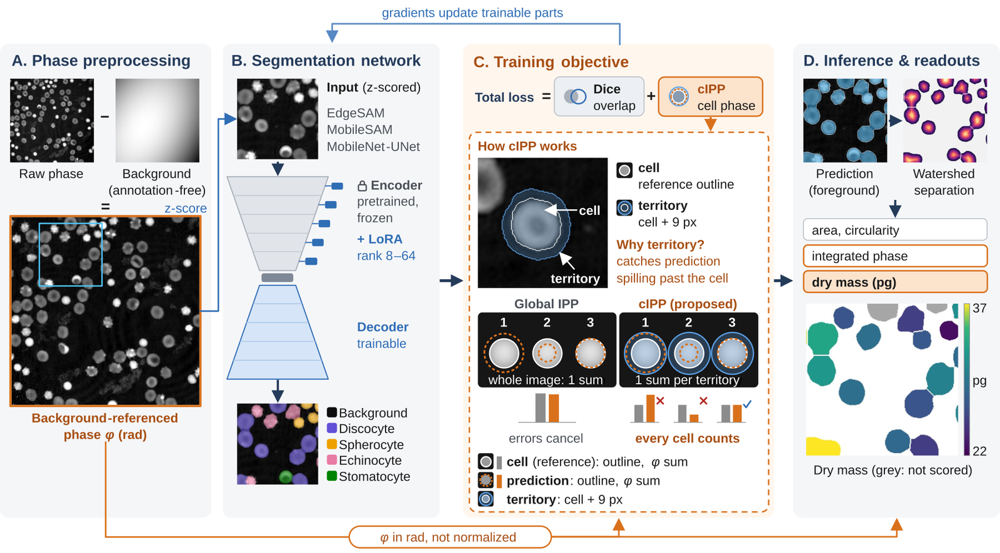
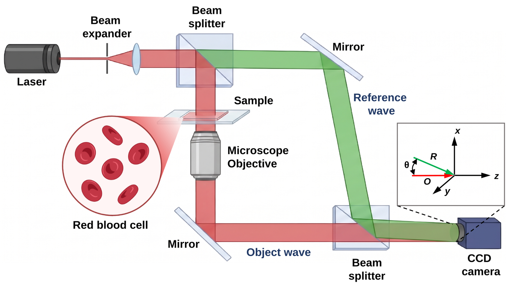
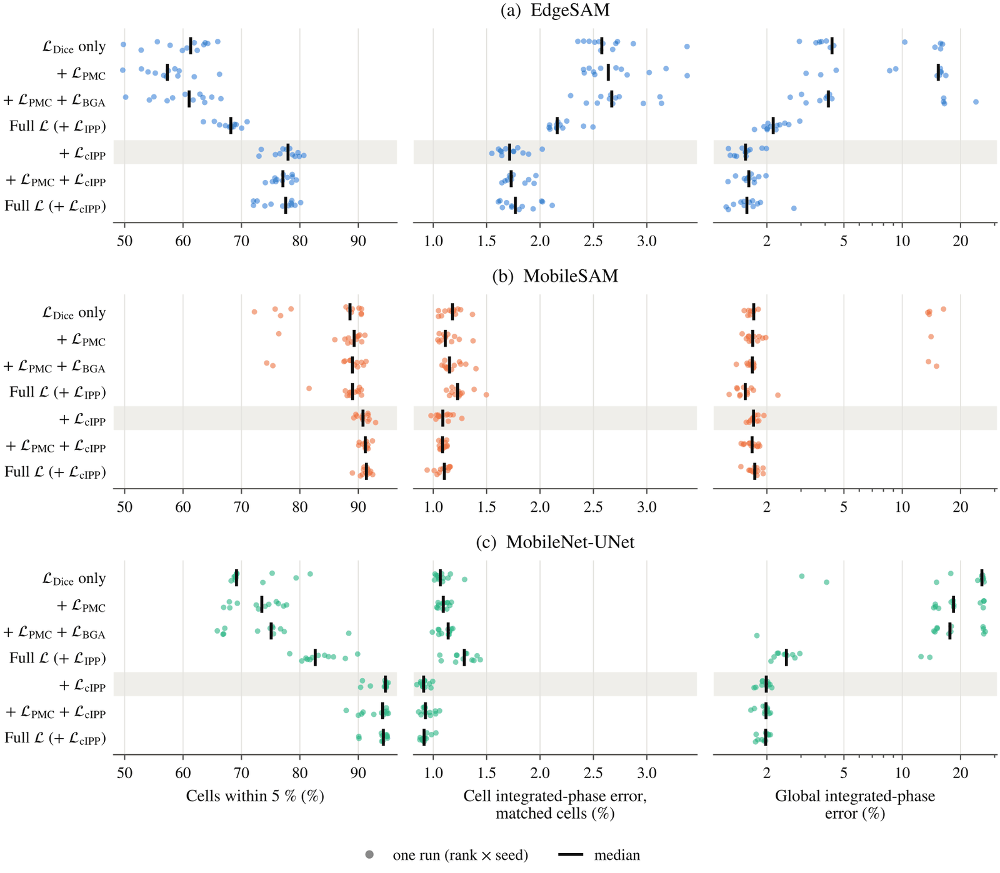
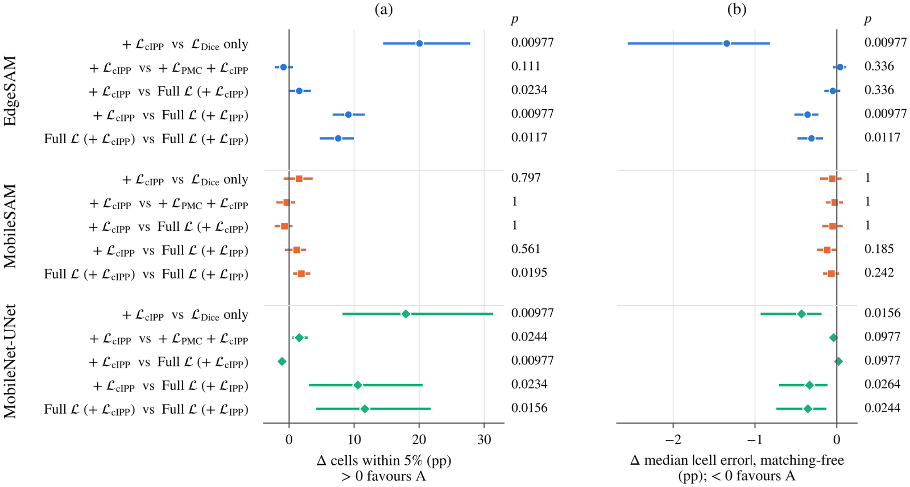
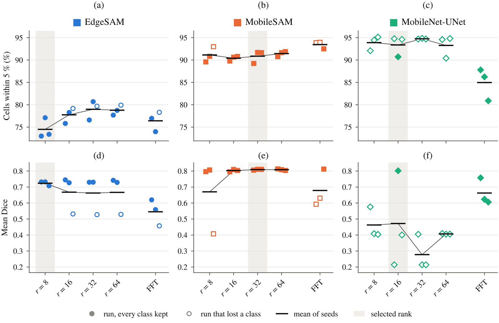
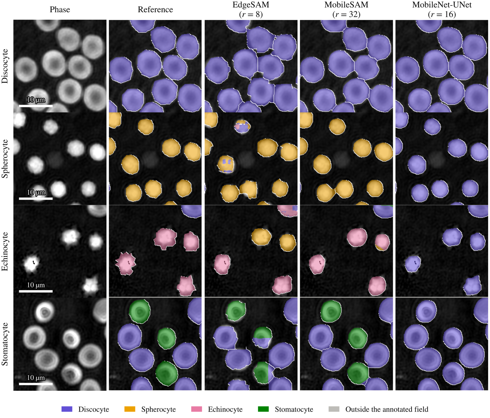
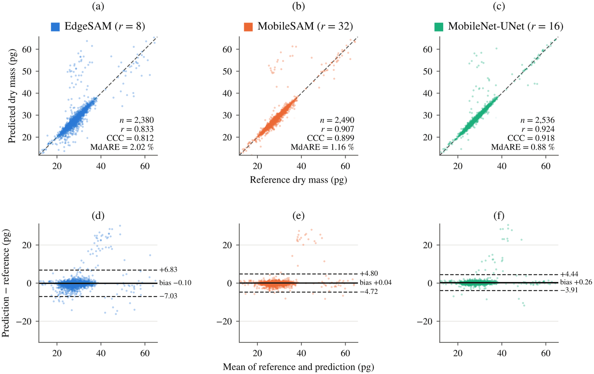
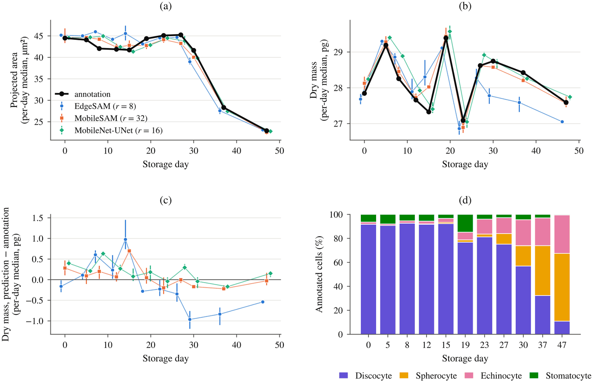

# Physics-Aware Lightweight Segmentation for Quantitative Holographic Cell Analysis with Optical Mass Preservation

Code, published tables and figures for the article of the same name (Applied Physics B, under review).

**Usama Ikram**<sup>1</sup>, **Youhyun Kim**<sup>2</sup>, **Inkyu Moon**<sup>1,2,\*</sup>

<sup>1</sup> Department of Artificial Intelligence, DGIST, Daegu 42988, South Korea ·
<sup>2</sup> Department of Robotics & Mechatronics Engineering, DGIST, Daegu 42988, South Korea ·
<sup>\*</sup> Corresponding author: inkyu.moon@dgist.ac.kr

---

## Overview

Digital holographic microscopy (DHM) yields label-free quantitative phase images, from which the dry mass of each
cell is obtained by integrating the phase inside its boundary. Segmentation networks are usually trained with
overlap losses (Dice, cross-entropy), which say nothing about the phase that the predicted boundary encloses. A
mask with high overlap can still cut off a cell's thin rim or take in part of a neighbour, and either error goes
straight into the dry mass.

This repository treats the **predicted cell boundary as a measurement domain**. Its central component is a
**cell-level integrated-phase preservation (cIPP)** loss, which constrains the phase integrated inside each
predicted cell (and therefore the cell's dry mass). The loss is added to a class-weighted Dice loss and trained on
three lightweight segmentation networks — **MobileSAM**, **EdgeSAM** and **MobileNet-UNet** — whose pretrained
encoders are adapted to single-channel phase maps with **Low-Rank Adaptation (LoRA)**. The framework is evaluated
on red blood cells (RBCs) imaged over 47 days of blood storage: 3 architectures × (4 LoRA ranks + full
fine-tuning) × 7 loss configurations × 3 seeds, or 315 trained runs.

<p align="center"></p>

*Fig. 1. Overview of the framework. (A) Phase preprocessing: the 32-bit phase map is referenced to an
annotation-free background; the referenced phase in radians feeds the loss and the measurements, and a z-scored
copy forms the network input. (B) Segmentation network: a pretrained lightweight encoder adapted with LoRA, with a
trainable decoder. (C) Training objective: Dice + cIPP. (D) Inference: watershed separation of touching cells and
per-cell readouts (area, circularity, integrated phase, dry mass).*

## Key findings

Unless stated otherwise, values are means ± SD over seeds 42–44 on the 66 test images, at the last-epoch
checkpoint.

- **cIPP improves single-cell phase fidelity.** Adding ℒ<sub>cIPP</sub> to ℒ<sub>Dice</sub> increased the share
  of cells whose integrated phase was within 5% of the reference in **all 12 paired runs of every architecture**
  (Holm-adjusted p = 0.0029). The median paired gains were **+16.4** (EdgeSAM), **+1.5** (MobileSAM) and
  **+25.5** (MobileNet-UNet) percentage points. Mean Dice did not change significantly.
- **Cell-level beats global phase preservation.** The proposed objective also beat the full objective with a
  whole-image (global) IPP term in all 12 pairs per architecture. In the full objective, replacing global IPP with
  cIPP raised the share of cells within 5% from 80.0% to 87.1% (36 of 36 pairs; median +8.3 points;
  p = 2.9 × 10⁻¹¹). A lower global error did not imply better per-cell fidelity, nor the converse.
- **PMC and BGA add nothing consistent.** Phase-mask contrast and boundary-gradient alignment did not change the
  cell-level result detectably once cIPP was present (Holm-adjusted p ≥ 0.30). The proposed objective is
  therefore the simplest one: **ℒ<sub>Dice</sub> + ℒ<sub>cIPP</sub>**.
- **Statistical robustness.** With individual cells as the unit and storage days as the exchangeable blocks, the
  gain stayed significant for EdgeSAM (+20.1 points) and MobileNet-UNet (+18.0 points). For MobileSAM it did not
  (+1.5 points, Holm-adjusted p = 0.80).
- **Representative configurations.** The ranks were selected on held-out validation images.
  - MobileSAM (r = 32) reproduced 90.9 ± 1.4% of cells to within 5%, with a mean Dice of 0.809.
  - EdgeSAM (r = 8) reached 74.5 ± 2.3% and ran about seven times faster with ONNX Runtime.
  - Both kept every morphology class in every seed.
  - MobileNet-UNet (r = 16) is reported as a failure case. It delineated cells well (93.4%) but lost two or three
    of the four classes in two of three seeds.
- **Dry mass.** For matched cells, the dry mass deviated from the annotation-derived value by a median of 1.9%
  (EdgeSAM), 1.1% (MobileSAM) and 0.9% (MobileNet-UNet). This is agreement between two segmentations of the same
  phase maps, not a validation of absolute dry mass. A few cells merged with a touching neighbour set the 95%
  limits of agreement (about ±4–6 pg).
- **Storage.** The predictions reproduced the decrease in cell area over 47 days. The predicted dry mass, however,
  showed a storage-dependent bias relative to the annotation, so time-course effects derived from automated
  segmentation should be checked against a reference subset.

The data come from a single sample series; the limitations are listed at the end of the
[Results](#results) section.

---

## Contents

- [Method](#method)
- [Experimental setup](#experimental-setup)
- [Results](#results)
- [Repository structure](#repository-structure)
- [Installation](#installation)
- [Data and weights](#data-and-weights)
- [Running the pipeline](#running-the-pipeline)
- [Reproducibility notes](#reproducibility-notes)
- [Citation](#citation) · [License](#license) · [Acknowledgements](#acknowledgements)

---

## Method

### Phase preprocessing (`qpicell/data/`)

- **Input.** Single-channel 32-bit floating-point phase maps in radians, 768 × 768 px, used as supplied. Nothing
  is ever converted to 8 bit; `qpicell/physics.py` rejects 8-bit, integer or rescaled data.
- **Mask registration** (`registration.py`). The annotation masks were drawn on 8-bit exports. They are carried
  onto the phase grid by an affine transform estimated with enhanced-correlation-coefficient (ECC) maximisation,
  followed by nearest-neighbour resampling. Only the masks are transformed, never the phase. Pixels outside the
  annotated field get an ignore label (255) and are excluded from every loss term and every metric.
- **Annotation-free background** (`background.py`). Each map is referenced to a second-order polynomial surface,
  fitted by iterative least squares to background pixels found from the phase alone. The surface is subtracted
  once, when the dataset is built. Training, evaluation and the dry-mass measurement all use the same referenced
  phase.
- **Reference cells** (`cells.py`). Touching cells, drawn as one region in the annotation, are split by a
  marker-controlled watershed: the h-maxima (h = 3 px) of the smoothed distance transform. Each reference cell
  also gets a **territory**, the pixels within 9 px whose nearest reference cell it is.
- **Phase wrapping** (`wrapping.py`). No unwrapping is applied. Pixels within 0.3 rad of 2π, or with a jump
  larger than π to a neighbour, are flagged. Cells within 2 px of a flagged pixel are excluded from the per-cell
  phase and dry-mass results.
- **Network input.** A separate copy of the referenced phase, resized to the input size of each architecture and
  z-scored per image. The physics-aware loss terms always use the phase in radians, in float32, outside the
  mixed-precision autocast.

### Lightweight segmentation models (`qpicell/models/`)

| Architecture | Encoder (pretrained) | Decoder (trained from scratch) | Input | LoRA placement | Deployed parameters |
|---|---|---|---|---|---|
| **EdgeSAM** | RepViT-M1 (`edge_sam_3x.pth`) | 4 × [transposed conv → BN → ReLU6] + 1 × 1 classifier | 256 px | every non-grouped convolution of the encoder and neck (81 layers) | 5,692,005 |
| **MobileSAM** | TinyViT (`mobile_sam.pt`) | one learned token per class, one transformer decoder layer (8 heads), dot product with the 4× upsampled embedding | 1024 px | fused QKV projection of the 10 attention blocks | 6,660,540 |
| **MobileNet-UNet** | MobileNetV2, ImageNet | U-Net decoder with four up-blocks and skip connections | 256 px | every non-depthwise convolution of the encoder (35 layers) | 7,622,821 |

All three networks take one channel and predict five classes (background, discocyte, spherocyte, echinocyte,
stomatocyte). The three-channel input stem is replaced by a single-channel convolution whose filters are the mean
of the pretrained RGB filters. The prompt encoder and mask decoder of SAM are not used.

### LoRA adaptation (`qpicell/models/lora.py`)

```math
W' = W + (B\,A)\,\frac{\alpha_L}{r}, \qquad \alpha_L = r
```

- The pretrained weight W is frozen. A is initialised with a Kaiming scheme and B with zeros, so training starts
  from the pretrained function. LoRA dropout is 0, and the ranks are r ∈ {8, 16, 32, 64}.
- For convolutions, the update is a 1 × 1 convolution to r channels followed by a convolution with the original
  kernel.
- Also trainable: the single-channel stem, the normalisation scale and shift parameters, and the complete decoder.
- After training, the adapters are merged into the base weights (`lora.merge`), so the deployed network is
  identical at every rank. Full fine-tuning (every parameter trained) is run as a control.

### Physics-aware loss terms (`qpicell/losses/`)

All terms act on the predicted foreground probability $p_i = 1 - \mathrm{softmax}(\text{logits})_{\text{bg},i}$
and on the background-referenced phase $\varphi_i$ in radians. Pixels outside the annotated field are excluded.

| Term | Definition | Role |
|---|---|---|
| ℒ<sub>Dice</sub> | class-weighted, Laplace-smoothed multi-class soft Dice, weights (0.5, 1, 1.5, 2, 2) | geometric overlap, class imbalance |
| ℒ<sub>PMC</sub> | $\max(0,\ \mu_{bg} - \mu_{cell} + 0.1\,\text{rad})$ | foreground has higher phase than background |
| ℒ<sub>BGA</sub> | mean \|∇p/max∇p − ∇φ/max∇φ\| | boundary follows phase transitions |
| ℒ<sub>IPP</sub> (global) | $\lvert \sum_i p_i\varphi_i - \sum_i G_i\varphi_i \rvert \,/\, (\lvert\sum_i G_i\varphi_i\rvert + \epsilon)$ | total integrated phase of the image |
| **ℒ<sub>cIPP</sub>** (proposed) | see below | integrated phase of **every cell** |

**Cell-level integrated-phase preservation** (`qpicell/losses/cell_ipp.py`). For reference cell c with pixels
G<sub>c</sub> and territory T<sub>c</sub> (with v<sub>i</sub> = 1 on annotated pixels):

```math
S_c^{ref} = \sum_{i\in G_c}\varphi_i v_i,\qquad
S_c^{pred} = \sum_{i\in T_c} p_i\varphi_i v_i,\qquad
e_c = \frac{S_c^{pred} - S_c^{ref}}{\max\!\left(|S_c^{ref}|,\ \kappa\,\mathrm{med}_{c'}|S_{c'}^{ref}|\right)}
```

```math
O_c = 1 - \frac{2\sum_{i\in G_c} p_i v_i + 1}{\sum_{i\in T_c} p_i v_i + |G_c| + 1},\qquad
F = \frac{\sum_{i\in T_0} p_i|\varphi_i| v_i}{\sum_c |S_c^{ref}|}
```

```math
\mathcal{L}_{cIPP} = \langle \rho(e_c)\rangle_c + \beta\langle O_c\rangle_c + \gamma\langle F\rangle,\qquad
\rho(e) = \sqrt{e^2+\delta^2}-\delta
```

with κ = 0.25, δ = 0.05 and β = γ = 1.

- Because a cell's predicted phase is collected only inside its own territory, phase missed in one cell cannot be
  offset by phase predicted elsewhere. Every cell carries the same weight, whatever its size. The global term, by
  contrast, lets errors cancel and is dominated by large cells.
- O<sub>c</sub> penalises a wrong shape inside the territory, and F penalises phase predicted far from every cell
  (T<sub>0</sub> is the set of pixels outside every territory).
- The implementation keeps an optional separation term, but its weight is η = 0 in every run, and
  `qpicell/losses/objective.py` asserts this.

### Training objectives

```math
\mathcal{L} = \mathcal{L}_{Dice} + \lambda_1\mathcal{L}_{PMC} + \lambda_2\mathcal{L}_{BGA} + \lambda_3\mathcal{L}_{IPP} + \lambda_4\mathcal{L}_{cIPP},
\qquad \lambda_1 = 0.1,\ \lambda_2 = 0.05,\ \lambda_3 = 0.1,\ \lambda_4 = 0.1
```

Each λ applies only when the objective contains that term. The seven configurations (`arms` in
`configs/config.yaml`):

| Key | Objective | Note |
|---|---|---|
| `dice` | ℒ<sub>Dice</sub> | baseline |
| `dice_pmc` | ℒ<sub>Dice</sub> + ℒ<sub>PMC</sub> | |
| `dice_pmc_bga` | ℒ<sub>Dice</sub> + ℒ<sub>PMC</sub> + ℒ<sub>BGA</sub> | |
| `dice_pmc_bga_ipp` | ℒ<sub>Dice</sub> + ℒ<sub>PMC</sub> + ℒ<sub>BGA</sub> + ℒ<sub>IPP</sub> | full objective with global IPP |
| **`dice_cipp`** | **ℒ<sub>Dice</sub> + ℒ<sub>cIPP</sub>** | **proposed** |
| `dice_pmc_cipp` | ℒ<sub>Dice</sub> + ℒ<sub>PMC</sub> + ℒ<sub>cIPP</sub> | |
| `dice_pmc_bga_cipp` | ℒ<sub>Dice</sub> + ℒ<sub>PMC</sub> + ℒ<sub>BGA</sub> + ℒ<sub>cIPP</sub> | full objective with cIPP |

The global and cell-level terms are never combined.

### Measurements (`qpicell/evaluation/`)

- **Instances.** Predicted cells are obtained from the predicted foreground by the same marker-controlled
  watershed as the reference cells, without using the annotation. Each cell takes the class that covers most of
  its pixels.
- **Integrated phase and dry mass:**

  ```math
  S = \sum_{i\in\Omega}\varphi_i,\qquad
  m = \frac{\lambda}{2\pi\alpha}\,S\,\Delta x_{\text{eff}}^2,\qquad
  \lambda = 666\ \text{nm},\ \alpha = 0.2\ \text{mL/g},\ \Delta x_{\text{eff}} = 0.1441\ \mu\text{m}
  ```

  so one radian per pixel corresponds to 0.0110 pg. No calibration to a reference mean corpuscular haemoglobin
  value is applied. The constants are asserted in `qpicell/physics.py`.
- **Shape.** Projected area A = N·Δx², and circularity C = 4πA/P² with the Crofton perimeter.
- **Scored cells.** Reference cells of 15–200 µm² that do not touch the unannotated area and are not near phase
  wrapping.
- **Cell-level phase metrics.** Reference and predicted cells are paired one to one by decreasing IoU (minimum
  0.5).
  - The **share of cells within 5%** (the primary criterion; unpaired cells count as failures).
  - The **matched-cell IPE**, the median relative error of paired cells, which equals their median absolute
    relative dry-mass error.
  - A **matching-free cell error**, measured inside each territory.
  - Each cell's outcome: matched, missed, merged or fragmented.
- **Global and class-specific IPE** = \|S<sub>pred</sub> − S<sub>ref</sub>\| / \|S<sub>ref</sub>\| × 100, per
  image.
- **Segmentation metrics.** Dice and IoU macro-averaged over the four cell classes; Aggregated Jaccard Index for
  watershed cells and for connected regions; boundary F1 at a 2-px tolerance; and the number of runs in which a
  class is lost (Dice < 0.05).

---

## Experimental setup

### Dataset

- **Imaging.** The quantitative phase maps were reconstructed from off-axis holograms recorded with a
  transmission Mach–Zehnder DHM (Fig. 2):
  - 666 nm laser diode;
  - 40×/0.75 NA objective;
  - CCD of 1920 × 1200 pixels of 5.86 µm, of which 1024 × 1024 were used.
- **Samples.** RBCs from three healthy donors, imaged repeatedly over 47 days of storage (IRB approval
  DGIST-180713-BR-012-01).
- **Images.** 248 phase maps with five-class masks. The 182 training-split images are divided deterministically
  (by a hash of the image name) into **141 training** and **41 validation** images. The **66 test** images are six
  per storage day on 11 days (days 0–47).
- **Test cells.** The test images contain 3,084 reference cells, of which **2,563 are scored**: 849 touching and
  1,714 isolated.
- **Augmentation.** Only lossless 90° rotations of the training images (564 views). Nothing alters the phase
  values.

<p align="center"></p>

*Fig. 2. Off-axis transmission Mach–Zehnder DHM setup used to acquire the RBC dataset.*

### Training (`configs/config.yaml`)

| Setting | Value |
|---|---|
| Optimiser, schedule | AdamW (β = 0.9, 0.999; weight decay 0.01), cosine annealing, 100 epochs, no warm-up |
| Learning rate (LoRA) | 5 × 10⁻⁴ EdgeSAM and MobileSAM, 1 × 10⁻³ MobileNet-UNet |
| Learning rate (full fine-tuning) | 1 × 10⁻⁴ for all three |
| Batch size, input size | EdgeSAM 16 / 256 px, MobileSAM 8 / 1024 px, MobileNet-UNet 16 / 256 px |
| Precision | FP16 autocast for the forward pass; every loss term in float32 |
| Seeds | 42, 43, 44 (Python, NumPy, PyTorch and data-loader workers; deterministic cuDNN) |
| Checkpoints | last epoch (all reported results); best validation Dice (sensitivity analysis only) |
| Runs | 315 = 3 architectures × 5 adaptation conditions × 7 objectives × 3 seeds; all completed |

### Rank selection (`scripts/evaluation/objective_and_rank_selection.py`)

One rank per architecture is selected on the **41 validation images**, so no test image takes part in the choice.
The rule, under the proposed objective:

1. **Stability.** Keep the ranks at which the fewest seeds lost a morphology class.
2. **Balanced score.** Among those ranks, take the one with the highest balanced score: the mean of the share of
   cells within 5% (divided by 100) and the mean Dice.
3. **Tie-break.** Take the smaller rank when two ranks score the same (tolerance 0).

Computational cost is not part of the score, because the merged network is the same at every rank. The rule
selects **r = 8 (EdgeSAM)**, **r = 32 (MobileSAM)** and **r = 16 (MobileNet-UNet)**. EdgeSAM and MobileSAM at
these ranks are the representative configurations; MobileNet-UNet is reported as a failure case.

### Benchmark (`scripts/evaluation/benchmark.py`)

- **Hardware and software.** NVIDIA RTX A5000 with strict FP32 (TF32 disabled); PyTorch 2.0.1 (CUDA 11.7) and
  ONNX Runtime 1.16.3 (CUDA Execution Provider, IO binding, opset 17).
- **Protocol.** Batch size 1, with 50 warm-up and 500 timed forward passes per runtime and pass (for ONNX Runtime,
  in each of three fresh sessions), repeated in three timing passes. Each pass rotates the architecture order and
  uses a fresh ONNX export.
- **Scope.** Only the forward pass of the merged network is timed. The numbers characterise relative cost on a
  desktop GPU, not embedded deployment.

---

## Results

### Selected configurations — Table 1

| Architecture | r | Cells within 5% (%) | Matched IPE (%) | Global IPE (%) | Mean Dice | AJI (watershed) | AJI (connected) | Boundary F1 | Class lost |
|---|---|---|---|---|---|---|---|---|---|
| EdgeSAM | 8 | 74.5 ± 2.3 | 1.89 ± 0.13 | 1.81 ± 0.23 | 0.724 ± 0.014 | 0.773 ± 0.003 | 0.313 ± 0.019 | 0.701 ± 0.017 | 0 of 3 |
| MobileSAM | 32 | **90.9 ± 1.4** | 1.06 ± 0.09 | 1.74 ± 0.18 | **0.809 ± 0.003** | 0.853 ± 0.006 | 0.315 ± 0.050 | 0.837 ± 0.012 | 0 of 3 |
| MobileNet-UNet (failure case) | 16 | 93.4 ± 2.3 | 0.92 ± 0.05 | 1.92 ± 0.15 | 0.472 ± 0.300 | 0.883 ± 0.011 | 0.662 ± 0.043 | 0.893 ± 0.019 | 2 of 3 |

The cell-level measures do not depend on the predicted class. For MobileNet-UNet they therefore show that cells
were delineated, not that they were classified correctly. The much lower AJI of the connected regions shows that
the separation of touching cells comes largely from the watershed step, not from the network.

### Loss configurations — Fig. 3, Table 2

<p align="center"></p>

*Fig. 3. Share of cells within 5%, matched-cell IPE and global IPE (logarithmic axis) of the seven loss
configurations for (a) EdgeSAM, (b) MobileSAM and (c) MobileNet-UNet. Points are LoRA runs (four ranks × three
seeds); bars are medians; the shaded row is the proposed objective.*

Share of cells within 5% over the 12 LoRA runs of each architecture. Δ is the median paired difference (proposed −
comparator, in percentage points), with the number of pairs favouring the proposed objective. p is the exact
Wilcoxon signed-rank test, Holm-adjusted over six comparisons (full table:
[`paper/tables/Table_2_…csv`](paper/tables/Table_2_objective_comparison_per_architecture.csv)).

| Comparator | EdgeSAM | MobileSAM | MobileNet-UNet |
|---|---|---|---|
| ℒ<sub>Dice</sub> alone | 59.9% → 77.5%, Δ +16.45 (12/12), p = 0.0029 | 84.9% → 91.0%, Δ +1.52 (12/12), p = 0.0029 | 71.8% → 93.8%, Δ +25.50 (12/12), p = 0.0029 |
| full objective, global IPP | 67.8% → 77.5%, Δ +9.79 (12/12), p = 0.0029 | 88.6% → 91.0%, Δ +1.52 (12/12), p = 0.0029 | 83.4% → 93.8%, Δ +10.24 (12/12), p = 0.0029 |
| ℒ<sub>Dice</sub> + ℒ<sub>PMC</sub> + ℒ<sub>BGA</sub> + ℒ<sub>cIPP</sub> | Δ +0.86 (8/12), p = 0.30 | Δ −0.55 (5/12), p = 0.85 | Δ −0.10 (5/12), p = 0.97 |

- **Missed cells.** Part of the gain over Dice alone came from cells that Dice alone missed. Averaged over ranks
  and seeds, Dice alone missed 6.3%, 4.1% and 18.2% of the scored cells (EdgeSAM, MobileSAM, MobileNet-UNet),
  against 0.2%, 0.01% and 0.07% with cIPP.
- **Segmentation.** Mean Dice did not differ significantly from Dice alone for any architecture (Holm-adjusted
  p = 0.61, 0.38, 1). Boundary F1 was higher in all 36 pairs.
- **Class loss.** The loss of minority classes was not reduced.

### Cell-level tests at the selected configurations — Fig. 4, Table 3

<p align="center"></p>

*Fig. 4. Cell-level paired comparisons at the selected configurations: difference A − B in (a) the share of cells
within 5% and (b) the median matching-free cell error. Points are estimates; lines are 95% hierarchical-bootstrap
intervals (days → images → cells); p values are Holm-adjusted day-block permutation tests.*

| Configuration | Within 5%, touching | Within 5%, isolated | Matched IPE, touching | Matched IPE, isolated | Matched | Missed | Merged | Fragmented |
|---|---|---|---|---|---|---|---|---|
| EdgeSAM (r = 8) | 49.5 ± 2.7 | 86.9 ± 2.3 | 3.58 ± 0.32 | 1.53 ± 0.09 | 92.9 ± 0.1 | 0.33 ± 0.20 | 7.9 ± 0.3 | 1.0 ± 0.3 |
| MobileSAM (r = 32) | 79.1 ± 1.6 | 96.7 ± 1.3 | 1.58 ± 0.13 | 0.91 ± 0.08 | 97.2 ± 0.1 | 0.01 ± 0.02 | 3.6 ± 0.1 | 0.2 ± 0.1 |
| MobileNet-UNet (r = 16) | 85.7 ± 5.0 | 97.2 ± 1.0 | 1.28 ± 0.23 | 0.80 ± 0.04 | 98.6 ± 0.6 | 0.12 ± 0.20 | 1.8 ± 0.4 | 0.5 ± 0.2 |

All values are in %. Touching cells were reproduced less accurately than isolated cells by every configuration.

### Rank selection and LoRA versus full fine-tuning — Fig. 5

<p align="center"></p>

*Fig. 5. Share of scored cells within 5% (top) and mean Dice (bottom) at each LoRA rank and with full fine-tuning
(FFT) under the proposed objective. Open markers are runs that lost a class; the shaded rank is the one selected
on the validation images.*

- **Training cost.** At the selected ranks, 0.53 M (8.9%), 0.85 M (12.3%) and 5.73 M (72.4%) parameters are
  trainable. After merging, the deployed networks have the same size at every rank.
- **Full fine-tuning** (learning rate 1 × 10⁻⁴) was not uniformly worse:
  - for MobileSAM it reproduced more cells within 5% (93.4%) but lost a class in two of three seeds;
  - for MobileNet-UNet it was the only setting that kept every class.

  For the two SAM-based models, LoRA came within about 3 points of full fine-tuning with 9–12% of the parameters
  trainable.

### Inference cost — Table 4

| Model (input) | Runtime | P50 latency (ms) | P99 latency (ms) | Throughput (img/s) | GPU memory (MiB) |
|---|---|---|---|---|---|
| EdgeSAM (256 × 256) | PyTorch | 9.40 ± 0.25 | 11.18 ± 1.45 | 106.4 ± 2.8 | 43 ± 1 |
| | ONNX Runtime | 3.38 ± 0.05 | 3.68 ± 0.06 | 296.2 ± 4.6 | 119 ± 17 |
| MobileNet-UNet (256 × 256) | PyTorch | 4.56 ± 0.13 | 6.51 ± 0.54 | 219.2 ± 6.4 | 74 ± 0 |
| | ONNX Runtime | 2.31 ± 0.02 | 2.48 ± 0.02 | 432.3 ± 4.4 | 147 ± 5 |
| MobileSAM (1024 × 1024) | PyTorch | 20.05 ± 0.21 | 20.13 ± 0.24 | 49.9 ± 0.5 | 358 ± 0 |
| | ONNX Runtime | 25.07 ± 0.21 | 25.29 ± 0.11 | 39.9 ± 0.3 | 1,162 ± 31 |

Values are means ± SD over three timing passes (merged weights, float32, batch size 1, RTX A5000). The exported
graphs reproduced the PyTorch class maps on every compared pixel (largest logit difference 1.3 × 10⁻³).

### Qualitative results — Fig. 6

<p align="center"></p>

*Fig. 6. One test window per morphology class, with the reference and the predictions at the selected
configurations (seed 42). MobileNet-UNet delineates the spherocytes, echinocytes and stomatocytes but labels them
as discocytes, consistent with its loss of these classes.*

### Single-cell dry mass — Fig. 7, Table 5

<p align="center"></p>

*Fig. 7. Dry-mass agreement of matched cells at the selected configurations (seed 42). (a–c) Predicted versus
reference dry mass; (d–f) Bland–Altman plots with bias and 95% limits of agreement.*

| Configuration | MdARE (%) | Bias (pg) | Pearson r | CCC | Image-level r | Area change, early → late | Dry-mass change, early → late |
|---|---|---|---|---|---|---|---|
| Annotation | – | – | – | – | – | −41.5% | −0.9% |
| EdgeSAM (r = 8) | 1.89 ± 0.13 | −0.10 ± 0.05 | 0.856 ± 0.022 | 0.841 ± 0.027 | 0.806 ± 0.042 | −44.5 ± 0.4% | −4.6 ± 1.0% |
| MobileSAM (r = 32) | 1.06 ± 0.09 | +0.16 ± 0.13 | 0.908 ± 0.004 | 0.898 ± 0.005 | 0.908 ± 0.035 | −44.9 ± 0.9% | −2.2 ± 0.2% |
| MobileNet-UNet (r = 16) | 0.92 ± 0.05 | +0.25 ± 0.05 | 0.912 ± 0.017 | 0.906 ± 0.017 | 0.944 ± 0.013 | −44.8 ± 0.7% | −2.3 ± 0.1% |

- **Limits of agreement.** The 95% limits of agreement (−6.3 to +6.1, −4.6 to +5.0 and −4.2 to +4.7 pg) were set
  by 0.8–2.3% of the matched cells that differed by more than 10 pg. These cells were mostly merged with a
  touching neighbour, and 43–79% came from day 15, the most crowded storage day. Without them, the limits narrow
  to about −3.2 to +2.4 pg (EdgeSAM) and within about ±1.6 pg (MobileSAM, MobileNet-UNet).
- **What the agreement measures.** Both segmentations are applied to the same background-referenced phase, so
  the agreement describes the segmentation and is not a validation of absolute dry mass.

### Storage time — Fig. 8

<p align="center"></p>

*Fig. 8. (a) Projected cell area and (b) dry mass: per-day medians for the annotation and the selected
configurations. (c) Prediction − annotation difference in per-day median dry mass. (d) Annotated class
composition.*

- **Class composition.** The annotated population shifted from discocytes (91.8% on day 0) to spherocytes and
  echinocytes (day 47: 56.5% and 32.1%). The two SAM-based models reproduced this shift to within 1.3–2.5
  percentage points on average.
- **Area.** The median area decreased by 41.5% in the annotation (borderline under date clustering, p = 0.050)
  and by about 45% in the predictions.
- **Dry mass.** The annotated dry mass showed no trend. The prediction − annotation difference in dry mass
  decreased with storage day in all nine analysed runs, so the small predicted decrease in dry mass reflects a
  storage-dependent segmentation bias, not a change in the cells.

### Limitations

- **One dataset.** A single RBC sample series (three donors imaged repeatedly over 11 dates, with no
  documented image-to-donor assignment). There is no independent test cohort, and generalisation to other cell
  types, imaging conditions or new donors is not established.
- **Statistical power.** Three seeds per condition. For MobileSAM the cIPP effect was consistent across runs but
  small relative to the variation between storage days.
- **Cell separation.** Touching cells are separated by a watershed on the predicted foreground, not by the
  network. Merged cells cause most of the large single-cell dry-mass errors. Cells superposed along the optical
  axis cannot be divided.
- **Class loss.** cIPP did not prevent the loss of minority morphology classes.
- **Absolute dry mass** was not validated independently, and depends on the annotation-free background
  reference.
- **No phase unwrapping.** Cells near possibly wrapped pixels (78 of 3,084 test cells) are excluded from the
  per-cell analyses. Specimens thicker than RBCs would need reliable unwrapping.
- **Benchmark scope.** Desktop GPU only, forward pass only; embedded deployment was not evaluated.

Every table of the article (Tables 1–5 and S1–S16) is in [`paper/tables/`](paper/tables/), and every figure in
[`paper/figures/`](paper/figures/); see [`paper/README.md`](paper/README.md).

---

## Repository structure

```
├── configs/config.yaml              single configuration: paths, physics constants, data, models, LoRA, losses,
│                                    the seven objectives, rank-selection rule, evaluation, storage analysis
├── qpicell/                         the library (all method code)
│   ├── physics.py                   constants, dry-mass factor, guards against 8-bit / rescaled phase data
│   ├── data/                        registration, background, reference cells, wrapping, preparation, dataset
│   ├── models/                      EdgeSAM, MobileSAM, MobileNet-UNet, LoRA (inject / merge / report)
│   ├── losses/                      Dice, PMC, BGA, global IPP (terms.py), cIPP (cell_ipp.py), objectives
│   ├── training/                    trainer, one run, the 315-run grid
│   └── evaluation/                  segmentation, instances, cell-level and global phase metrics, shape,
│                                    agreement statistics, storage-time trends
├── third_party/edge_sam/            RepViT encoder of EdgeSAM (vendored; S-Lab License 1.0, non-commercial)
├── scripts/
│   ├── utilities/                   prepare_data.py, check_setup.py, status.py
│   ├── training/                    train.py (one run), run_queue.py + start_queue.sh (multi-GPU queue)
│   ├── evaluation/                  evaluate, rescore, consolidate, objective_and_rank_selection, storage_trends,
│   │                                phase_range, phase_quartile_fnr, background_invariance, benchmark
│   ├── preflight.py                 checks a machine before the long analysis
│   ├── run_rescore.sh               adds per-cell shape measurements from the saved predictions
│   ├── run_analysis.sh              consolidation → selection → analyses → figures
│   ├── run_benchmark.sh             latency / memory (PyTorch and ONNX Runtime)
│   └── run_everything.sh            preflight → rescore → analysis → benchmark
├── additional_analysis/             statistical analyses (W-1 … W-11) and the table generator, see its README
├── manuscript/                      make_all.py (figures), verify.py (consistency checks), figtab/, Fig. 2 asset
├── tests/                           unit and integration tests (synthetic data; no dataset or weights needed)
├── paper/                           published tables (CSV/XLSX) and figures (PNG)
├── data/README.md                   expected data layout (data not distributed)
├── weights/README.md                pretrained weights to download
├── requirements.txt
└── CITATION.cff
```

---

## Installation

The experiments were run on Linux with Python 3.10, PyTorch 2.0.1 (CUDA 11.7) and NVIDIA RTX A5000 GPUs.

```bash
git clone https://github.com/uikram/Physics-Aware-Lightweight-Segmentation-for-Quantitative-Holographic-Cell-Analysis-with-Optical-Mass-.git
cd Physics-Aware-Lightweight-Segmentation-for-Quantitative-Holographic-Cell-Analysis-with-Optical-Mass-

conda create -n qpicell python=3.10 -y && conda activate qpicell
# PyTorch for your CUDA version; the published runs used:
pip install torch==2.0.1 torchvision==0.15.2 --index-url https://download.pytorch.org/whl/cu117
pip install -r requirements.txt
# optional, for the ONNX Runtime benchmark:
pip install onnx onnxruntime-gpu==1.16.3
```

Check the installation; this needs neither data nor weights:

```bash
python -m pytest -q                                   # 3 tests are skipped until data/prepared/ exists
python scripts/utilities/check_setup.py --no-data     # physics constants, the 315-run grid, parameter counts
```

`check_setup.py --no-data` builds every architecture at every rank and reports the trainable parameters, for
example 534,205 (8.9%) for EdgeSAM at r = 8, 851,360 (12.3%) for MobileSAM at r = 32 and 5,734,709 (72.4%) for
MobileNet-UNet at r = 16. These are the values of Table S9.

## Data and weights

- **Data.** The phase maps are not redistributed. They are available from the corresponding author upon
  reasonable request. The expected layout is in [`data/README.md`](data/README.md).
- **Weights.** Download the three pretrained encoders into `weights/` as described in
  [`weights/README.md`](weights/README.md).

---

## Running the pipeline

All commands run from the repository root and read `configs/config.yaml`. Outputs go to `training_results/`,
`results/`, `additional_analysis/results/` and `manuscript/`, which are excluded by `.gitignore`.

**1. Prepare the data (once, on the CPU).**

```bash
python scripts/utilities/prepare_data.py --workers 16
python scripts/utilities/check_setup.py              # now also checks the prepared data and the 141/41/66 split
```

**2. Train.** Each run trains for 100 epochs, then evaluates its `last` and `best` checkpoints on the 66 test
images. Runs that have already finished are skipped.

```bash
# one run: architecture, condition (r8, r16, r32, r64 or fullft), loss configuration, seed
python scripts/training/train.py --arch mobile_sam --condition r32 --arm dice_cipp --seed 42 --gpu 0

# code-path test: 1 epoch, 2 batches, every output under smoke/
python scripts/training/train.py --arch edge_sam --condition r8 --arm dice_cipp --seed 42 --gpu 0 --smoke

# the full grid of 315 runs, queued over the GPUs in configs/config.yaml (queue.gpus)
bash scripts/training/start_queue.sh            # subsets: --archs, --conditions, --arms, --seeds
python scripts/utilities/status.py              # progress
```

**3. Add the per-cell shape measurements.** This step re-scores the saved predictions on the CPU and checks that
every existing number is reproduced.

```bash
bash scripts/run_rescore.sh            # check only
WRITE=1 bash scripts/run_rescore.sh    # write
```

**4. Consolidate, and make a provisional rank selection.** `additional_analysis/common.py` needs a
`rank_selection.csv`, but the validation-based selection needs W-9 (step 5). So the first selection is made from
the test metrics, using a temporary copy of the configuration. Only W-9 reads it, and only to label one column; it
is replaced in step 6.

```bash
python scripts/evaluation/consolidate.py
python -c "import yaml; c = yaml.safe_load(open('configs/config.yaml')); c['selection']['source'] = 'test'; yaml.safe_dump(c, open('configs/config_bootstrap.yaml', 'w'))"
python scripts/evaluation/objective_and_rank_selection.py --config configs/config_bootstrap.yaml
```

**5. Validation-based rank selection (GPU, inference only).**

```bash
CUDA_DEVICE_ORDER=PCI_BUS_ID CUDA_VISIBLE_DEVICES=0 python additional_analysis/w9_validation_selection.py --infer
python additional_analysis/w9_validation_selection.py --select
```

**6. Analysis and figures.** This step runs consolidation, storage-time trends, phase range, the final
(validation-based) selection, missed pixels by phase quartile, background invariance and
`manuscript/make_all.py`.

```bash
bash scripts/run_analysis.sh      # options: WORKERS, SKIP_COLLECT=1, ONLY_OUTPUTS=1, SKIP_FIGURES=1, SKIP_IMAGES=1
```

**7. Statistical analyses and the published tables.**

```bash
bash additional_analysis/make_tables.sh                     # W-2, W-4, W-5, W-8, W-7, W-1, then Tables 1–5, S1–S16
python additional_analysis/w6_superposition_and_fov.py      # needs data/prepared/
python additional_analysis/w10_claim_checks.py
python additional_analysis/w11_validation_sensitivity.py
python manuscript/make_all.py --checkpoint last --images    # redraw the figures now that W-1/W-5/W-6 exist
python manuscript/verify.py                                 # consistency checks of figures and tables
```

The tables are written to `results/tables_for_manuscript/` and the figures to `manuscript/figures/`. `make_all.py`
also writes working tables to `manuscript/tables/`; their numbering predates the final Supplementary Information,
so the numbered tables of the article are those from `tables_for_manuscript.py`.

**8. Inference cost (a quiet GPU).**

```bash
ONNX=1 GPU=0 bash scripts/run_benchmark.sh
```

After the first full pass, `bash scripts/run_everything.sh` reruns steps 3, 6 and 8 in one go, after a
`preflight.py` check of the machine.

---

## Reproducibility notes

- **Recorded environment.**
  - Software: Python 3.10.19, PyTorch 2.0.1+cu117 (cuDNN 8.5), NumPy 1.26.4, SciPy 1.11.4, pandas 2.1.4 and ONNX
    Runtime 1.16.3, on Linux.
  - Hardware: NVIDIA RTX A5000.
  - Every run's `training.json` records the Python and PyTorch versions and the GPU, and the analysis scripts
    record the NumPy, SciPy and pandas versions in their JSON metadata.
- **Version sensitivity.** With NumPy, SciPy and pandas at these versions, rerunning the selection step on the
  published consolidated results reproduces `rank_selection.csv`, `rank_table.csv` and `arm_confirmation.csv`
  byte for byte. Newer SciPy releases change some pooled Wilcoxon p-values in `arm_confirmation.csv` slightly,
  but not the selected ranks.
- **Determinism.** Deterministic cuDNN is requested, and PyTorch applies deterministic algorithms where a kernel
  exists. Runs are reproducible up to the remaining non-deterministic CUDA kernels, not bitwise across GPU models.
- **Data integrity.** The prepared phase maps carry SHA-256 checksums, which training and evaluation verify.
- **Provenance.** Every table records the result files it was built from, with their hashes
  (`paper/tables/provenance.json`).
- **Run inventory.** All 315 runs finished their 100 epochs. The rescore reproduced every previously stored
  metric of all 630 run–checkpoint pairs.

---

## Citation

```bibtex
@article{ikram_physics_aware_qpi_segmentation,
  title   = {Physics-Aware Lightweight Segmentation for Quantitative Holographic Cell Analysis
             with Optical Mass Preservation},
  author  = {Ikram, Usama and Kim, Youhyun and Moon, Inkyu},
  journal = {Applied Physics B},
  note    = {under review}
}
```

## License

**License to be added before public release.**
[`third_party/edge_sam/`](third_party/edge_sam/) (the RepViT encoder of
[EdgeSAM](https://github.com/chongzhou96/EdgeSAM), vendored unchanged apart from one import path) is distributed
under the **S-Lab License 1.0, non-commercial**; its terms are in
[`third_party/edge_sam/LICENSE`](third_party/edge_sam/LICENSE). MobileSAM is installed from its repository
(Apache-2.0), and torchvision's MobileNetV2 weights are under BSD-3-Clause.

## Acknowledgements

This work was supported by the National Research Foundation of Korea (NRF) grant funded by the Korean government
(MSIT) in 2026 (Grant No. RS-2026-25611334, Project Title: AI Mechanician: A Physics- and Math-Based AI that
Identifies and Unifies Multi-Transport Phenomena in Irregular Porous Media from Visualization), and by the
InnoCORE program of the Ministry of Science and ICT (26-InnoCORE-02). We thank the authors of
[MobileSAM](https://github.com/ChaoningZhang/MobileSAM) and [EdgeSAM](https://github.com/chongzhou96/EdgeSAM) for
releasing their code and weights.
