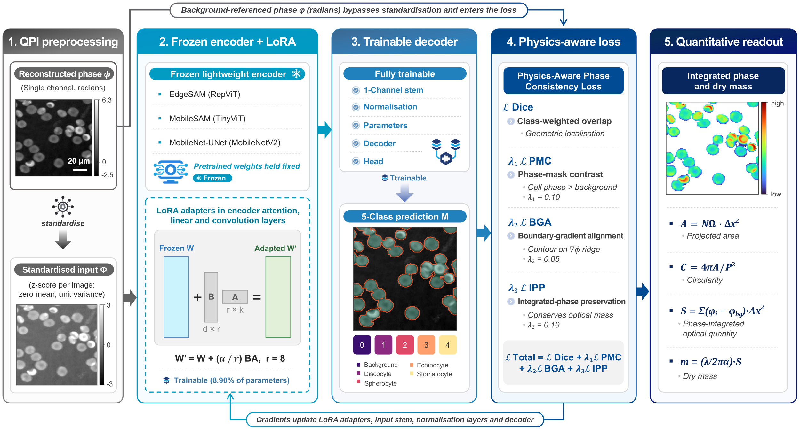
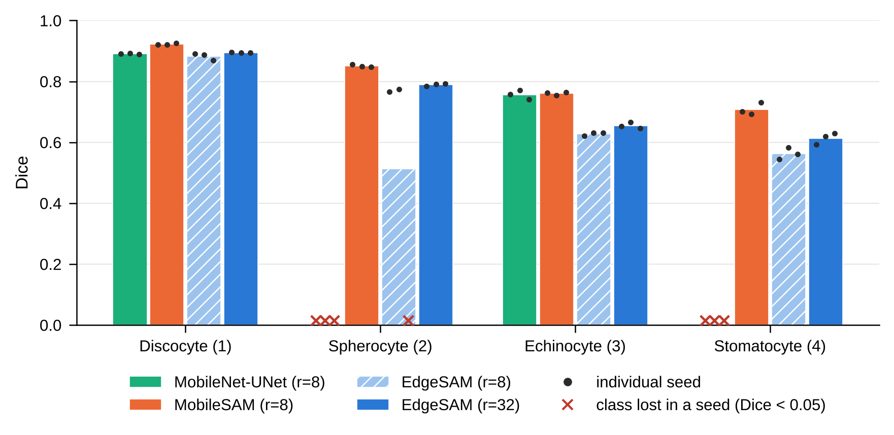
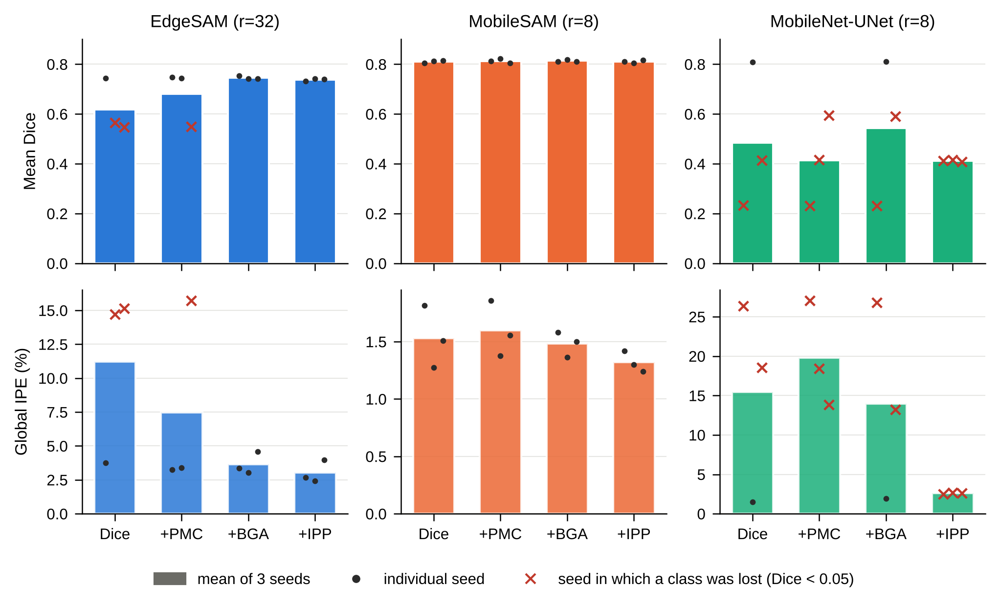
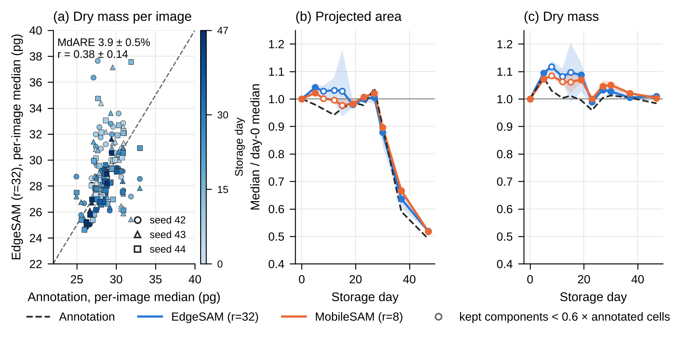
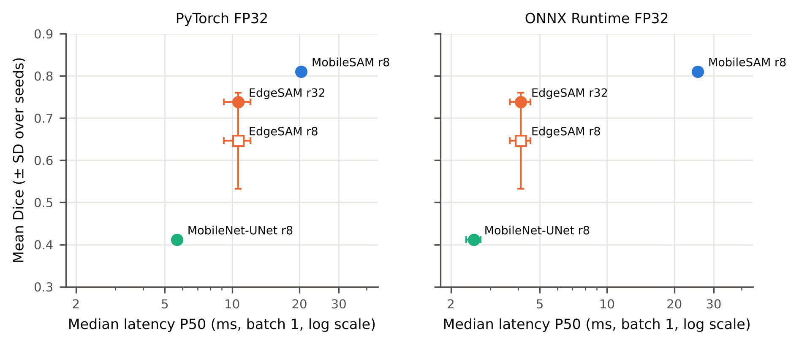

# Physics-Aware Lightweight Segmentation for Quantitative Holographic Cell Analysis with Optical Mass Preservation

Code, results and figures for the Applied Physics B manuscript of the same name.

Usama Ikram<sup>1</sup>, Youhyun Kim<sup>2</sup>, Inkyu Moon<sup>1,2,\*</sup>

Intelligent Imaging and Vision Systems Laboratory, DGIST

<sup>1</sup> Department of Artificial Intelligence, DGIST, Daegu 42988, South Korea ·
<sup>2</sup> Department of Robotics & Mechatronics Engineering, DGIST, Daegu 42988, South Korea
\* Corresponding author

Segmentation networks trained with overlap losses (Dice, cross-entropy) say nothing about the phase
integrated inside the predicted boundary, which is exactly the quantity a quantitative phase imaging
(QPI) pipeline goes on to turn into dry mass. This repository implements a physics-aware objective
that adds three terms on the background-referenced phase — phase-mask contrast (PMC),
boundary-gradient alignment (BGA) and integrated-phase preservation (IPP) — on top of a frozen
lightweight encoder adapted with LoRA, and evaluates it on red blood cells imaged over a 47-day
storage period.



*Five stages: QPI preprocessing, a frozen lightweight encoder with LoRA adapters, a trainable
decoder, the physics-aware phase consistency loss, and the quantitative readout (projected area,
circularity, integrated phase, dry mass). The background-referenced phase in radians bypasses
standardisation and enters the loss directly.*

---

## Headline results

Three architectures (MobileSAM, EdgeSAM, MobileNet-UNet) × five LoRA ranks × four loss
configurations × three seeds. Mean ± SD over seeds 42, 43 and 44; last-epoch checkpoint; metrics on
the native 768 × 768 grid.

### Segmentation at the preferred LoRA configurations

| Architecture | LoRA rank | Trainable params | Mean Dice | AJI | Boundary F1 | Global IPE (%) | Runs with a lost class |
|---|---|---|---|---|---|---|---|
| MobileSAM | 8 | 0.67 M (10.0 %) | **0.810 ± 0.006** | 0.262 ± 0.017 | 0.802 ± 0.011 | **1.32 ± 0.09** | 0/3 |
| EdgeSAM | 32 | 1.47 M (21.2 %) | 0.738 ± 0.006 | 0.335 ± 0.020 | 0.642 ± 0.005 | 3.02 ± 0.84 | 0/3 |
| MobileNet-UNet | 8 | 5.58 M (71.8 %) | 0.412 ± 0.004 | **0.551 ± 0.053** | **0.814 ± 0.003** | 2.60 ± 0.07 | 3/3 |

MobileNet-UNet reaches a competitive boundary F1 and AJI while collapsing two of the four cell
classes to Dice < 0.05 in every seed, which is why mean Dice is low — the full per-class breakdown
is in [`artifacts/tables/main/T2_preferred.md`](artifacts/tables/main/T2_preferred.md).



### Loss ablation



Full tables, including every rank and the seed-paired differences:
[`artifacts/tables/main/T5_loss_ablation.md`](artifacts/tables/main/T5_loss_ablation.md),
[`artifacts/tables/si/S4_ablation_all_ranks.md`](artifacts/tables/si/S4_ablation_all_ranks.md).

### Integrated phase and optical mass (phase-wrapped cells excluded)

| Configuration | Global IPE (%) | Per-cell \|IPE\| median (%) | Dry-mass MdARE (%) | Dry-mass bias (pg) | Day-0 median dry mass (pg) |
|---|---|---|---|---|---|
| MobileSAM r = 8 | 1.32 ± 0.09 | 1.11 ± 0.09 | 2.87 ± 0.21 | 0.66 ± 0.31 | 28.21 ± 0.07 |
| EdgeSAM r = 32 | 3.02 ± 0.84 | 1.88 ± 0.24 | 3.93 ± 0.52 | 0.46 ± 0.68 | 27.88 ± 0.43 |
| MobileNet-UNet r = 8 | 2.60 ± 0.07 | 1.36 ± 0.03 | 2.48 ± 0.31 | −0.17 ± 0.07 | 28.06 ± 0.15 |
| Annotation (reference) | — | — | — | — | 27.83 |

Dry mass is computed as *m* = λ/(2πα) · Σ(φ − φ_bg) Δx², with λ = 0.666 µm, α = 0.2 mL/g and
Δx = 0.1441 µm; no calibration to mean corpuscular haemoglobin is applied. Agreement statistics use
per-image median dry mass over the 66 validation images. Because that median varies little between
images (28.7 ± 1.6 pg), Pearson *r* and Lin's CCC are low even where the errors are small — MdARE,
bias and the limits of agreement are the informative measures. Full table:
[`artifacts/tables/main/T7_phase_and_mass.md`](artifacts/tables/main/T7_phase_and_mass.md).



### Inference cost (NVIDIA RTX A5000, batch 1, strict FP32, 3 timing passes)

| Architecture | Runtime | Input (px) | P50 (ms) | P99 (ms) | FPS | Peak VRAM (MB) |
|---|---|---|---|---|---|---|
| MobileSAM | PyTorch | 1024 | 20.35 ± 0.15 | 20.51 ± 0.13 | 49–50 | 358 |
| MobileSAM | ONNX Runtime | 1024 | 25.43 ± 0.21 | 25.56 ± 0.18 | 39–40 | 1178 |
| EdgeSAM | PyTorch | 256 | 10.64 ± 1.45 | 12.97 ± 1.53 | 81–103 | 42 |
| EdgeSAM | ONNX Runtime | 256 | 4.11 ± 0.43 | 5.58 ± 0.31 | 229–277 | 132 |
| MobileNet-UNet | PyTorch | 256 | 5.66 ± 0.10 | 8.00 ± 0.63 | 175–180 | 52 |
| MobileNet-UNet | ONNX Runtime | 256 | 2.53 ± 0.19 | 3.33 ± 0.79 | 374–431 | 152 |

Two caveats that matter when quoting these numbers: only the rank-8 checkpoints were timed (LoRA is
merged before timing, so cost is expected to be rank-independent, but r = 32 was **not** measured),
and each model runs at its own native input size, so the MobileSAM gap mixes architecture with
resolution. The protocol is written out in
[`manuscript/benchmarking_protocol.md`](manuscript/benchmarking_protocol.md) (v5).



---

## Dataset

| Item | Value |
|---|---|
| Training images with a float32 phase map | 182 (728 views after four lossless 90° rotations) |
| Validation / evaluation images | 66 |
| Storage days in the validation set | 11 (days 0, 5, 8, 12, 15, 19, 23, 27, 30, 37, 47) |
| Annotated cells (15–200 µm², not cut by the field of view) | 2049 |
| of which phase-wrapped, excluded from phase-derived results | 61 (3.0 %) across 29 images |
| Cells used for phase-derived results | 1988 |

Classes carry their mask value: 1 = discocyte, 2 = spherocyte, 3 = echinocyte, 4 = stomatocyte.
Raw outputs and `configs/base.yaml` keep an earlier naming; the two names are exchanged where
results are read (`qpi/utils/classnames.py`), so `results.json`, every table and every figure use the
manuscript order.

Inputs are single-channel float32 phase maps in radians on a 768 × 768 grid, used without resizing
or cropping. Each map is referenced to the median phase of its own annotated background more than
5 px from any cell. No phase unwrapping is applied. The network input is formed separately: resized
to each architecture's input size (256 px for EdgeSAM and MobileNet-UNet, 1024 px for MobileSAM) and
standardised per image to zero mean and unit variance. The loss sees the background-referenced phase
in radians, not the standardised input.

The phase maps are not redistributed here (see [Data availability](#data-availability)).

---

## Repository layout

```
main.py                     single-run entry point: list-runs | write-grid | run --run-id … --gpu …
configs/                    base.yaml (all settings), experiments.yaml (architectures, ranks, ablation losses),
                            multiseed.yaml, smoke.yaml (overlay), views.yaml
qpi/
  data/                     ECC registration, dataset build, dataset class, verification
  models/                   EdgeSAM (vendored RepViT), MobileSAM, MobileNet-UNet, LoRA utilities
  training/                 physics-aware loss, trainer
  evaluation/               segmentation and IPE metrics, checkpoint evaluation
  analysis/                 per-cell phase integral, dry mass, robustness, wrapping, multi-seed compilation
  benchmark.py              inference benchmark, protocol v5 (FP32 PyTorch and ONNX Runtime, P50/P99/FPS/VRAM)
  equivalence.py            ONNX FP32 against PyTorch FP32 with a fixed acceptance gate
  utils/                    class names, env and GPU policy, io, layout, progress, seeding
scripts/                    prepare_dataset, verify_dataset, run_queue, run_analysis, run_cell_analysis,
                            run_benchmark, run_robustness, check_equivalence, check_freshness,
                            compile_results, aggregate_multiseed, organise_results, verify_outputs, record_run
ops/                        server helpers: run_benchmark.sh, run_cell_analysis.sh, make_manuscript_outputs.sh,
                            organise_results.sh, start_multiseed.sh, check_multiseed.sh, progress.sh,
                            status.sh, stop.sh, clean.sh, tidy.sh, pack_results.sh
manuscript/
  results.py                one JSON with every number used in the manuscript, from actual outputs only
  figures.py, ms_tables.py, make_tex.py
  benchmarking_protocol.md  what the benchmark measures and how (no results)
  outputs/results.json      the generated numbers
artifacts/
  figures/manuscript/       the manuscript figures (PNG + PDF)
  figures/main/, figures/si/  full result figures and supplementary figures
  figures/pptx/Figures.pptx editable figure sources
  tables/main/, tables/si/  every table as .md and .csv; ALL_TABLES.md is the concatenation
  tables/raw/               all_runs.csv, cell_analysis_long.csv
  code/                     the scripts that build the tables, figures and revision documents
outputs/
  full/                     seed-42 main experiment: runs/<run_id>/{config,history,metrics,checkpoints,predictions}
  multiseed/                seeds 42/43/44 extension, plus summary/
  analysis/, cell_analysis/, compiled/   per-cell analyses and the compiled multi-seed JSONs
tests/                      unit tests (no GPU required)
data/                       raw_data/, dataset/, X_train_raw/ (inputs); processed/ is built by scripts
weights/                    pretrained MobileSAM / EdgeSAM checkpoints (not tracked, see below)
run_full_experiment.sh      the full pipeline
run_multiseed.sh            multi-seed extension, STAGE=1|2|3; needs outputs/full first
run_smoke_test.sh           the same pipeline on a tiny budget, separate settings and outputs
```

---

## Getting started

```bash
pip install -r requirements.txt     # on the server, install CUDA builds of torch/torchvision and onnxruntime-gpu
python -m pytest -q tests           # unit tests, no GPU needed
```

Pretrained encoder checkpoints go in `weights/` (`mobile_sam.pt`, `edge_sam_3x.pth`); they are large
binaries and are not tracked by git. The RepViT encoder of EdgeSAM is vendored in
`qpi/models/vendor/edge_sam/` — the `edge_sam` pip package is not required.

Build the dataset, then run:

```bash
python scripts/prepare_dataset.py        # float32 phase + mask per frame -> data/processed/
python scripts/verify_dataset.py         # content-hash check of the train/val split
bash run_smoke_test.sh                   # minutes; writes outputs/smoke, manuscript/outputs_smoke
bash run_full_experiment.sh              # full run: main experiment, analysis, benchmark, figures
```

A single run:

```bash
python main.py list-runs
python main.py run --run-id edge_sam_lora_r8 --gpu 0
```

Notes on running:

* **GPU policy.** `run_full_experiment.sh` sets `CUDA_VISIBLE_DEVICES=2,3` itself and refuses any
  other value; `enforce_gpu_policy` aborts if the variable contains anything else. Change
  `hardware.allowed_physical_gpus` in `configs/base.yaml` for a different machine.
* **Resumable.** Finished runs are skipped. To redo one, delete `outputs/full/runs/<run_id>` or pass
  `--force`.
* **Smoke and full outputs cannot mix.** `OUTPUT_MODE.json` binds an output directory to one mode.

### Re-running individual pieces

```bash
./ops/make_manuscript_outputs.sh                  # results.json, figures, tex report, verification (no GPU)
./ops/run_cell_analysis.sh                        # per-cell analyses, resumable; ARGS="--all" for all losses
./ops/organise_results.sh                         # individual files + outputs/compiled/*_multiseed.json
python scripts/check_freshness.py                 # which result file is older than its inputs, and how to rebuild it
python scripts/run_robustness.py --scope all      # robustness of every run (GPU)
GPU=1 SEEDS="42 43 44" ./ops/run_benchmark.sh     # benchmark + equivalence gate + manuscript outputs
./ops/start_multiseed.sh N                        # rerun or extend the multi-seed series
./ops/progress.sh --watch
```

---

## Figure and table index

| Figure | File | Shows |
|---|---|---|
| Fig. 1 | `artifacts/figures/manuscript/Fig1_framework.png` | framework overview |
| Fig. 3 | `artifacts/figures/manuscript/Fig3_per_class_dice.png` | per-class Dice by architecture |
| Fig. 4 | `artifacts/figures/manuscript/Fig4_lora_vs_full_finetuning.png` | LoRA against full fine-tuning |
| Fig. 5 | `artifacts/figures/manuscript/Fig5_loss_ablation.png` | loss ablation |
| Fig. 7 | `artifacts/figures/manuscript/Fig7_composition.png` | class composition over storage |
| Fig. 8 | `artifacts/figures/manuscript/Fig8_dry_mass_and_area.png` | dry-mass agreement and storage trends |
| Figs. S1–S3 | `artifacts/figures/manuscript/FigS*.png` | rank sweep by seed, validation curves, accuracy vs throughput |
| Supplementary | `artifacts/figures/si/FS1–FS8` | per-class rank sweep, IPE heatmap, per-cell IPE CDF, robustness, parameters vs rank, error strata, training curves, annotation trends |

| Table | File | Shows |
|---|---|---|
| T1 | `artifacts/tables/main/T1_dataset.md` | dataset after the corrected preprocessing |
| T2 | `artifacts/tables/main/T2_preferred.md` | segmentation at the preferred LoRA configurations |
| T3 | `artifacts/tables/main/T3_same_rank.md` | all architectures at r = 8, with seed-paired differences |
| T4 | `artifacts/tables/main/T4_training_stability.md` | training stability |
| T5 | `artifacts/tables/main/T5_loss_ablation.md` | loss ablation |
| T6 | `artifacts/tables/main/T6_lora_vs_full_ft.md` | LoRA against full fine-tuning |
| T7 | `artifacts/tables/main/T7_phase_and_mass.md` | integrated phase and optical mass |
| T8 | `artifacts/tables/main/T8_efficiency.md` | computational efficiency |
| T9, T10 | `artifacts/tables/main/T9_storage_per_day.md`, `T10_storage_statistics.md` | storage-day statistics |
| S1–S14 | `artifacts/tables/si/` | rank sweeps, paired differences, all runs, per-class IPE, parameters by rank, benchmark per seed, robustness, wrapping, error strata, reference sensitivity |

Everything concatenated: [`artifacts/tables/ALL_TABLES.md`](artifacts/tables/ALL_TABLES.md).
The scripts that generate them live in `artifacts/code/`.

---

## Reproducibility

Seed 42 for every run of the main experiment; the multi-seed extension adds seeds 43 and 44 (Python,
NumPy, PyTorch and the data-loader generator are all seeded). Deterministic algorithms are requested,
but operations without a deterministic CUDA kernel only warn, so bitwise equality across GPU models
is not guaranteed. Full fine-tuning was trained once per architecture, at seed 42 only — compare it
with the seed-42 LoRA rows in T6, not with the three-seed means.

`outputs/<mode>/run_metadata.json` records configuration hashes, the data manifest hash, package
versions (pip freeze), GPU names and timestamps. There is no split leakage: train and validation come
from the provided split and are checked by content hash in `scripts/verify_dataset.py`.

---

## Data availability

The quantitative phase maps are not redistributed in this repository. `data/raw_data/`,
`data/dataset/`, `data/X_train_raw/` and the built `data/processed/` are excluded from version
control by size. Requests for the data go to the corresponding author.

## Licence

Code in this repository: see `LICENSE` (to be added before public release). The RepViT encoder
vendored in `qpi/models/vendor/edge_sam/` is distributed under the S-Lab **non-commercial** licence;
its terms are in `qpi/models/vendor/edge_sam/LICENSE` and they constrain any licence chosen for the
repository as a whole. MobileSAM is installed from its upstream repository at a pinned commit.

## Citation

```bibtex
@article{ikram_physics_aware_holographic,
  title   = {Physics-Aware Lightweight Segmentation for Quantitative Holographic
             Cell Analysis with Optical Mass Preservation},
  author  = {Ikram, Usama and Kim, Youhyun and Moon, Inkyu},
  journal = {Applied Physics B},
  note    = {under review}
}
```
