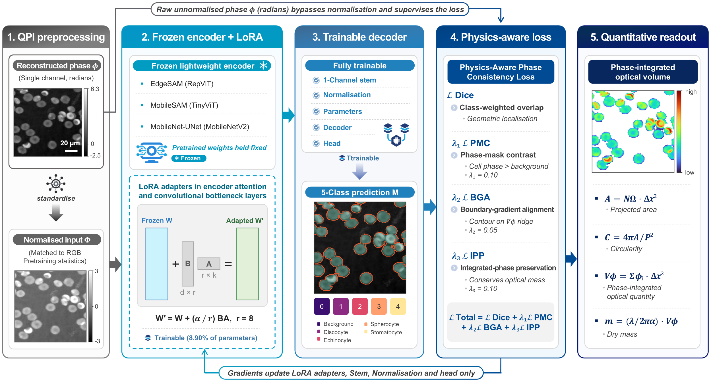
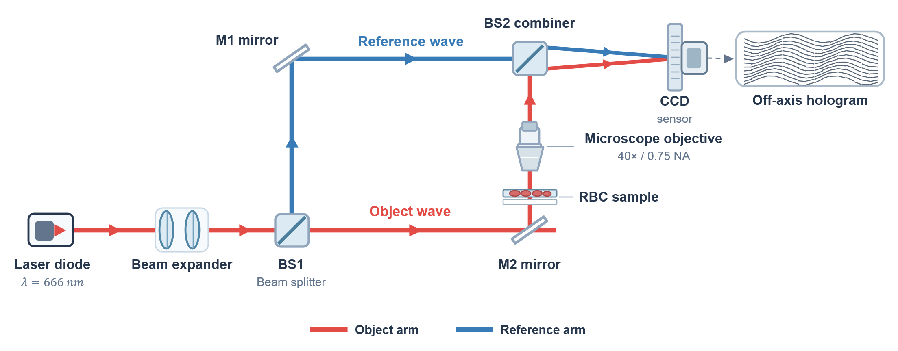
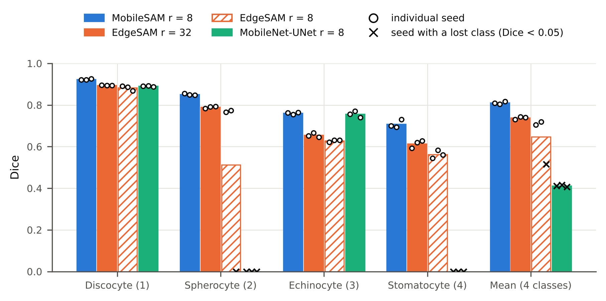
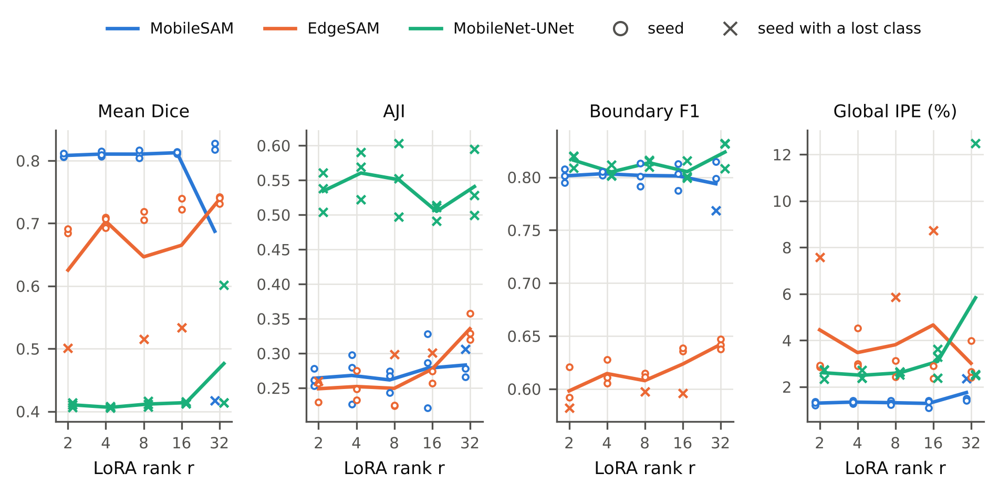
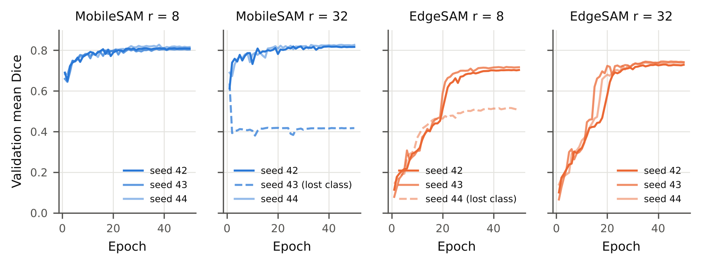
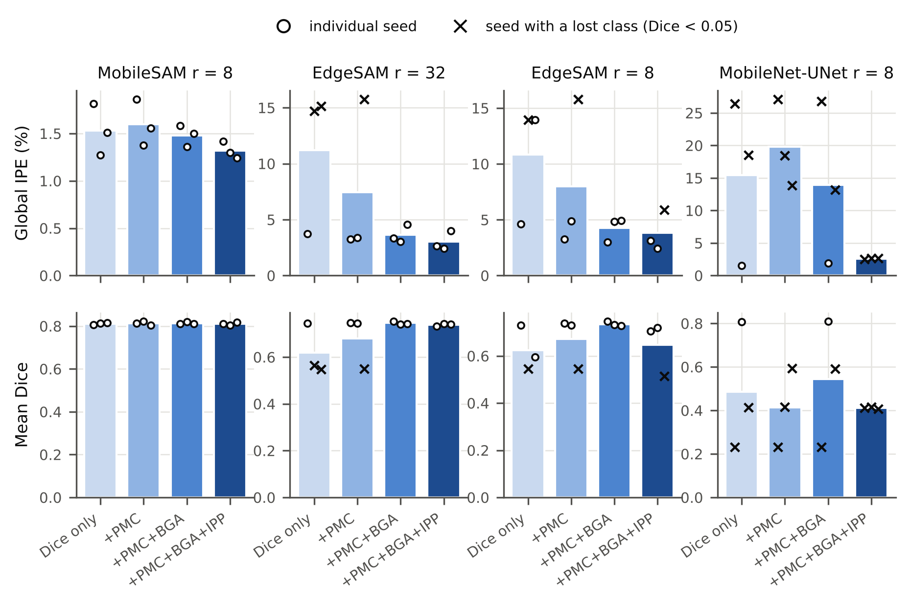
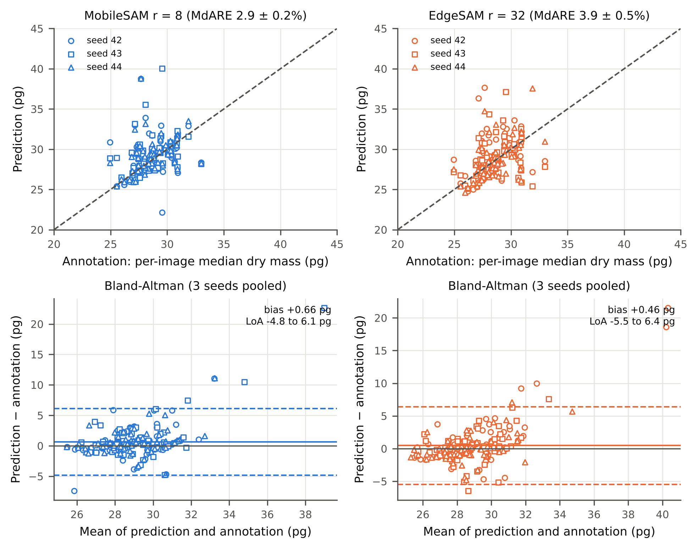
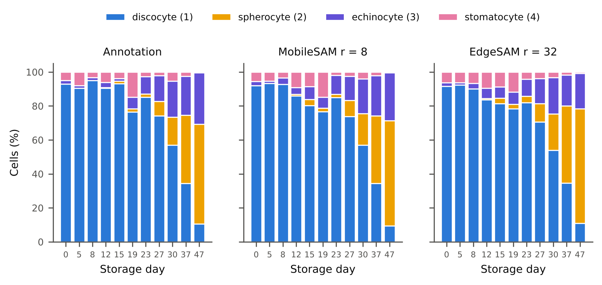
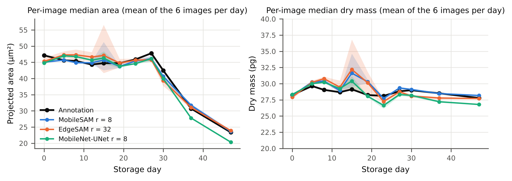

> **SUPERSEDED (29 Oct 2026).** The current manuscript and SI are in `artifacts/manuscript_final/`. This file predates the final audit and contains statements that are WRONG and must not be reused: (1) a "small storage-dependent dry-mass bias": the date-clustered test does not support it (EdgeSAM r=32 p = 0.08 to 0.19, MobileSAM r=8 p = 0.63 to 0.98; the p = 0.008 to 0.05 values come from a test that treats the 66 images as independent); (2) "dry mass remained constant": a decrease is only *not statistically supported*; (3) latency of EdgeSAM paired with r = 32: only the rank-8 checkpoints were timed. See `artifacts/manuscript_final/change_log.md`.

# Physics-Aware Lightweight Segmentation for Quantitative Holographic Cell Analysis with Optical Mass Preservation

Usama Ikram^1^, Youhyun Kim^2^, and Inkyu Moon^1,2,\*^

^1.^ Department of Artificial Intelligence, DGIST, Daegu 42988, South Korea

^2.^ Department of Robotics & Mechatronics Engineering, DGIST, Daegu 42988, South Korea

\*Corresponding author: inkyu.moon@dgist.ac.kr

**Abstract**

[Digital holographic microscopy provides label-free quantitative phase images from which cellular dry mass is obtained by integrating the phase over each cell. Segmentation networks trained with geometric overlap losses do not constrain this integral, so boundary errors propagate into optical-mass estimates. We propose a physics-aware lightweight segmentation framework in which the predicted cell boundary is treated as the measurement domain of the integrated phase. A Physics-Aware Phase Consistency Loss adds phase-mask contrast, boundary-gradient alignment, and integrated-phase preservation terms, computed on background-referenced 32-bit phase maps, to a class-weighted Dice loss, and low-rank adaptation (LoRA) adapts lightweight foundation-model encoders to single-channel phase images. On red blood cell phase maps acquired over 47 days of storage, MobileSAM and EdgeSAM were compared at five LoRA ranks with three random seeds per configuration (180 training runs including the loss ablation). Relative to Dice-only training, the physics-aware objective lowered the global integrated-phase error in all 15 architecture-rank combinations and reduced the number of runs that lost a morphology class. MobileSAM (rank 8) reached a mean Dice of 0.810 ± 0.006, a boundary F1-score of 0.802, and a global integrated-phase error of 1.32 ± 0.09%; EdgeSAM (rank 32) gave better instance separation (aggregated Jaccard index 0.335 vs 0.262) at about half the latency (10.6 vs 20.4 ms) and one eighth of the GPU memory. Without calibration, per-image dry mass from predicted masks agreed with annotation-derived values within a median absolute relative error of 2.9% (MobileSAM) and 3.9% (EdgeSAM). Annotation-derived dry mass showed no storage trend while projected cell area decreased by 44%; the predicted masks reproduced the area change and the morphological composition but added a small storage-dependent dry-mass bias, which identifies instance separation as the remaining limitation for optical-mass analysis.]{.mark}

[**Index Terms**---Quantitative Digital Holographic Microscopy, Quantitative Phase Imaging, Physics-Aware Segmentation, Optical Mass Preservation, Lightweight Deep Learning, Low-Rank Adaptation.]{.mark}

# 1. Introduction

Holography was introduced by Dennis Gabor in 1947 as a two-step process of recording and reconstructing an optical wavefront, which he called microscopy by reconstructed wavefronts \[1\] and for which he received the Nobel Prize in Physics in 1971 \[2\]. His in-line geometry gave reconstructions of limited quality because the virtual image, the conjugate real image, and the transmitted wave reach the observer together \[2\]. Leith and Upatnieks resolved this twin-image problem with the off-axis hologram, in which the object and reference waves reach the recording plane along directions separated by a finite angle and which, combined with laser illumination, extended holography to three-dimensional objects \[2, 3\].

Digital recording followed advances in electronic detection and computation. Goodman and Lawrence demonstrated digital image formation from electronically detected holograms in 1967 \[4\], and Schnars and Jueptner recorded holograms directly on a CCD target and reconstructed them numerically in 1994 \[5\]. In digital holography (DH), the photosensitive emulsion is replaced by a CCD or CMOS image sensor, the sampled interference pattern is stored as a digital hologram, and the object field is recovered by numerical propagation rather than by optical reconstruction \[6, 7\]. Because DH requires no imaging lens \[8\] and reconstructs both the amplitude and the phase of the object wave \[9\], it provides direct quantitative access to the optical field.

Applied to microscopy, DH is known as digital holographic microscopy (DHM) \[9\], which combines digital holography with optical microscopy to provide wide-field, label-free quantitative phase microscopy of transparent and semi-transparent specimens \[10\]. A DHM system consists of a light source, an interferometer containing a microscope objective, a digital image sensor, and a computer for hologram storage and processing \[6\], and the approach has been applied to biological specimens since early in-line implementations \[11, 12\]. Because a single hologram contains information describing the microscopic volume, numerical reconstruction permits refocusing at different depths, which makes the technique non-destructive and well suited to living cells \[13, 14\].

Quantitative phase imaging (QPI) uses the refractive index of the specimen as an endogenous imaging contrast and represents the measured data as quantitative maps of the optical path length delay introduced by the sample \[15, 16, 17\]. Operating on unlabelled specimens, it avoids photobleaching and exhibits lower phototoxicity than fluorescence microscopy \[15, 18\]. The phase measured at each pixel is the integral of the refractive index difference between the cell and its surrounding medium through the cell thickness, and refractive index is related to mass through the specific refractive increment, whose typical average value for cells is 0.18 to 0.20 mL/g \[19\]. The measured phase is therefore proportional to the cellular content excluding water, the cellular dry mass \[15, 19\], a relationship in use since the 1950s for label-free measurement of cell growth \[19, 20, 21\]. Because dry mass is obtained by integrating the phase over the cellular region, the boundary that defines this region determines the accuracy of the measurement.

This is particularly valuable in hematological analysis, where red blood cell (RBC) morphology reports on cellular integrity during storage \[22\]. In stored blood, healthy discocytes are progressively transformed into echinocytes and then into spherocytes, a process termed the RBC storage lesion \[23, 24\], accompanied by a loss of cell surface area and surface-to-volume ratio \[25\] and by weakened deformability \[23\]. Over a 42-day storage period the proportion of discocytes decreases while that of echinocytes and spherocytes increases \[24\], so the morphology distribution is used to evaluate the quality of stored blood \[23\]. DHM has quantified three-dimensional geometric and chemical changes of single RBCs during the storage lesion \[25\], and deep learning has been combined with label-free DHM to assess storage lesions automatically, for which reliable segmentation of individual cells is a prerequisite \[26\].

Segmentation is regarded as mandatory for the quantitative analysis of QPI data \[27\]. Conventional image-processing pipelines are affected by background phase variations, holographic artifacts, and weak phase transitions near adjacent cells, and they require several processing stages and careful parameter adjustment to extract a single cell \[26\]; the Empirical Gradient Threshold method, distance-transform processing, and marker-controlled watershed segmentation have been used for this purpose \[28, 29, 30\]. Learning-based methods delineate complex boundaries more flexibly, with U-Net style encoder-decoder networks as established baselines \[27\], and AI-assisted segmentation supports automated tasks such as cell counting and biophysical parameter quantification \[16\].

Lightweight segmentation models are attractive for quantitative biomedical imaging because they reduce inference latency and memory requirements while retaining the spatial resolution needed for accurate boundary localization \[31\]. MobileNet-UNet replaces a heavyweight encoder with a MobileNetV2 backbone, using depthwise separable convolutions and inverted residual bottlenecks \[32\]. Among foundation models, MobileSAM replaces the image encoder of the Segment Anything Model (SAM) with TinyViT by decoupled distillation while retaining the mask decoder \[33\], and EdgeSAM distils SAM into a RepViT architecture with a prompt-in-the-loop strategy that preserves prompt-to-mask interactions \[34\].

Because full-network adaptation of large, pre-trained models is computationally expensive and prone to overfitting on limited biomedical data, parameter-efficient fine-tuning updates only a small task-specific subset of parameters, through approaches such as BitFit, structural adapters, and Visual Prompt Tuning \[35\]. Low-Rank Adaptation (LoRA) adds trainable low-rank decomposition matrices to selected modules, adapting the model while largely preserving the pre-trained representation \[36\].

Despite these advances, an important limitation remains. Cross-Entropy and Dice, the standard objectives for biomedical segmentation \[27\], optimize spatial classification or geometric overlap and place no explicit constraint on the quantitative phase enclosed by the predicted cell boundary \[37\]. In QPI, however, that boundary is not only a geometric contour but the measurement domain over which the phase is integrated, so a prediction can achieve high geometric overlap while still introducing an error in the integrated phase that propagates into phase-derived quantities such as cellular dry mass \[37\]. This distinction between a geometric segmentation boundary and a quantitative measurement boundary motivates objectives that explicitly preserve the phase-integrated optical information enclosed by the predicted region, a requirement referred to here as optical-mass preservation.

A second limitation concerns domain adaptation and computational cost. Lightweight and foundation vision models are pretrained on natural RGB datasets \[38\], whereas quantitative phase images are single-channel distributions whose values represent optical phase rather than color and reflectance \[39\], so direct transfer can be suboptimal, while unrestricted full fine-tuning on small and imbalanced datasets risks overfitting and the degradation of minority morphological classes. Large models such as the original SAM also impose computational and memory requirements that limit their use in resource-constrained environments \[33, 40, 41, 42\], and deep learning applied to holographic data, although much faster than iterative reconstruction, requires substantial computational resources and training data \[43\].

[This work addresses these limitations with a physics-aware lightweight segmentation framework whose main contribution is a segmentation objective that preserves the integrated quantitative phase within the predicted cells, so that the predicted boundary can be used directly for optical-mass estimation. We introduce a Physics-Aware Phase Consistency Loss that incorporates quantitative phase information into the segmentation objective through three constraints: Phase-Mask Contrast (PMC), a global constraint on foreground localization based on cell-to-background phase contrast; Boundary-Gradient Alignment (BGA), which encourages predicted boundaries to follow spatial phase transitions; and Integrated-Phase Preservation (IPP), which explicitly constrains the quantitative phase integrated within the predicted cellular region. The constraints act on the original 32-bit phase maps in radians after each map has been referenced to its own background, never on the normalized network input, so that the preserved physical quantity is altered neither by input normalization nor by the arbitrary zero level of the reconstruction. LoRA then adapts lightweight models pretrained on natural images to the holographic phase domain with most parameters frozen, which also regularizes training on a small, imbalanced dataset.]{.mark}

[The image encoders of two lightweight foundation models, MobileSAM [33] and EdgeSAM [34], and a convolutional MobileNet-UNet [32] baseline are adapted with LoRA and evaluated on quantitative phase images of red blood cells recorded over a 47-day storage period. Because the stability of parameter-efficient adaptation on a small dataset cannot be judged from a single training run, every configuration is trained with three random seeds, and the models are compared in terms of segmentation accuracy, integrated-phase and optical-mass preservation, computational efficiency, and training stability.]{.mark}

# 2. Method

## 2.1 Overall Framework

[The proposed framework treats the predicted cell boundary as a quantitative measurement domain rather than as a purely geometric contour. As illustrated in Fig. 1, the pipeline consists of four main stages: background referencing and standardization of the 32-bit quantitative phase maps, segmentation by a LoRA-adapted lightweight network, optimization with the Physics-Aware Phase Consistency Loss, and extraction of phase-derived cellular measurements.]{.mark}

{width="7.255905511811024in" height="3.909448818897638in"}

[**Fig. 1** Overview of the proposed physics-aware lightweight segmentation framework for quantitative holographic cell analysis. LoRA-adapted lightweight networks segment cells from the standardized phase image, while the background-referenced phase in radians enters the Physics-Aware Phase Consistency Loss through the PMC, BGA, and IPP constraints. The resulting segmentation masks serve as measurement domains that preserve phase-integrated optical information for subsequent quantitative cellular analysis.]{.mark}

## 2.2 QPI Preprocessing

[The input data consist of single-channel quantitative phase maps reconstructed as 32-bit floating-point arrays in radians (768 × 768 pixels). These maps represent the quantitative phase delay associated with the optical path difference introduced by the cells. Because the measured phase depends jointly on refractive-index contrast and specimen thickness, it is treated as an optical phase quantity rather than as a direct measurement of geometric cell thickness or volume. Ground-truth semantic masks contain five classes, with mask values 0 to 4 assigned to background, discocyte, spherocyte, echinocyte, and stomatocyte, respectively. The masks had been drawn on 8-bit grey-level exports of the phase maps; they were transferred to the 32-bit maps by an affine enhanced-correlation-coefficient registration of each phase map to its 8-bit export (the estimated transforms consisted of scale and translation only) with nearest-neighbor resampling of the labels. Pixels of a phase map outside the field of view of its 8-bit export carry no annotation and are excluded from every loss term and every metric.]{.mark}

[The reconstructed phase maps do not share a common zero level: the background phase of the validation maps lay between 0.66 and 2.50 rad. Because an arbitrary constant c adds c·A to the phase integrated over a region of area A, every map was referenced to its own background before training and evaluation: the median phase of the annotated background pixels more than 5 pixels from any cell was subtracted, so that the background is 0 rad and the integrated phase of a cell measures the cell only. The same background-referenced phase is used for the physics-aware loss terms (PMC, BGA, and IPP), for the integrated-phase error, and for the dry-mass estimation. For the network input only, the referenced map is resized to the input size of each model (256 × 256 pixels for MobileNet-UNet and EdgeSAM, 1024 × 1024 pixels for MobileSAM) and standardized per image to zero mean and unit variance; the physics-aware terms receive the background-referenced phase in radians at the same resolution and never the standardized values.]{.mark}

[Data augmentation is restricted to transformations that preserve the quantitative phase values and cellular morphology. Each training image is used in its original orientation and in its three lossless 90° rotations. Intensity perturbations, nonlinear contrast transformations, and phase-value modifications are excluded because they could alter the quantitative optical information that the proposed framework is designed to preserve.]{.mark}

## 2.3 Lightweight Segmentation Models

[Three lightweight architectures are evaluated, covering convolutional, transformer-based, and hybrid designs. MobileNet-UNet pairs an ImageNet-pretrained MobileNetV2 encoder with a U-Net-style decoder with skip connections, which retains the fine spatial information required for accurate cellular boundary delineation [32]. For MobileSAM and EdgeSAM, only the pretrained image encoders are used: the distilled TinyViT encoder of MobileSAM [33] and the RepViT encoder of EdgeSAM [34]. Because dense five-class segmentation requires no prompts, each encoder is combined with a compact decoder trained from scratch. In MobileSAM, a learned prompt embedding is added to five class tokens that attend to the image embedding through one transformer decoder layer, and each class map is the inner product of its token with the upsampled embedding; in EdgeSAM, four transposed-convolution stages upsample the embedding to the input resolution, followed by a 1 × 1 classifier. In all three networks, the first convolution is replaced by a single-channel convolution initialized with the mean of the pretrained RGB filters. EdgeSAM is evaluated as a computationally efficient architecture rather than as evidence of embedded deployment.]{.mark}

## 2.4 LoRA-Based Lightweight Adaptation

LoRA is employed to adapt pretrained lightweight segmentation networks to the distinct statistical and structural characteristics of holographic phase images. For a pretrained weight matrix *W*, the adapted weight is expressed as:

$W' = W + (B \cdot A) \times \frac{\alpha}{r}$ , (1)

[where *W* is the frozen pretrained weight matrix, *B* and *A* are trainable low-rank matrices, *r* is the rank of the low-dimensional adaptation space, and *α* is a scaling factor. We set *α* = *r*, so the low-rank update enters with unit scaling at every rank, and *B* is initialized to zero so that training starts from the pretrained model. To evaluate the balance between adaptation capacity, parameter efficiency, and training stability, a rank sweep *r* ∈ {2, 4, 8, 16, 32} is performed for every architecture.]{.mark}

[LoRA modules are inserted into architecture-dependent layers. In the TinyViT encoder of MobileSAM, they are added to the fused query-key-value projections of the attention blocks; in the convolutional encoders of EdgeSAM and MobileNet-UNet, they are added to every non-grouped convolution and linear layer, while depthwise convolutions remain frozen. To address the structural domain shift from three-channel natural images to single-channel quantitative phase maps, the single-channel input stem and the normalization parameters are fully unfrozen. The decoder and the output head also remain trainable to generate the five-class RBC segmentation output, so the fraction of trainable parameters differs among architectures (Table S5). For inference, the low-rank matrices are merged into the frozen weights (*W*′ = *W* + *BA*), so latency and memory do not depend on the rank.]{.mark}

## 2.5 Physics-Aware Phase Consistency Loss

Conventional segmentation objectives optimize geometric agreement between predicted and annotated masks but do not explicitly constrain the quantitative phase signal enclosed by the predicted boundary. In QPI, however, the predicted mask defines the spatial domain over which phase information is integrated for subsequent biophysical analysis. We therefore introduce a Physics-Aware Phase Consistency Loss that combines geometric segmentation with constraints derived directly from the quantitative phase distribution.

### 2.5.1 Multi-Class Dice Loss

To mitigate class imbalance among rare morphology degradation types (e.g., stomatocytes) and ensure numerical stability during mixed-precision (FP16) training, the baseline biological segmentation loss is defined as a class-weighted, smoothed Multi-Class Dice Loss:

$L_{Dice} = \frac{1}{\sum_{c = 0}^{4}w_{c}}\sum_{c = 0}^{4}w_{c}\left( 1 - \frac{2|P_{c} \cap G_{c}| + 1}{|P_{c}| + |G_{c}| + 1} \right)$, (2)

[where $w_{c} \in \{ 0.5,1.0,1.5,2.0,2.0\}$ correspond to the background and the four morphology classes, respectively, $P_{c}$ and $G_{c}$ are the predicted probability map and the annotation of class *c*, and pixels without annotation are excluded from all sums. A Laplace smoothing factor of $+ 1$ prevents division by zero for images in which a class is absent. All loss terms are computed in 32-bit floating point, whereas the network forward pass uses FP16 mixed precision.]{.mark}

### 2.5.2 Phase-Mask Contrast Term

[To ensure that the predicted cell region maintains higher phase values than the surrounding medium, the contrast term penalizes predictions in which the mean cell phase does not exceed the mean background phase by at least a predefined margin:]{.mark}

$L_{PMC} = \text{max}(0,\mu_{bg} - \mu_{cell} + \text{margin})$, (3)

[where $\mu_{cell}$ and $\mu_{bg}$ denote the mean background-referenced phase inside the predicted cellular foreground and in the surrounding background, respectively, each weighted by the soft foreground probability, and the margin is 0.1 rad. This term provides a global physical constraint on foreground localization but does not by itself guarantee accurate cellular boundaries.]{.mark}

### 2.5.3 Boundary-Gradient Alignment Term

[Because probabilistic network outputs $\lbrack 0,1\rbrack$ and physical phase measurements exist on incompatible scales, the spatial gradient magnitudes of the predicted mask ($\nabla M$) and of the background-referenced phase map ($\nabla\Phi$), computed by forward differences, are first max-normalized per sample to a $\lbrack 0,1\rbrack$ scale. The segmentation boundary is then aligned with strong phase gradients via an $L_{1}$ penalty:]{.mark}

$L_{BGA} = \left. \parallel\frac{\nabla M}{\text{max}(\nabla M) + \epsilon} - \frac{\nabla\Phi}{\text{max}(\nabla\Phi) + \epsilon} \right.\parallel_{1}$. (4)

[The $L_{1}$ difference is averaged over annotated pixels. This term anchors the predicted measurement boundary to phase transitions present in the measured QPI data.]{.mark}

### 2.5.4 Integrated-Phase Preservation Term

[The key quantitative constraint of the proposed framework is preservation of the phase signal integrated over the segmented cellular domain. For a background-referenced quantitative phase map *φ~i~*, predicted foreground probability *M~i~*, and ground-truth foreground mask *G~i~*, the predicted and reference integrated phase quantities are $S_{pred} = \sum_{i}^{}{M_{i}\varphi_{i}},$ $S_{GT} = \sum_{i}^{}{G_{i}\varphi_{i}}$. The IPP loss is then defined as the ground-truth-normalized relative error:]{.mark}

$L_{IPP} = \frac{\left| S_{pred} - S_{GT} \right|}{\left| S_{GT} \right| + \epsilon}.$ (5)

[The relative formulation ($\epsilon = 10^{- 4}$) makes the penalty insensitive to the absolute scale of the phase integral. Because *φ* is referenced to the background, $S_{GT}$ measures the cells only; without this referencing, a residual offset *c* would add *c* times the foreground area to both integrals. Because the sums run over the whole foreground of an image, IPP constrains the total integrated phase of the image; the error of individual cells is evaluated separately (Section 3.3.2). The IPP term directly constrains the integrated phase quantity used in subsequent optical-mass analysis. Under the conventional specific refractive increment assumption, this quantity is proportional to cellular dry mass; preserving the integrated phase during segmentation therefore targets the quantity required for downstream dry-mass estimation.]{.mark}

### 2.5.5 Final Loss Function

The final objective combines the biological segmentation task with the three physics-aware constraints:

$L_{total} = L_{Dice} + \lambda_{1}L_{PMC} + \lambda_{2}L_{BGA} + \lambda_{3}L_{IPP}$ , (6)

[where $\lambda_{1} = 0.1$, $\lambda_{2} = 0.05$, and $\lambda_{3} = 0.1$ control the relative contributions of the PMC, BGA, and IPP terms, respectively. All physics-aware terms are evaluated using the binary cellular foreground probability $M = 1 - p_{background}$ rather than individual morphology classes, and each term is averaged over the images of a mini-batch that contain at least one annotated cell. This separates the morphological classification objective from the physical requirement that the total cellular measurement domain be accurately preserved. The contribution of each term is examined by the ablation in Section 4.4.]{.mark}

## 2.6 Quantitative Phase-Derived Cellular Measurements

The principal purpose of the proposed physics-aware segmentation is to enable reliable quantitative cellular measurements from the predicted mask. For each connected cellular component, we therefore extract projected area, circularity, integrated phase, and dry mass. The projected area is calculated as:

$A = N_{\Omega}\,\Delta x_{\text{eff}}^{2}$ , (7)

where *N~Ω~* is the number of pixels in *Ω* , and *∆x*~eff~ is the effective object-plane pixel pitch, defined as the camera pixel pitch divided by the system magnification. For the imaging system used in this study, *∆x*~eff~ = 0.1441 μm/px, and the projected area is therefore expressed in μm^2^. Cell circularity is defined as:

$C = \frac{4\pi A}{P^{2}}$ , (8)

where *P* denotes the perimeter of the segmented component. Circularity characterizes the two-dimensional projected outline of a cell, while complementary phase information reflects variations in the cell's optical thickness profile. The central optical quantity used in this study is the integrated phase over the segmented cellular domain:

$S_{\varphi} = \sum_{i \in \Omega}^{}\varphi_{i}\,\Delta x_{\text{eff}}^{2}$ , (9)

[Here, *φ~i~* is the phase of pixel *i* after subtraction of the local background level described below, and *S~φ~* represents the area-integrated quantitative phase associated with the cell, incorporating the coupled contributions of refractive-index contrast and optical thickness. It serves as the primary phase-derived optical quantity whose preservation is explicitly enforced by the IPP loss. Under the conventional assumption that the cellular refractive-index increment is approximately proportional to dry-mass concentration, cellular dry mass can be estimated from the integrated phase as:]{.mark}

$m = \frac{\lambda}{2\pi\alpha}S_{\varphi}$ , (10)

where *λ* is the illumination wavelength and *α* is the specific refractive increment of cellular solids. In this study, *λ* = 666 nm and *α* = 0.2 mL/g were used, with the latter corresponding to the specific refractive increment for haemoglobin-dominated RBCs. Equations (9) and (10) establish the physical motivation for optical-mass preservation in the proposed segmentation framework: errors in the predicted measurement boundary alter the integrated phase and therefore propagate directly into dry-mass estimates. The proposed loss consequently optimizes segmentation not only for geometric agreement but also for preservation of the phase-integrated information required for quantitative biophysical analysis.

[Per-cell measurements are obtained from connected components of the predicted foreground at the native 768 × 768 resolution. Components with a projected area outside 15–200 µm², which correspond to isolated pixel artifacts or unresolved multi-cell clusters, and components that touch an unannotated image region are excluded. The cell perimeter is calculated with the Crofton estimator to reduce sensitivity to pixelation. For dry-mass estimation, the background level is estimated as the median phase of the non-cellular pixels farther than 5 pixels from the analyzed mask and subtracted from the phase of each cell, so that each measurement uses only the mask under evaluation (predicted or annotated). Because the phase maps are in radians, Eq. (10) is applied with the physical constants only; no calibration to a reference hemoglobin content is used. Cells whose phase reaches the 2π upper limit of the reconstructed maps or shows a wrap discontinuity (phase within 0.3 rad of 2π, or a jump larger than π between neighboring pixels, within 2 pixels of the cell) are excluded from all phase-derived results; this rule was fixed before the results were computed.]{.mark}

# 3. Experiments

## 3.1 Dataset and Imaging Configuration

[The experimental evaluation was designed to assess four aspects of the proposed framework: (1) multi-class segmentation accuracy across different RBC morphologies, (2) preservation of quantitative phase information and optical-mass-related measurements, (3) computational efficiency, and (4) training stability of the lightweight segmentation architectures. The framework was evaluated using single-channel quantitative phase images acquired with a DHM system during long-term blood storage experiments [26, 44]. Blood samples (2 mL each) were collected from three healthy donors under a protocol approved by the Institutional Review Board of DGIST (Approval No. DGIST-180713-BR-012-01), with the same samples imaged repeatedly over the storage period. The quantitative phase maps were numerically reconstructed from off-axis holograms and represent the phase delay associated with the optical path difference introduced by the RBCs. Images were acquired at eleven time points over 47 days of storage (days 0, 5, 8, 12, 15, 19, 23, 27, 30, 37, and 47). Cells were manually annotated and classified by an expert biologist into discocytes, spherocytes, echinocytes, and stomatocytes using representative example morphologies as classification criteria. Cells were segmented into multi-label masks, and overlapping cells were separated into individual instances using a distance transform of the mask thresholded at 0.3 to construct binary marker maps. No cells superposed along the optical axis were identified among the annotated cells: the cells with the highest phase per pixel relative to the typical cell in the same image were single, optically dense cells rather than superposed pairs. Laterally touching cells and unresolved multi-cell clusters, which were most frequent at day 15, are discussed in Section 4.9. The provided split comprises 256 training images and 66 validation images (six per time point). Because 32-bit phase maps were available for 182 of the training images and for all validation images, the models were trained on 182 images, each with its three 90° rotations (728 training views), and evaluated on the 66 validation images. These contain 2,049 annotated cells with a projected area of 15–200 µm², of which 61 (3.0%) met the phase-wrapping criterion of Section 2.6 and were excluded from phase-derived results (Table S1).]{.mark}

[Holograms were recorded with an off-axis transmission digital holographic microscope based on a Mach-Zehnder interferometer [26, 44], as shown in Fig. 2. The light source was a 666 nm laser diode. The sample was imaged with a 40×/0.75 NA microscope objective onto a CCD sensor (11.3 mm × 7.1 mm, 1920 × 1200 pixels of 5.86 µm × 5.86 µm, of which 1024 × 1024 pixels were used). The field of view was approximately 140 µm, with an effective pixel size at the sample of 0.1441 µm. The object wave was reconstructed numerically: the +1 diffraction order was isolated by spatial filtering in the Fourier domain to remove the zero order and twin image, and the phase was recovered using a Fresnel-approximation numerical diffraction calculation. Background phase aberrations were corrected using a numerical phase mask fitted to a fringe-free reference region of each hologram. The reconstructed phase maps used in this study comprise 768 × 768 pixels and are confined to the interval [0, 2π] rad. Relative to the background, the peak phase of the annotated cells had a median of 2.15 rad (95th percentile 4.16 rad); cells whose phase reached the 2π limit were identified and excluded from phase-derived results as described in Section 2.6.]{.mark}

{width="7.259722222222222in" height="2.8409722222222222in"}

**Fig. 2** Schematic of the off-axis transmission Mach-Zehnder DHM setup used to acquire the RBC dataset. BS1/BS2, beam splitters; M1/M2, mirrors. Schematic redrawn for this manuscript; not to scale.

## 3.2 Training Configuration

[All networks were trained for 50 epochs with the AdamW optimizer and a cosine annealing learning-rate schedule (initial learning rate 5 × 10⁻⁴ for MobileSAM and EdgeSAM and 10⁻³ for MobileNet-UNet; batch size 8 for MobileSAM and 16 for the other models). Mixed precision (FP16) was used in the forward pass to reduce memory consumption, while all loss terms were computed in 32-bit floating point. The substantial class imbalance of longitudinal RBC morphology data was addressed by the class-weighted Multi-Class Dice Loss of Section 2.5.1; mini-batches were drawn by uniform shuffling. Every LoRA configuration (three architectures, five ranks, and four loss variants; Section 3.5) was trained with three random seeds (42, 43, and 44), giving 180 training runs; full fine-tuning was trained once per architecture (seed 42). All configurations used the same optimization schedule and data. Because the validation images also serve as the evaluation images, no checkpoint was selected on them: every reported result is from the model after the final epoch.]{.mark}

## 3.3 Evaluation Metrics

[The proposed framework was evaluated using four categories of metrics: segmentation performance, quantitative phase preservation, computational efficiency, and training stability.]{.mark}

### 3.3.1 Segmentation Performance and Training Stability

[Spatial agreement between predicted and ground-truth masks was evaluated using the Dice coefficient and Intersection-over-Union (IoU) at the native 768 × 768 resolution, after bilinear upsampling of the network output. For each morphology class, Dice and IoU were computed from all validation pixels pooled and then macro-averaged over the four foreground classes. A morphology class that was not predicted by the model received a score of zero rather than being excluded from the average, so that the dominant background class cannot inflate the aggregate performance and failures in minority classes are reflected directly in the reported scores. Instance-level separation in densely populated regions was evaluated with the Aggregated Jaccard Index (AJI) on the connected components of the binary foreground. Training stability was assessed by repeating every configuration with three seeds: a run in which any morphology class reached a Dice below 0.05 is reported as having lost that class. Results are given as mean ± standard deviation over the three seeds, and every seed is reported in the Supplementary Information.]{.mark}

### 3.3.2 Quantitative Phase Preservation

[The physical fidelity of the predicted measurement boundaries was evaluated using the integrated-phase error (IPE). This metric quantifies the relative difference between the phase-integrated optical quantities obtained from the predicted and ground-truth cellular regions on the background-referenced phase, consistent with the integrated-phase definition in Eq. (9). For a predicted integrated phase $S_{pred}$ and the corresponding ground-truth value $S_{GT}$, IPE is defined as]{.mark}

$IPE(\%) = \frac{\left| S_{pred} - S_{GT} \right|}{\left| S_{GT} \right| + \epsilon} \times 100.$ (11)

[IPE was evaluated both globally and for individual RBC morphology classes. For each image, $S_{pred}$ and $S_{GT}$ are accumulated by summing the background-referenced phase over all annotated pixels in the relevant region (the full foreground for the global formulation, or the corresponding class mask for class-specific IPE), and Eq. (11) is evaluated per image; the reported global IPE is the mean of these per-image values, and class-specific IPE is the mean over the images that contain that class. Because Eq. (11) operates on $\left| S_{pred} - S_{GT} \right|$, IPE is an absolute (unsigned) error, so over- and underestimation in different images cannot cancel in the reported mean; within one image, however, the phase is summed over all cells before the absolute value is taken. A morphology class with zero detections yields $S_{pred} = 0$ for that class, which is not excluded but is reflected directly in Eq. (11) as an IPE of 100%. To assess the error of individual cells, a per-cell IPE was also computed by matching each ground-truth cell (projected area 15–200 µm²) one-to-one with a predicted cell (IoU ≥ 0.5) and evaluating the relative phase-integral error for that cell, using phase after subtraction of a least-squares background plane; unmatched and phase-wrapped cells were excluded from this per-cell statistic, and the fraction of matched cells is reported. A lower IPE indicates that the predicted segmentation boundary more accurately preserves the phase-integrated optical information associated with the cell. Boundary accuracy was additionally evaluated using the boundary F1-score with a 2-pixel tolerance, pooled over all images, excluding boundary pixels adjacent to unannotated regions. Together, the boundary F1-score and IPE measure geometric boundary accuracy and optical-mass preservation, respectively.]{.mark}

### 3.3.3 Computational Efficiency

Computational efficiency was characterized using median inference latency, tail latency, throughput in frames per second (FPS), trainable parameter count, and peak VRAM allocation. These metrics were used to quantify the computational requirements of each lightweight architecture and to assess its potential suitability for future implementation in resource-constrained holographic imaging systems.

## 3.4 Computational Benchmarking Protocol

[Computational benchmarking was performed on an NVIDIA RTX A5000 GPU to characterize the relative inference efficiency of the evaluated lightweight architectures, independently of training. Each model was evaluated in strict 32-bit floating point (TF32 disabled) with batch size 1 at its native input size, both in native PyTorch and through ONNX Runtime (ORT) with the CUDA Execution Provider. For each runtime, 50 unrecorded warm-up iterations were followed by 500 synchronized forward passes on real validation phase maps kept on the GPU; for ORT, three independent sessions were timed. The procedure was repeated with three seeds. We report the median (P50) and 99th-percentile (P99) latency, the throughput (FPS = 1000/P50), and the peak GPU memory, measured as the device memory in use after the timed loop minus that before the model was loaded.]{.mark}

[The purpose of this experiment was to establish the relative computational efficiency of the candidate architectures under a controlled GPU environment rather than to demonstrate actual embedded deployment. Because LoRA is merged into the weights before inference, latency and memory are independent of the rank and were measured once per architecture. MobileSAM is timed at its 1024-pixel input and the other models at 256 pixels, so latency differences between architectures combine architecture and input size. Before any ORT result was reported, the exported models were compared with the PyTorch models on all validation images under acceptance criteria fixed in advance (argmax agreement ≥ 99.9%, change in mean Dice ≤ 0.001, and mean per-image dry-mass difference ≤ 0.1%); all three models passed (Table S14).]{.mark}

## 3.5 Ablation Studies

[Three groups of experiments were performed for all three architectures, each configuration with three random seeds. First, a LoRA rank sweep (*r* = 2, 4, 8, 16, and 32) characterized the relation among adaptation capacity, segmentation accuracy, integrated-phase preservation, and training stability; the complete sweep is given in the Supplementary Information. From this sweep, MobileSAM at *r* = 8 and EdgeSAM at *r* = 32 are presented as the preferred configurations, and all architectures are additionally compared at the same rank (*r* = 8). Second, LoRA was compared with full fine-tuning of each network under the same objective and schedule. Third, the Physics-Aware Phase Consistency Loss was ablated by progressively adding the PMC, BGA, and IPP terms to the Dice loss at every rank (60 configurations); the full objective is the rank-sweep run of the same rank and seed, so every comparison within a rank is paired by seed. The preferred ranks were chosen after inspection of the rank sweep on the evaluation images, because no separate selection set was available (Section 5).]{.mark}

## 3.6 Statistical Analysis

[Statistical analyses were performed to evaluate storage-associated changes in RBC morphology and phase-derived quantitative measurements. Because cells segmented from the same QPI share common acquisition conditions, individual cells were not treated as statistically independent observations. The image was therefore used as the unit of analysis, with each image represented by the median of its detected cells. Cell-level distributions were reported as descriptive summaries. Monotonic associations between quantitative measurements and storage duration were evaluated using Spearman rank correlation. Differences between the early discocyte-dominated storage period (days 0–8, 18 images) and the terminal storage period (days 37 and 47, 12 images) were evaluated using a two-sided Mann-Whitney test. For phase-integrated quantities that co-vary with projected area, partial Spearman correlation controlling for area was used to determine whether an independent association with storage duration remained. Agreement between dry-mass estimates derived from predicted and manually annotated boundaries was assessed on per-image median dry mass by the median absolute relative error (MdARE: the median, across images, of the absolute difference between predicted-mask and annotation-mask dry mass divided by the annotation-mask dry mass), the Bland-Altman bias (mean predicted-minus-annotation difference) with 95% limits of agreement [46], Pearson correlation, and Lin's concordance correlation coefficient (CCC) [45]. Because correlation coefficients depend on the spread of the reference values, agreement was judged primarily by MdARE, bias, and the limits of agreement. Differences between model configurations were computed per seed (paired by seed) and are reported with 95% t-intervals; with three seeds these intervals are wide and are used descriptively rather than as significance tests.]{.mark}

# 4. Results

[The framework was evaluated on segmentation accuracy, training stability, integrated-phase and optical-mass preservation, and computational efficiency. Unless stated otherwise, values are means ± standard deviation over three seeds of the final-epoch models, computed on the 66 validation images at their native resolution. MobileSAM at *r* = 8 and EdgeSAM at *r* = 32 are presented as the preferred configurations and MobileNet-UNet at *r* = 8 as a convolutional baseline, and all architectures are also compared at the same rank (*r* = 8).]{.mark}

## [4.1 Segmentation Accuracy]{.mark}

[Table 1 lists the preferred configurations and the comparison at the same rank. MobileSAM (*r* = 8) reached the highest mean Dice (0.810 ± 0.006) and boundary F1-score (0.802 ± 0.011) and the highest Dice for every morphology class, including echinocytes (0.760 ± 0.006) and stomatocytes (0.708 ± 0.020) (Fig. 3). EdgeSAM (*r* = 32) reached a mean Dice of 0.738 ± 0.006 and separated individual cells better than MobileSAM (AJI 0.335 ± 0.020 vs 0.262 ± 0.017).]{.mark}

[**TABLE 1** Segmentation performance of the preferred LoRA configurations (MobileSAM *r* = 8, EdgeSAM *r* = 32) and of all architectures at the same rank (*r* = 8), full physics-aware objective. Mean ± SD over three seeds (42, 43, 44); final-epoch models; native 768 × 768 grid. "Runs with a lost class": seeds in which a class had Dice < 0.05 (sphero(2) = spherocyte, stomato(4) = stomatocyte). Per-class Dice: Fig. 3 and Table S2.]{.mark}

| Architecture | LoRA rank | Role | Trainable params | Mean Dice | Mean IoU | AJI | Boundary F1 | Global IPE (%) | Runs with a lost class |
|---|---|---|---|---|---|---|---|---|---|
| MobileSAM | 8 | preferred; same rank | 0.67 M (10.0%) | 0.810 ± 0.006 | 0.690 ± 0.008 | 0.262 ± 0.017 | 0.802 ± 0.011 | 1.32 ± 0.09 | 0/3 |
| EdgeSAM | 32 | preferred | 1.47 M (21.2%) | 0.738 ± 0.006 | 0.598 ± 0.007 | 0.335 ± 0.020 | 0.642 ± 0.005 | 3.02 ± 0.84 | 0/3 |
| EdgeSAM | 8 | same rank | 0.53 M (8.9%) | 0.647 ± 0.114 | 0.514 ± 0.095 | 0.249 ± 0.043 | 0.608 ± 0.009 | 3.81 ± 1.82 | 1/3 (s44: sphero(2)) |
| MobileNet-UNet | 8 | baseline; same rank | 5.58 M (71.8%) | 0.412 ± 0.004 | 0.353 ± 0.006 | 0.551 ± 0.053 | 0.814 ± 0.003 | 2.60 ± 0.07 | 3/3 (s42: sphero(2), stomato(4); s43: sphero(2), stomato(4); s44: sphero(2), stomato(4)) |

[Seed-paired differences at *r* = 8 (mean [95% t-interval]):]{.mark}

| Comparison (seed-paired, r = 8) | Δ Mean Dice | Δ AJI | Δ Boundary F1 | Δ Global IPE (pp) |
|---|---|---|---|---|
| MobileSAM minus EdgeSAM | +0.164 [-0.133, +0.461] | +0.012 [-0.088, +0.113] | +0.194 [+0.145, +0.243] | -2.49 [-7.15, +2.17] |
| MobileNet-UNet minus EdgeSAM | -0.235 [-0.508, +0.038] | +0.301 [+0.133, +0.469] | +0.206 [+0.181, +0.231] | -1.21 [-5.70, +3.28] |

{width=6.5in}

[**Fig. 3** Per-class Dice of MobileSAM (*r* = 8), EdgeSAM (*r* = 32 and *r* = 8), and MobileNet-UNet (*r* = 8). Bars: mean over three seeds; circles: individual seeds; crosses: seeds in which the class was lost (Dice < 0.05). Numbers in parentheses are mask values.]{.mark}

[MobileNet-UNet reached a high boundary F1-score (0.814) and the highest AJI (0.551), but it did not predict a single spherocyte or stomatocyte pixel in any seed, so its mean Dice was 0.412. Boundary F1 and AJI are computed on the binary foreground, which MobileNet-UNet delineates well; they are blind to the class assigned to each cell. Aggregate boundary and instance metrics alone therefore do not reveal the loss of whole morphology classes, and per-class results must be read together with them. For quantitative holographic analysis, complete morphology coverage matters because the predicted region of each class defines where its phase is integrated.]{.mark}

[At the same rank (*r* = 8), MobileSAM exceeded EdgeSAM in boundary F1-score (paired difference +0.194, 95% interval +0.145 to +0.243). The differences in mean Dice (+0.164, −0.133 to +0.461) and in global IPE (−2.49 percentage points, −7.15 to +2.17) were not separable from seed variation, because one of the three EdgeSAM seeds lost the spherocyte class at *r* = 8 (Section 4.2).]{.mark}

## [4.2 LoRA Rank and Training Stability]{.mark}

[Across the rank sweep (Fig. 4, Table S2), MobileSAM was stable from *r* = 2 to *r* = 16 (mean Dice 0.808 to 0.813, seed SD at most 0.006). At *r* = 32, one seed lost the spherocyte and stomatocyte classes; its validation Dice dropped after the first epoch and did not recover (Fig. 5). EdgeSAM improved with rank in AJI and boundary F1-score and was stable at *r* = 4 and *r* = 32, but at *r* = 2, 8, and 16 the same seed (44) lost the spherocyte class (Table 2). EdgeSAM converged late, with a step increase of the validation Dice between about epochs 15 and 25; in the unstable runs the Dice stayed near 0.5 and this step did not occur (Fig. 5). Between EdgeSAM *r* = 32 and *r* = 8, the mean Dice difference was +0.091 (−0.196 to +0.379) and the AJI difference +0.086 (+0.026 to +0.146) (Table S4). MobileNet-UNet lost the spherocyte class in all 15 runs, which is a systematic failure rather than instability.]{.mark}

[Increasing the rank therefore did not improve MobileSAM, whereas EdgeSAM benefited from the larger adaptation capacity; we present MobileSAM at *r* = 8 and EdgeSAM at *r* = 32 for this reason, without claiming an optimal rank. LoRA is merged into the weights for inference, so the rank changes the number of trainable parameters (Table S5) but not the inference cost.]{.mark}

[**TABLE 2** Training stability: number of seeds (of three) in which a morphology class was lost (Dice < 0.05), with the seed and the lost classes, for every architecture and LoRA rank, with the full physics-aware objective and with the Dice loss only.]{.mark}

| Objective | Architecture | r = 2 | r = 4 | r = 8 | r = 16 | r = 32 |
|---|---|---|---|---|---|---|
| Full physics-aware | MobileSAM | 0/3 | 0/3 | 0/3 | 0/3 | 1/3 (s43: sphero(2), stomato(4)) |
| Full physics-aware | EdgeSAM | 1/3 (s44: sphero(2)) | 0/3 | 1/3 (s44: sphero(2)) | 1/3 (s44: sphero(2)) | 0/3 |
| Full physics-aware | MobileNet-UNet | 3/3 (s42: sphero(2), stomato(4); s43: sphero(2), stomato(4); s44: sphero(2), stomato(4)) | 3/3 (s42: sphero(2), stomato(4); s43: sphero(2), stomato(4); s44: sphero(2), stomato(4)) | 3/3 (s42: sphero(2), stomato(4); s43: sphero(2), stomato(4); s44: sphero(2), stomato(4)) | 3/3 (s42: sphero(2), stomato(4); s43: sphero(2), stomato(4); s44: sphero(2), stomato(4)) | 3/3 (s42: sphero(2), stomato(4); s43: sphero(2), stomato(4); s44: sphero(2)) |
| Dice only | MobileSAM | 1/3 (s42: sphero(2)) | 0/3 | 0/3 | 0/3 | 2/3 (s42: sphero(2); s43: sphero(2)) |
| Dice only | EdgeSAM | 0/3 | 1/3 (s43: sphero(2)) | 1/3 (s43: sphero(2)) | 2/3 (s43: sphero(2); s44: sphero(2)) | 2/3 (s43: sphero(2); s44: sphero(2)) |
| Dice only | MobileNet-UNet | 3/3 (s42: sphero(2), stomato(4); s43: sphero(2), stomato(4); s44: sphero(2), stomato(4)) | 3/3 (s42: sphero(2), stomato(4); s43: sphero(2), stomato(4); s44: sphero(2)) | 2/3 (s42: sphero(2), echino(3), stomato(4); s44: sphero(2), stomato(4)) | 2/3 (s42: sphero(2), echino(3), stomato(4); s44: sphero(2)) | 3/3 (s42: sphero(2), echino(3), stomato(4); s43: sphero(2), stomato(4); s44: sphero(2), stomato(4)) |

{width=6.5in}

[**Fig. 4** LoRA rank sweep with the full physics-aware objective: mean Dice, AJI, boundary F1-score, and global IPE against rank. Lines: mean over three seeds; circles: individual seeds; crosses: seeds in which a class was lost.]{.mark}

{width=6.5in}

[**Fig. 5** Validation Dice during training for the three seeds of MobileSAM (*r* = 8, 32) and EdgeSAM (*r* = 8, 32). Dashed lines: runs that lost a class. Training curves of all ranks: Fig. S2.]{.mark}

## [4.3 Parameter-Efficient Adaptation versus Full Fine-Tuning]{.mark}

[To evaluate the effectiveness of parameter-efficient adaptation, LoRA was compared with full fine-tuning of all three architectures under the same objective, schedule, and data (Table 3, Fig. S5). Full fine-tuning, which updated 5.7 to 7.6 M parameters and was trained with one seed, lost morphology classes in all three architectures: the spherocyte class for EdgeSAM (mean Dice 0.559, global IPE 8.31%), the spherocyte, echinocyte, and stomatocyte classes for MobileSAM (mean Dice 0.217), and, as with LoRA, the spherocyte and stomatocyte classes for MobileNet-UNet. With the same seed, the LoRA-adapted MobileSAM (*r* = 8) and EdgeSAM (*r* = 32) detected all four classes.]{.mark}

[These results indicate that increasing the number of trainable parameters does not necessarily improve adaptation to QPI phase images. Constraining adaptation to low-rank updates helps to retain the pretrained representations while providing sufficient flexibility for the QPI domain, which matters most for the minority morphology classes of this small dataset. Because full fine-tuning was trained with a single seed, this comparison is indicative.]{.mark}

[**TABLE 3** LoRA versus full fine-tuning (full physics-aware objective). LoRA rows: preferred rank, mean ± SD over three seeds, and the seed-42 run alone; full fine-tuning: single seed-42 run. Per-class Dice: Table S8 and Fig. S5.]{.mark}

| Architecture | LoRA rank | Seeds | Trainable params | Mean Dice | AJI | Boundary F1 | Global IPE (%) | Runs with a lost class |
|---|---|---|---|---|---|---|---|---|
| MobileSAM | 8 | 42, 43, 44 | 0.67 M (10.0%) | 0.810 ± 0.006 | 0.262 ± 0.017 | 0.802 ± 0.011 | 1.32 ± 0.09 | 0/3 |
| MobileSAM | 8 (seed 42 only) | 42 | 0.67 M (10.0%) | 0.810 | 0.243 | 0.792 | 1.42 | none |
| MobileSAM | full fine-tuning | 42 | 6.66 M (100.0%) | 0.217 | 0.448 | 0.808 | 2.16 | sphero(2), echino(3), stomato(4) |
| EdgeSAM | 32 | 42, 43, 44 | 1.47 M (21.2%) | 0.738 ± 0.006 | 0.335 ± 0.020 | 0.642 ± 0.005 | 3.02 ± 0.84 | 0/3 |
| EdgeSAM | 32 (seed 42 only) | 42 | 1.47 M (21.2%) | 0.731 | 0.329 | 0.647 | 2.66 | none |
| EdgeSAM | full fine-tuning | 42 | 5.69 M (100.0%) | 0.559 | 0.278 | 0.635 | 8.31 | sphero(2) |
| MobileNet-UNet | 8 | 42, 43, 44 | 5.58 M (71.8%) | 0.412 ± 0.004 | 0.551 ± 0.053 | 0.814 ± 0.003 | 2.60 ± 0.07 | 3/3 (s42: sphero(2), stomato(4); s43: sphero(2), stomato(4); s44: sphero(2), stomato(4)) |
| MobileNet-UNet | 8 (seed 42 only) | 42 | 5.58 M (71.8%) | 0.412 | 0.603 | 0.816 | 2.52 | sphero(2), stomato(4) |
| MobileNet-UNet | full fine-tuning | 42 | 7.62 M (100.0%) | 0.418 | 0.642 | 0.825 | 2.17 | sphero(2), stomato(4) |

## [4.4 Physics-Aware Loss Ablation]{.mark}

[Table 4 and Fig. 6 compare the four objectives for the preferred configurations and MobileNet-UNet; the complete ablation at every rank is given in Table S6, Table S7, and Fig. S4. Adding the physics-aware terms lowered the mean global IPE relative to Dice-only training in all 15 architecture-rank combinations; with three seeds, the 95% interval excluded zero in three of them. The reduction was large where Dice-only training was unstable: for EdgeSAM at *r* = 32, the IPE fell from 11.20 ± 6.46% to 3.02 ± 0.84%, and for MobileNet-UNet at *r* = 8 from 15.48 ± 12.73% to 2.60 ± 0.07%. For MobileSAM at *r* = 8, whose Dice-only IPE was already low, the reduction was small (1.53 ± 0.27% to 1.32 ± 0.09%; −0.21 percentage points, −0.75 to +0.33).]{.mark}

[**TABLE 4** Ablation of the Physics-Aware Phase Consistency Loss. Each objective adds one term to the class-weighted Dice loss; the full objective is the rank-sweep run of the same rank and seeds. Mean ± SD over three seeds; lower part: seed-paired differences with 95% t-intervals.]{.mark}

| Configuration | Objective | Mean Dice | Boundary F1 | Global IPE (%) | Runs with a lost class |
|---|---|---|---|---|---|
| MobileSAM r = 8 | Dice only | 0.811 ± 0.005 | 0.808 ± 0.012 | 1.53 ± 0.27 | 0/3 |
| MobileSAM r = 8 | Dice + PMC | 0.813 ± 0.009 | 0.805 ± 0.002 | 1.60 ± 0.24 | 0/3 |
| MobileSAM r = 8 | Dice + PMC + BGA | 0.813 ± 0.005 | 0.806 ± 0.004 | 1.48 ± 0.11 | 0/3 |
| MobileSAM r = 8 | Dice + PMC + BGA + IPP (full) | 0.810 ± 0.006 | 0.802 ± 0.011 | 1.32 ± 0.09 | 0/3 |
| EdgeSAM r = 32 | Dice only | 0.619 ± 0.109 | 0.519 ± 0.212 | 11.20 ± 6.46 | 2/3 (s43: sphero(2); s44: sphero(2)) |
| EdgeSAM r = 32 | Dice + PMC | 0.680 ± 0.113 | 0.638 ± 0.027 | 7.45 ± 7.17 | 1/3 (s44: sphero(2)) |
| EdgeSAM r = 32 | Dice + PMC + BGA | 0.746 ± 0.006 | 0.643 ± 0.011 | 3.64 ± 0.82 | 0/3 |
| EdgeSAM r = 32 | Dice + PMC + BGA + IPP (full) | 0.738 ± 0.006 | 0.642 ± 0.005 | 3.02 ± 0.84 | 0/3 |
| MobileNet-UNet r = 8 | Dice only | 0.485 ± 0.294 | 0.814 ± 0.054 | 15.48 ± 12.73 | 2/3 (s42: sphero(2), echino(3), stomato(4); s44: sphero(2), stomato(4)) |
| MobileNet-UNet r = 8 | Dice + PMC | 0.414 ± 0.181 | 0.782 ± 0.022 | 19.79 ± 6.71 | 3/3 (s42: sphero(2), echino(3), stomato(4); s43: sphero(2), stomato(4); s44: sphero(2)) |
| MobileNet-UNet r = 8 | Dice + PMC + BGA | 0.544 ± 0.292 | 0.812 ± 0.052 | 13.96 ± 12.46 | 2/3 (s42: sphero(2), echino(3), stomato(4); s44: sphero(2)) |
| MobileNet-UNet r = 8 | Dice + PMC + BGA + IPP (full) | 0.412 ± 0.004 | 0.814 ± 0.003 | 2.60 ± 0.07 | 3/3 (s42: sphero(2), stomato(4); s43: sphero(2), stomato(4); s44: sphero(2), stomato(4)) |

[Seed-paired differences of the global IPE (percentage points, mean [95% t-interval]):]{.mark}

| Configuration | Δ IPE (pp), Full − Dice only | Δ IPE (pp), Full − (Dice+PMC+BGA): IPP |
|---|---|---|
| MobileSAM r = 8 | -0.21 [-0.75, +0.33] | -0.16 [-0.41, +0.09] |
| EdgeSAM r = 32 | -8.18 [-23.52, +7.15] | -0.63 [-0.75, -0.51] |
| MobileNet-UNet r = 8 | -12.88 [-44.66, +18.90] | -11.36 [-42.49, +19.77] |

[The physics terms also reduced training failures: over the rank sweep, the number of runs that lost a class decreased from 3 of 15 to 1 of 15 for MobileSAM and from 6 of 15 to 3 of 15 for EdgeSAM (Table 2). The contributions of the individual terms could not be separated reliably with three seeds. Adding IPP to Dice + PMC + BGA lowered the mean IPE in 13 of 15 combinations, most clearly for EdgeSAM at *r* = 32 (−0.63 percentage points, −0.75 to −0.51), whereas PMC and BGA alone had no consistent effect (8 and 11 of 15; Table S7). Mean Dice was not systematically changed by the physics terms.]{.mark}

[Because the IPP term weights each pixel by its phase, it could favor high-phase regions over low-phase cell margins. Misses did concentrate in the low-phase part of the cells: within the annotated cells, the false-negative rate in the lowest phase quartile was 23 to 28%, compared with below 6% in the other quartiles (Table S9). Adding IPP did not consistently increase this deficit: the lowest-quartile false-negative rate changed by −4.0 (−5.3 to −2.8) percentage points for EdgeSAM at *r* = 32 and by +2.4 (−1.2 to +5.9) for MobileSAM at *r* = 8.]{.mark}

{width=6.5in}

[**Fig. 6** Ablation of the physics-aware loss: global IPE (top) and mean Dice (bottom) for the four objectives. Bars: mean over three seeds; circles: seeds; crosses: seeds in which a class was lost. All ranks: Fig. S4.]{.mark}

## [4.5 Integrated-Phase and Optical-Mass Preservation]{.mark}

[Table 5 summarizes the measurement-related errors. The global IPE was 1.32 ± 0.09% for MobileSAM (*r* = 8) and 3.02 ± 0.84% for EdgeSAM (*r* = 32). For annotated cells that were matched one-to-one to a predicted cell (IoU ≥ 0.5; 66.6% and 66.3% of the cells), the median per-cell IPE was 1.11 ± 0.09% and 1.88 ± 0.24%, and 90% of the matched cells had errors below 8.3% and 16.2%, respectively (Fig. S6). Unmatched cells were mostly merged or missed cells: both SAM-based models produced about two thirds as many cell components as were annotated (0.667 and 0.696), consistent with their AJI. Class-specific IPE (Table S8) is dominated by confusion between morphologies and is therefore much larger than the global IPE.]{.mark}

[**TABLE 5** Integrated-phase and optical-mass preservation (phase-wrapped cells excluded). Per-cell IPE: matched cells (IoU ≥ 0.5). Dry mass: per-image medians, predicted vs annotation masks; LoA: 95% limits of agreement. Mean ± SD over three seeds.]{.mark}

| Configuration | Global IPE (%) | Per-cell \|IPE\| median (%) | Per-cell \|IPE\| P90 (%) | Annotated cells matched (IoU ≥ 0.5, %) | Predicted / annotated cells | Dry-mass MdARE (%) | Dry-mass bias (pg) | LoA low (pg) | LoA high (pg) | Day-0 median dry mass (pg) |
|---|---|---|---|---|---|---|---|---|---|---|
| MobileSAM r = 8 | 1.32 ± 0.09 | 1.11 ± 0.09 | 8.3 ± 1.3 | 66.6 ± 0.6 | 0.667 ± 0.006 | 2.87 ± 0.21 | 0.66 ± 0.31 | -4.71 ± 1.07 | 6.02 ± 1.66 | 28.21 ± 0.07 |
| EdgeSAM r = 32 | 3.02 ± 0.84 | 1.88 ± 0.24 | 16.2 ± 1.7 | 66.3 ± 1.9 | 0.696 ± 0.025 | 3.93 ± 0.52 | 0.46 ± 0.68 | -5.12 ± 1.64 | 6.04 ± 3.00 | 27.88 ± 0.43 |
| EdgeSAM r = 8 | 3.81 ± 1.82 | 2.04 ± 0.65 | 17.5 ± 5.6 | 60.5 ± 2.4 | 0.631 ± 0.014 | 3.63 ± 0.02 | 0.89 ± 0.24 | -6.03 ± 0.39 | 7.80 ± 0.65 | 28.15 ± 0.45 |
| MobileNet-UNet r = 8 | 2.60 ± 0.07 | 1.36 ± 0.03 | 11.1 ± 0.2 | 84.7 ± 1.2 | 0.855 ± 0.015 | 2.48 ± 0.31 | -0.17 ± 0.07 | -3.64 ± 0.69 | 3.30 ± 0.78 | 28.06 ± 0.15 |
| Annotation (reference) |  |  |  |  | 1 |  |  |  |  | 27.83 |

[Dry mass was computed without calibration. The median day-0 dry mass was 27.83 pg from the annotation masks, 0.93 of a typical mean corpuscular hemoglobin of 30 pg, and 28.21 pg and 27.88 pg from the MobileSAM and EdgeSAM masks. Per image, dry mass from the predicted masks agreed with the annotation-derived dry mass within a median absolute relative error of 2.87 ± 0.21% (MobileSAM) and 3.93 ± 0.52% (EdgeSAM), with biases of +0.66 and +0.46 pg and limits of agreement of about −5 to +6 pg (Fig. 7). The Pearson correlation was low (0.24 and 0.38) because the annotation-derived per-image dry mass varied little between images (28.66 ± 1.55 pg); for such a narrow range, the error-based measures describe the agreement better than correlation.]{.mark}

{width=6.5in}

[**Fig. 7** Dry-mass agreement between predicted and annotation masks (per-image median dry mass, three seeds pooled, phase-wrapped cells excluded). Top: predicted vs annotation-derived values with the identity line; bottom: Bland-Altman plots with bias (solid) and 95% limits of agreement (dashed).]{.mark}

[The global IPE depended on the background referencing of Section 2.2: without it, the IPE of MobileSAM rose from 1.32% to 2.06% (Table S10), whereas estimating the background from the predicted instead of the annotated mask changed it by less than 0.01 percentage points. To test robustness to background phase variations, synthetic tilt, defocus-like, and astigmatism-like fields of up to 0.5 rad were added to the validation phase maps: the mean Dice changed by at most 0.003 and the background-corrected IPE by at most 0.1 percentage points (Table S11, Fig. S9). Constant offsets are removed by the per-image standardization of the network input and are therefore not a test of robustness.]{.mark}

## [4.6 Computational Efficiency]{.mark}

[Inference cost is independent of the LoRA rank after merging, so one measurement per architecture is reported (Table 6). In PyTorch FP32, EdgeSAM needed 10.64 ± 1.45 ms per image (81 to 103 FPS) and 42 MB of GPU memory, MobileSAM 20.35 ± 0.15 ms (49 to 50 FPS) and 358 MB, and MobileNet-UNet 5.66 ± 0.10 ms and 52 MB. ORT reduced the latency of EdgeSAM to 4.11 ± 0.43 ms (229 to 277 FPS) and of MobileNet-UNet to 2.53 ± 0.19 ms, but increased that of MobileSAM to 25.43 ± 0.21 ms, and it used more memory for all models (132 to 1,178 MB). MobileSAM processes 1024-pixel inputs and the other models 256-pixel inputs, so these differences combine architecture and resolution. All ORT models reproduced the PyTorch predictions (Table S14). These measurements characterize a desktop GPU rather than an embedded device (Fig. S11 shows accuracy against latency).]{.mark}

[**TABLE 6** Computational efficiency on an NVIDIA RTX A5000 (batch 1, strict FP32). P50 and P99: mean ± SD over three seeds; FPS: range of the per-seed values; peak VRAM: largest value over seeds and sessions. Inference cost does not depend on the LoRA rank.]{.mark}

| Architecture | Runtime | Input (px) | Trainable params, preferred rank | P50 (ms) | P99 (ms) | FPS (per-seed range) | Peak VRAM (MB, max) |
|---|---|---|---|---|---|---|---|
| MobileSAM | PyTorch FP32 | 1024 | 0.67 M (r = 8) | 20.35 ± 0.15 | 20.51 ± 0.13 | 49-50 | 358 |
| MobileSAM | ONNX Runtime FP32 | 1024 | 0.67 M (r = 8) | 25.43 ± 0.21 | 25.56 ± 0.18 | 39-40 | 1178 |
| EdgeSAM | PyTorch FP32 | 256 | 1.47 M (r = 32) | 10.64 ± 1.45 | 12.97 ± 1.53 | 81-103 | 42 |
| EdgeSAM | ONNX Runtime FP32 | 256 | 1.47 M (r = 32) | 4.11 ± 0.43 | 5.58 ± 0.31 | 229-277 | 132 |
| MobileNet-UNet | PyTorch FP32 | 256 | 5.58 M (r = 8) | 5.66 ± 0.10 | 8.00 ± 0.63 | 175-180 | 52 |
| MobileNet-UNet | ONNX Runtime FP32 | 256 | 5.58 M (r = 8) | 2.53 ± 0.19 | 3.33 ± 0.79 | 374-431 | 152 |

## [4.7 Visualization of Segmentation Results]{.mark}

[Fig. 8 shows representative segmentation results for each morphology class. Consistent with the per-class results, MobileNet-UNet assigns no pixel to the spherocyte or stomatocyte class, so cells of these morphologies are labeled with other classes, whereas the two SAM-based models label all four morphologies. Neighboring cells that touch are sometimes merged into one predicted region by both SAM-based models, more often by MobileSAM, in agreement with their AJI and with the number of predicted cell components (Section 4.5).]{.mark}

[FIGURE NOT YET GENERATED: main/FQ1_qualitative_segmentation.png. Run `python artifacts/code/make_qualitative_figures.py` on the server (needs data/processed), then rebuild.]{.mark}

[**Fig. 8** Qualitative segmentation results of MobileSAM (*r* = 8), EdgeSAM (*r* = 32), and MobileNet-UNet (*r* = 8), seed 42, for the four morphology classes. For each class, the 256 × 256 window with the most annotated pixels of that class is shown with the annotation.]{.mark}

## [4.8 Storage-Induced Morphology Changes]{.mark}

[To evaluate the applicability of the proposed framework to quantitative biological analysis, storage-induced changes in RBC morphology and phase-derived biophysical properties were examined over the 47-day storage period, using the annotation masks as the reference and the masks predicted by MobileSAM (*r* = 8) and EdgeSAM (*r* = 32). Each storage time point consisted of six independent validation images; therefore, the analysis represents cross-sectional population changes rather than longitudinal tracking of the same cells.]{.mark}

[The annotation shows the expected storage lesion (Fig. 9, Table 7): discocytes made up 93% of the cells at day 0 and 11% at day 47, while spherocytes increased from 0% to 59% and echinocytes from 2% to 30%; stomatocytes peaked at 15% at day 19. Both preferred models reproduced this composition, with a mean absolute difference per day of 1.7 percentage points for MobileSAM and 2.8 for EdgeSAM.]{.mark}

{width=6.5in}

[**Fig. 9** RBC morphology composition over the 47-day storage period: annotation and the masks predicted by MobileSAM (*r* = 8) and EdgeSAM (*r* = 32), mean over three seeds. Numbers in parentheses are mask values.]{.mark}

[Representative quantitative phase images in Fig. S12 further illustrate these storage-associated morphological changes, showing a transition from predominantly biconcave discocytes at the initial storage time point to increased occurrence of altered RBC morphologies at later storage stages.]{.mark}

## [4.9 Quantitative Phase-Derived Cellular Analysis Across Storage]{.mark}

[With the image as the unit of analysis (Table 8, Fig. 10), the projected area of the annotated cells decreased with storage (Spearman ρ = −0.53, *p* < 0.001; −43.9% from days 0–8 to days 37 and 47), whereas their dry mass did not change (ρ = −0.11, *p* = 0.36; −0.8%; Mann-Whitney *p* = 0.21), and circularity showed no trend. The cells therefore lost projected area without losing dry mass, consistent with the spherocytic transformation, in which membrane is lost while the hemoglobin content is retained [24, 25, 44]. The per-cell mean area was highest at day 15 (Table 7) because of large clustered components, whereas the per-image median area did not peak at that time point (Fig. 10).]{.mark}

[The predicted masks reproduced the decrease in area (MobileSAM −40.6%, EdgeSAM −44.3%) but showed a small decrease in dry mass that the annotation does not show (MobileSAM −2.6 ± 0.4%, not significant; EdgeSAM −6.1 ± 0.3%, *p* between 0.008 and 0.05 across seeds). Fig. 10 shows that this bias arises at days 5 to 19, where the predicted per-image dry mass exceeds the annotation-derived value, and is largest at day 15, the time point with the most touching cells. A bias of this kind occurred for all 15 rank-sweep configurations (Table S13). Population-level dry-mass trends from predicted masks should therefore be read against this segmentation bias.]{.mark}

[**TABLE 7** Cell morphology, dry mass, and composition over storage (phase-wrapped cells excluded). Annotation: mean ± SD over cells. Models: per-day cell mean averaged over three seeds ± SD over seeds. Composition order: discocyte (1) / spherocyte (2) / echinocyte (3) / stomatocyte (4).]{.mark}

| Day | Annotated cells | Area (µm²), annotation | Dry mass (pg), annotation | Composition (%), annotation | Area (µm²), MobileSAM r8 | Dry mass (pg), MobileSAM r8 | Area (µm²), EdgeSAM r32 | Dry mass (pg), EdgeSAM r32 |
|---|---|---|---|---|---|---|---|---|
| 0 | 185 | 52.1 ± 21.6 | 31.7 ± 14.3 | 93 / 0 / 2 / 5 | 52.5 ± 0.7 | 33.2 ± 0.5 | 50.5 ± 2.1 | 31.5 ± 0.9 |
| 5 | 211 | 51.2 ± 21.9 | 33.2 ± 15.0 | 91 / 0 / 1 / 8 | 57.1 ± 1.2 | 37.7 ± 0.7 | 58.5 ± 1.7 | 37.3 ± 0.5 |
| 8 | 220 | 51.9 ± 24.4 | 34.9 ± 17.8 | 95 / 0 / 2 / 3 | 55.3 ± 0.5 | 37.3 ± 0.3 | 59.3 ± 4.9 | 39.3 ± 2.7 |
| 12 | 230 | 54.9 ± 31.8 | 36.3 ± 22.3 | 90 / 0 / 3 / 6 | 59.7 ± 1.3 | 39.7 ± 0.8 | 61.6 ± 2.8 | 40.2 ± 1.4 |
| 15 | 206 | 59.3 ± 32.6 | 40.9 ± 25.1 | 93 / 1 / 1 / 4 | 56.8 ± 5.8 | 39.1 ± 3.6 | 60.7 ± 1.1 | 41.6 ± 1.4 |
| 19 | 162 | 49.8 ± 23.7 | 32.2 ± 15.6 | 77 / 2 / 7 / 15 | 52.2 ± 1.6 | 34.7 ± 0.8 | 54.5 ± 3.6 | 35.5 ± 1.7 |
| 23 | 108 | 49.5 ± 20.3 | 30.6 ± 12.4 | 85 / 2 / 10 / 3 | 50.4 ± 1.1 | 31.7 ± 0.4 | 49.8 ± 1.2 | 31.3 ± 0.5 |
| 27 | 93 | 50.8 ± 22.9 | 33.0 ± 13.3 | 74 / 9 / 15 / 2 | 52.9 ± 0.3 | 35.5 ± 0.2 | 49.9 ± 1.5 | 33.2 ± 1.0 |
| 30 | 188 | 46.0 ± 24.0 | 33.5 ± 15.2 | 57 / 16 / 21 / 5 | 47.4 ± 1.3 | 35.4 ± 0.6 | 44.5 ± 0.5 | 32.8 ± 0.3 |
| 37 | 157 | 36.7 ± 16.8 | 31.0 ± 10.4 | 34 / 40 / 23 / 3 | 39.2 ± 0.4 | 32.8 ± 0.4 | 35.5 ± 1.7 | 30.1 ± 1.2 |
| 47 | 228 | 27.1 ± 11.0 | 28.8 ± 7.5 | 11 / 59 / 30 / 0 | 29.5 ± 1.3 | 31.5 ± 0.9 | 28.9 ± 0.6 | 30.1 ± 0.6 |

[**TABLE 8** Storage trends with the image as the unit of analysis (per-image medians, 66 images). Early: days 0–8; late: days 37 and 47. Model rows: mean ± SD over seeds of ρ and of the late-vs-early change; *p*-values as the range over seeds.]{.mark}

| Quantity | Masks | Spearman ρ vs day | Late vs early (%) | Partial ρ (dry mass \| area) |
|---|---|---|---|---|
| Projected area | Annotation | -0.53 (p = 4.2e-06) | -43.9 (MW p = 5.3e-06) |  |
| Projected area | MobileSAM r = 8 | -0.56 ± 0.06 (p 1.5e-07 to 2.6e-05) | -40.6 ± 1.3 (MW p 5.3e-06 to 2.1e-05) |  |
| Projected area | EdgeSAM r = 32 | -0.65 ± 0.08 (p 6.8e-13 to 1e-07) | -44.3 ± 1.2 (MW p 5.3e-06 to 6.5e-06) |  |
| Projected area | MobileNet-UNet r = 8 | -0.67 ± 0.03 (p 2.5e-11 to 4.5e-09) | -53.0 ± 0.6 (MW p 5.3e-06 to 5.3e-06) |  |
| Dry mass | Annotation | -0.11 (p = 0.36) | -0.8 (MW p = 0.21) | 0.08 (p = 0.5) |
| Dry mass | MobileSAM r = 8 | -0.17 ± 0.03 (p 0.11 to 0.27) | -2.6 ± 0.4 (MW p 0.094 to 0.12) | 0.04 ± 0.07 (p 0.35 to 0.85) |
| Dry mass | EdgeSAM r = 32 | -0.27 ± 0.04 (p 0.0078 to 0.052) | -6.1 ± 0.3 (MW p 0.013 to 0.049) | 0.08 ± 0.09 (p 0.24 to 0.87) |
| Dry mass | MobileNet-UNet r = 8 | -0.47 ± 0.01 (p 5.5e-05 to 8.2e-05) | -8.2 ± 0.5 (MW p 0.00035 to 0.00056) | -0.10 ± 0.02 (p 0.35 to 0.57) |
| Circularity | Annotation | 0.19 (p = 0.12) | +0.1 (MW p = 0.75) |  |
| Circularity | MobileSAM r = 8 | 0.14 ± 0.08 (p 0.07 to 0.56) | +0.1 ± 0.1 (MW p 0.094 to 0.85) |  |
| Circularity | EdgeSAM r = 32 | -0.15 ± 0.10 (p 0.09 to 0.79) | -1.7 ± 0.7 (MW p 0.0021 to 0.17) |  |
| Circularity | MobileNet-UNet r = 8 | -0.51 ± 0.03 (p 2.1e-06 to 3.5e-05) | -1.7 ± 0.4 (MW p 4.4e-05 to 7.6e-05) |  |

{width=6.5in}

[**Fig. 10** Per-image median projected area (left) and dry mass (right) over storage, as the mean of the six images per day: annotation and predicted masks (mean over three seeds; band: range over seeds).]{.mark}

# 5. Discussion

[Treating the predicted boundary as the measurement domain of the integrated phase changes what a segmentation model is optimized for. With the Physics-Aware Phase Consistency Loss, the global integrated-phase error was lower than with Dice-only training for every architecture and rank examined, and it was 1.3% for MobileSAM and 3.0% for EdgeSAM at the preferred configurations. The gain was largest where geometric training alone was unstable (EdgeSAM and MobileNet-UNet) and small where it was already accurate (MobileSAM), which indicates that the physics terms mainly protect the measurement domain against failure modes that overlap metrics do not penalize strongly. These findings show that geometric overlap alone does not fully characterize the suitability of a segmentation mask for quantitative QPI measurements.]{.mark}

[The ablation supports the full objective as a whole rather than a ranking of its terms. With three seeds, the full objective gave the lowest and least variable IPE and fewer runs that lost a class; IPP had its clearest effect for EdgeSAM at *r* = 32, and the separate effects of PMC and BGA were not consistent across ranks. Because all three terms act on the class-agnostic foreground, they cannot by themselves prevent confusion between morphologies; this task is carried by the class-weighted Dice term.]{.mark}

[Preserving the integrated phase is particularly important because segmentation errors propagate directly into downstream phase-derived measurements. Without any calibration, the dry mass from the predicted masks agreed with the annotation-derived dry mass within a median of 2.9 to 3.9% per image, and the day-0 value (27.8 pg from the annotation) was consistent with a typical mean corpuscular hemoglobin. The low correlation between predicted and annotation-derived per-image dry mass is a consequence of the narrow range of the reference, not of large errors; Bland-Altman limits of about ±6 pg describe the remaining per-image error. DHM and QPI are advantageous in this context because they enable label-free quantitative cellular analysis without the staining required by conventional imaging [47, 48].]{.mark}

[MobileSAM and EdgeSAM offer different trade-offs. MobileSAM was the more accurate model (higher Dice, boundary F1-score, and class Dice, lower IPE) and was stable at ranks 2 to 16, but it is twice as slow in PyTorch, needs about eight times more GPU memory, and separated touching cells less well. EdgeSAM was faster and lighter, separated cells better, and needed a larger rank (*r* = 32) to train reliably; at smaller ranks, one of three seeds failed to learn the spherocyte class. Full fine-tuning lost minority classes in all three architectures, which suggests that restricting adaptation to low-rank updates regularizes training on relatively small and imbalanced QPI datasets. Reporting every seed was essential: a single seed would have hidden the failure of EdgeSAM at *r* = 8 (seed 44) or of MobileSAM at *r* = 32 (seed 43).]{.mark}

[On a desktop GPU, both preferred models run at video rate in PyTorch (about 49 FPS for MobileSAM and 95 FPS for EdgeSAM on average), and EdgeSAM exceeds 200 FPS with ORT. These results characterize performance on a desktop-class GPU rather than actual edge-device deployment; validation on low-power embedded platforms will be required to establish real-world edge performance.]{.mark}

[In the annotated cells, projected area decreased by 44% over 47 days of storage while dry mass remained constant, the signature of the spherocytic transformation in which membrane rather than hemoglobin is lost [24, 25]. This contrast is the kind of information that QPI adds to morphology, and it depends on the preservation of the integrated phase: the predicted masks reproduced the area change and the composition but introduced a dry-mass bias of 2.6 to 6.1% between early and late storage that arose mainly in images with many touching cells. Instance separation, rather than boundary placement, is therefore the main limitation of the present models for population-level optical-mass analysis.]{.mark}

[Several limitations remain. The validation images were also the evaluation images: no checkpoint was selected on them, but the preferred ranks were chosen after inspecting the rank sweep, and an independent held-out test cohort was not available. Three seeds give wide confidence intervals, and full fine-tuning was run once. Float32 phase maps were available for 182 of the 256 training images, and the annotations were transferred from 8-bit exports by registration. The framework was evaluated only on RBC QPI data, and its generalizability to other cell types, imaging conditions, and densely crowded cellular environments remains to be established. Because the reconstructed phase is limited to an unambiguous range, cells reaching the 2π limit (3.0% of the annotated cells; 12% of echinocytes and 10% of stomatocytes) were excluded from phase-derived results, and specimens with substantially greater optical thickness than RBCs would require phase unwrapping before this framework is applied. In addition, LoRA adaptation was performed offline, and adaptation to changes in imaging conditions or optical aberrations was not investigated. The dataset used in this study provides only the reconstructed phase channel; the corresponding amplitude images were not available, as the original holograms were not retained by the data provider, so incorporating amplitude information was not evaluated in this work. Amplitude images could potentially provide complementary information in the low-phase and boundary regions where segmentation errors were found to concentrate (Section 4.4), and represent a promising direction for future work. Future work will therefore focus on improving instance separation within the physics-aware objective, validation using independent QPI datasets and additional cell types, and evaluation on embedded computing platforms.]{.mark}

[Overall, the present results support optical-mass preservation as a measurement-oriented principle for physics-aware QPI segmentation. In this framework, optical-mass preservation is achieved by constraining the integrated quantitative phase within predicted cellular regions rather than by interpreting QPI as a direct measurement of geometric volume. By combining this physical constraint with lightweight architecture design and parameter-efficient adaptation, the proposed framework enables computationally efficient holographic cell segmentation in which predicted boundaries function as physically meaningful measurement domains for subsequent quantitative cellular analysis.]{.mark}

# 6. Conclusion

[This study presented a physics-aware lightweight segmentation framework for quantitative holographic cell analysis, in which the predicted cell boundary is the measurement domain of the integrated phase. On background-referenced 32-bit phase maps of red blood cells, the Physics-Aware Phase Consistency Loss lowered the integrated-phase error relative to Dice-only training for every architecture and LoRA rank examined and reduced training failures.]{.mark}

[With LoRA, MobileSAM (*r* = 8) gave the most accurate segmentation and the lowest integrated-phase error (1.3%), and EdgeSAM (*r* = 32) the best combination of instance separation and computational cost. Dry mass estimated from the predicted masks without calibration agreed with annotation-derived values within a median of 3 to 4% per image, and the annotation showed that stored cells lose projected area but not dry mass.]{.mark}

[Overall, the proposed approach shows that optical-mass preservation can be incorporated into lightweight QPI segmentation by explicitly preserving the integrated quantitative phase within predicted cellular regions. Improving the separation of touching cells within the physics-aware objective, and validation on independent QPI datasets, additional cell types, and embedded computing platforms, are the next steps.]{.mark}

**Author contributions**

Usama Ikram implemented the lightweight segmentation framework, LoRA-based adaptation, and Physics-Aware Phase Consistency Loss; conducted the training, ablation, and computational benchmarking experiments; performed the quantitative phase and statistical analyses; prepared the figures and tables; and wrote the initial draft of the manuscript. Youhyun Kim contributed to the quantitative phase imaging experiments, data preparation, and interpretation of the quantitative holographic cell analysis results, and reviewed the manuscript. Inkyu Moon conceived and supervised the study, provided expertise in digital holographic microscopy and quantitative phase imaging, provided the red blood cell storage dataset and computational resources, guided the interpretation of the results, and reviewed and edited the manuscript. All authors read and approved of the final manuscript.

**Funding**

This work was supported by the National Research Foundation of Korea (NRF) grant funded by the Korean government (MSIT) in 2026 (Grant No. RS-2026-25611334, Project Title: AI Mechanician: A Physics- and Math-Based AI that Identifies and Unifies Multi-Transport Phenomena in Irregular Porous Media from Visualization). This work was supported by the InnoCORE program of the Ministry of Science and ICT (26-InnoCORE-02).

**Data availability**

The data generated and/or analyzed during the current study are available from the corresponding author upon reasonable request.

**Declarations**

**Conflict of interest**

The authors declare that they have no competing interests.

**Ethics approval and consent to participate**

Blood samples were collected from three healthy donors under a protocol approved by the Institutional Review Board of DGIST (Approval No. DGIST-180713-BR-012-01), and informed consent was obtained from all donors.

**Consent for publication**

Not applicable.

**References**

\[1\] D. Gabor, A new microscopic principle. Nature 161, 777-778 (1948).

\[2\] A. Beléndez, J. T. Sheridan, and I. Pascual, Celebrating holography anniversaries: a historical perspective. Proc. SPIE 12151, 1215102 (2022).

\[3\] E. N. Leith and J. Upatnieks, Reconstructed wavefronts and communication theory. J. Opt. Soc. Am. 52(10), 1123-1130 (1962).

\[4\] J. W. Goodman and R. W. Lawrence, Digital image formation from electronically detected holograms. Appl. Phys. Lett. 11, 77-79 (1967).

\[5\] U. Schnars and W. Jüptner, Direct recording of holograms by a CCD target and numerical reconstruction. Appl. Opt. 33, 179-181 (1994).

\[6\] R. Kumar and G. Dwivedi, Emerging scientific and industrial applications of digital holography: an overview. Eng. Res. Express 5(3), 032005 (2023).

\[7\] B. Javidi, A. Carnicer, A. Anand, et al., Roadmap on digital holography. Opt. Express 29(22), 35078-35118 (2021).

\[8\] T. Tahara, X. Quan, R. Otani, Y. Takaki, and O. Matoba, Digital holography and its multidimensional imaging applications: a review. Microscopy 67(2), 55-67 (2018).

\[9\] Z. Huang and L. Cao, Quantitative phase imaging based on holography: trends and new perspectives. Light Sci. Appl. 13(1), 145 (2024).

\[10\] P. Gao and C. Yuan, Resolution enhancement of digital holographic microscopy via synthetic aperture: a review. Light Adv. Manuf. 3, 6 (2022).

\[11\] W. Xu, M. Jericho, I. Meinertzhagen, and H. Kreuzer, Digital in-line holography for biological applications. Proc. Natl. Acad. Sci. 98(20), 11301-11305 (2001).

\[12\] I. Moon and B. Javidi, 3-D visualization and identification of biological microorganisms using partially temporal incoherent light in-line computational holographic imaging. IEEE Trans. Med. Imaging 27(12), 1782-1790 (2008).

\[13\] E. M. Mihaylova, Imaging of live cells by digital holographic microscopy. Photonics 11, 980 (2024).

\[14\] B. Kemper and G. V. Bally, Digital holographic microscopy for live cell applications and technical inspection. Appl. Opt. 47(4), A52-A61 (2008).

\[15\] Y. Park, C. Depeursinge, and G. Popescu, Quantitative phase imaging in biomedicine. Nat. Photonics 12(10), 578-589 (2018).

\[16\] J. Park, B. Bai, D. Ryu, et al., Artificial intelligence-enabled quantitative phase imaging methods for life sciences. Nat. Methods 20(11), 1645-1660 (2023).

\[17\] T. Cacace, V. Bianco, and P. Ferraro, Quantitative phase imaging trends in biomedical applications. Opt. and Lasers Eng. 135, 106188 (2020).

\[18\] Y. Cotte, F. Toy, P. Jourdain, et al., Marker-free phase nanoscopy. Nat. Photonics 7(2), 113-117 (2013).

\[19\] T. L. Nguyen, S. Pradeep, R. L. Judson-Torres, et al., Quantitative phase imaging: recent advances and expanding potential in biomedicine. ACS Nano 16(8), 11516-11544 (2022).

\[20\] S. Aknoun, J. Savatier, P. Bon, et al., Living cell dry mass measurement using quantitative phase imaging with quadriwave lateral shearing interferometry: an accuracy and sensitivity discussion. J. Biomed. Opt. 20(12), 126009 (2015).

\[21\] M. E. Kandel, Y. R. He, Y. J. Lee, et al., Phase imaging with computational specificity (PICS) for measuring dry mass changes in sub-cellular compartments. Nat. Commun. 11, 6256 (2020).

\[22\] A. Anand, I. Moon, and B. Javidi, Automated disease identification with 3-D optical imaging: a medical diagnostic tool. Proc. IEEE 105(5), 924-946 (2017).

\[23\] M. Jiang, M. Shao, X. Yang, et al., Automatic classification of red blood cell morphology based on quantitative phase imaging. Int. J. Opt. 2022, 1240020 (2022).

\[24\] C. Roussel, M. Dussiot, M. Marin, et al., Spherocytic shift of red blood cells during storage provides a quantitative whole cell-based marker of the storage lesion. Transfusion 57(4), 1007-1018 (2017).

\[25\] K. Jaferzadeh and I. Moon, Quantitative investigation of red blood cell three-dimensional geometric and chemical changes in the storage lesion using digital holographic microscopy. J. Biomed. Opt. 20(11), 111218 (2015).

\[26\] E. Kim, S. Park, S. Hwang, I. Moon, and B. Javidi, Deep learning-based phenotypic assessment of red cell storage lesions for safe transfusions. IEEE J. Biomed. Health Inform. 26(3), 1318-1328 (2021).

\[27\] Y. Jo, H. Cho, S. Y. Lee, et al., Quantitative phase imaging and artificial intelligence: a review. IEEE J. Sel. Top. Quantum Electron. 25(1), 6800914 (2019).

\[28\] F. Yi, I. Moon, B. Javidi, et al., Automated segmentation of multiple red blood cells with digital holographic microscopy. J. Biomed. Opt. 18(2), 026006 (2013).

\[29\] I. Moon, K. Jaferzadeh, E. Ahmadzadeh, et al., Automated quantitative analysis of multiple cardiomyocytes at the single-cell level with three-dimensional holographic imaging informatics. J. Biophotonics 11(12), e201800116 (2018).

\[30\] F. Yi, I. Moon, B. Javidi, et al., Cell morphology-based classification of red blood cells using holographic imaging informatics. Biomed. Opt. Express 7(6), 2385-2399 (2016).

\[31\] R. Poudel, S. Liwicki, and R. Cipolla, Fast-SCNN: Fast semantic segmentation network. arXiv:1902.04502 (2019).

\[32\] B. Bag, H. Maity, and C. Koley, UNet MobileNetV2: Medical image segmentation using deep neural network (DNN). J. Mech. Contin. Math. Sci. 18(1), 21-29 (2023).

\[33\] C. Zhang, D. Han, Y. Qiao, et al., Faster Segment Anything: Towards lightweight SAM for mobile applications. arXiv:2306.14289 (2023).

\[34\] C. Zhou, X. Li, C. Loy, and B. Dai, EdgeSAM: Prompt-in-the-loop distillation for on-device deployment of SAM. arXiv:2312.06660 (2023).

\[35\] M. Jia, L. Tang, B. Chen, et al., Visual prompt tuning. In European Conference on Computer Vision (2022).

\[36\] E. Hu, Y. Shen, P. Wallis, et al., LoRA: Low-rank adaptation of large language models. Int. Conf. Learn. Represent. (ICLR) (2022).

\[37\] S. Park, J. Lee, J. Park, and I. Moon, HoloFluoNet: Live cell imaging intelligence based on fused holography and fluorescence for virtual staining, cell segmentation, classification, and viability analysis. Eng. Appl. Artif. Intell. 161, 112323 (2025).

\[38\] O. Russakovsky, J. Deng, H. Su, et al., ImageNet large scale visual recognition challenge. Int. J. Comput. Vis. 115(3), 211-252 (2015).

\[39\] B. Rappaz, P. Marquet, E. Cuche, et al., Measurement of the integral refractive index and dynamic cell morphometry of living cells with digital holographic microscopy. Opt. Express 13(23), 9361-9373 (2005).

\[40\] I. Moon and B. Javidi, AI-driven digital holographic microscopy for label-free quantitative cellular analysis: toward low-cost and field-deployable platforms. Biomed. Opt. Express 17(5), 2349-2370 (2026).

\[41\] C. Nguyen and T. Hy, Efficient deep learning for medical imaging: Bridging the gap between high-performance AI and clinical deployment. arXiv:2602.00910 (2026).

\[42\] Y. Xu, T. M. Khan, Y. Song, and E. Meijering, Edge deep learning in computer vision and medical diagnostics: a comprehensive survey. arXiv:2605.06714 (2026).

\[43\] A. E. G. Madsen, M. A. Panah, P. E. Larsen, F. Nielsen, and J. Glückstad, On-axis digital holographic microscopy: current trends and algorithms. Opt. Commun. 537, 129458 (2023).

\[44\] I. Moon, F. Yi, Y. Lee, et al., Automated quantitative analysis of 3D morphology and mean corpuscular hemoglobin in human red blood cells stored in different periods. Opt. Express 21(25), 30947-30957 (2013).

\[45\] L. I.-K. Lin, A concordance correlation coefficient to evaluate reproducibility. Biometrics 45(1), 255-268 (1989).

\[46\] J. M. Bland and D. G. Altman, Statistical methods for assessing agreement between two methods of clinical measurement. Lancet 1(8476), 307-310 (1986).

\[47\] S. Rogers, X. Ge, M. Brummet, et al., Quantifying dynamic range in red blood cell energetics: Evidence of progressive energy failure during storage. Transfusion 61(5), 1586-1599 (2021).

\[48\] M. Bardyn, B. Rappaz, K. Jaferzadeh, et al., Red blood cells ageing markers: a multi-parametric analysis. Blood Transfusion 15(3), 239 (2017).
