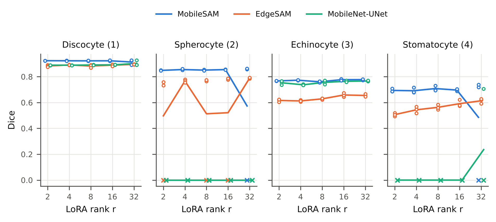
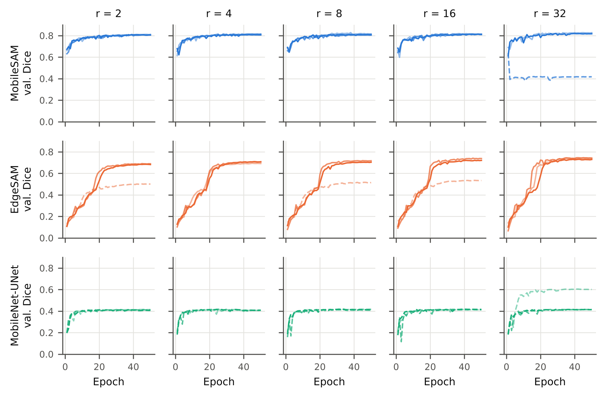
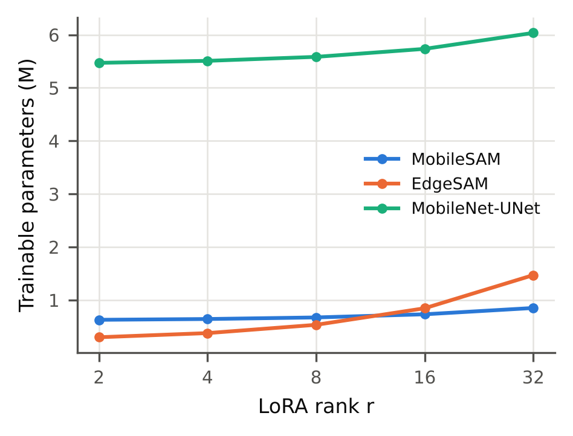
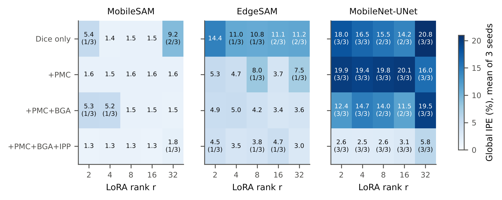
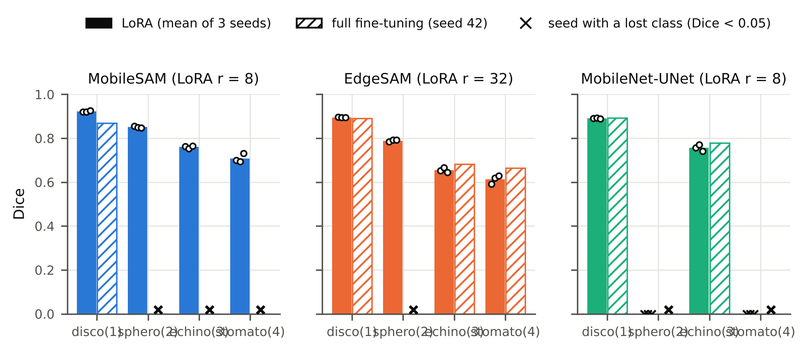
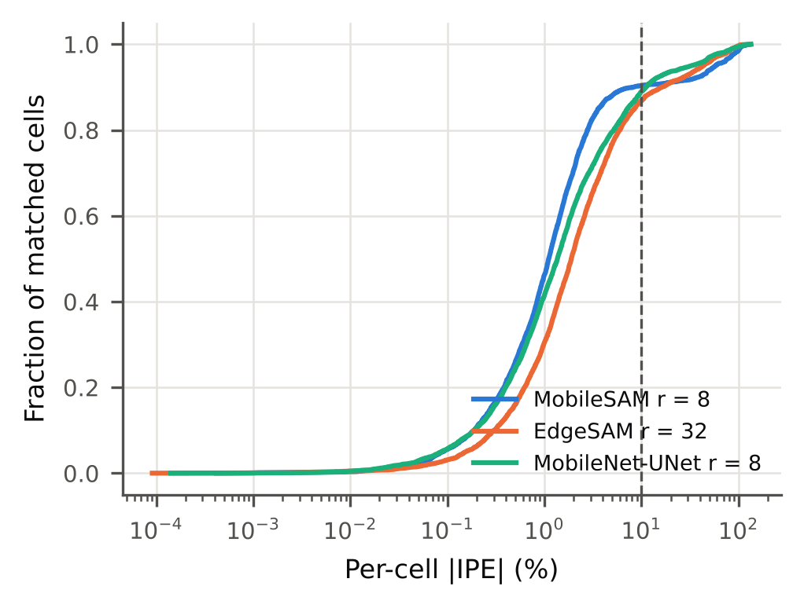
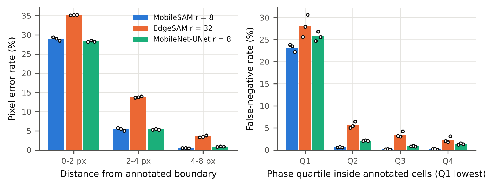
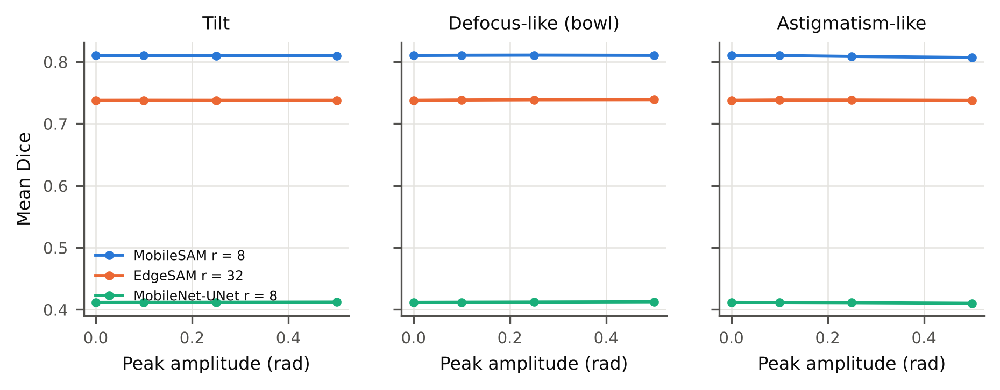
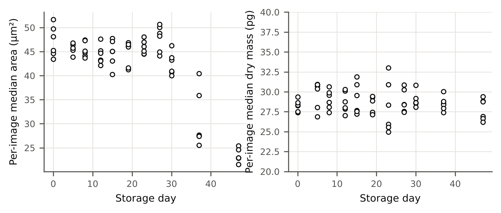
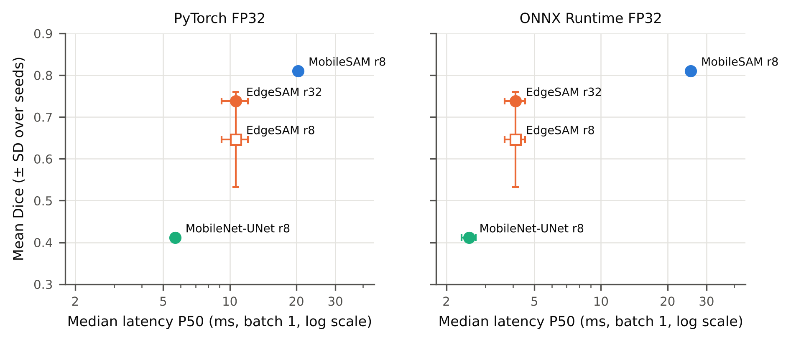

**Supplementary Information**

**Physics-Aware Lightweight Segmentation for Quantitative Holographic Cell Analysis with Optical Mass Preservation**

Usama Ikram^1^, Youhyun Kim^2^, and Inkyu Moon^1,2,\*^

^1^Department of Artificial Intelligence, DGIST, Daegu 42988, South Korea

^2^Department of Robotics & Mechatronics Engineering, DGIST, Daegu 42988, South Korea

^\*^Corresponding author: inkyu.moon@dgist.ac.kr (I. Moon)

[**S-I. Complete LoRA Rank Sweep for All Architectures and Seeds**]{.mark}

[LoRA ranks *r* = 2, 4, 8, 16, and 32 were trained for all three architectures with the full physics-aware objective and three seeds each (Table S2; every seed in Table S3). MobileSAM was stable from *r* = 2 to *r* = 16 (mean Dice 0.808 to 0.813, seed SD at most 0.006); at *r* = 32, seed 43 lost the spherocyte and stomatocyte classes. EdgeSAM improved with rank in AJI and boundary F1-score; at *r* = 2, 8, and 16, seed 44 lost the spherocyte class, while *r* = 4 and *r* = 32 were stable in all seeds. MobileNet-UNet lost the spherocyte class in every run. Seed-paired differences between ranks are given in Table S4; with three seeds their 95% intervals are wide and are reported descriptively. The trainable parameters grow with the rank (Table S5, Fig. S3), whereas the inference cost does not, because the low-rank matrices are merged into the frozen weights before deployment. Per-class Dice against rank is shown in Fig. S1.]{.mark}

[**TABLE S1** Dataset after the corrected preprocessing (32-bit phase, background referenced).]{.mark}

| Item | Value | Source |
|---|---|---|
| Training images (base, with float32 phase map) | 182 | metrics.json n_train_views / 4 |
| Training views (4 lossless 90° rotations per base image) | 728 | metrics.json n_train_views |
| Validation (= evaluation) images | 66 | metrics.json n_val_images |
| Storage days in the validation set | 11 (days 0, 5, 8, 12, 15, 19, 23, 27, 30, 37, 47) | cells_gt.csv |
| Validation images per storage day | 6/6/6/6/6/6/6/6/6/6/6 | cells_gt.csv |
| Annotated cells (area 15-200 µm², not cut by the annotated field of view) | 2049 | compiled cell_analysis annotation |
|   of which phase-wrapped (excluded from phase-derived results, D-21) | 61 (3.0%) in 29 images | compiled cell_analysis annotation |
| Annotated cells used for phase-derived results | 1988 | compiled cell_analysis annotation |
|   discocyte (1): cells (wrapped) | 1450 (8, 0.6%) | compiled cell_analysis annotation |
|   spherocyte (2): cells (wrapped) | 259 (14, 5.4%) | compiled cell_analysis annotation |
|   echinocyte (3): cells (wrapped) | 230 (28, 12.2%) | compiled cell_analysis annotation |
|   stomatocyte (4): cells (wrapped) | 110 (11, 10.0%) | compiled cell_analysis annotation |
| Peak phase of the non-wrapped annotated cells, background-referenced (rad): median (5th to 95th percentile), max | 2.15 (1.52 to 4.16), 5.05 | cells_gt.csv max_phase_rad |

[**TABLE S2** Complete LoRA rank sweep, all architectures (full physics-aware objective, mean ± SD over seeds 42, 43, 44; numbers in parentheses are mask values).]{.mark}

| Architecture | LoRA rank | Trainable params | Mean Dice | Mean IoU | AJI | Boundary F1 | Global IPE (%) | Dice discocyte (1) | Dice spherocyte (2) | Dice echinocyte (3) | Dice stomatocyte (4) | Runs with a lost class |
|---|---|---|---|---|---|---|---|---|---|---|---|---|
| MobileSAM | 2 | 0.63 M (9.4%) | 0.808 ± 0.003 | 0.687 ± 0.004 | 0.264 ± 0.013 | 0.801 ± 0.006 | 1.30 ± 0.09 | 0.924 ± 0.000 | 0.848 ± 0.002 | 0.767 ± 0.001 | 0.694 ± 0.013 | 0/3 |
| MobileSAM | 4 | 0.64 M (9.6%) | 0.811 ± 0.004 | 0.691 ± 0.005 | 0.268 ± 0.037 | 0.803 ± 0.002 | 1.34 ± 0.07 | 0.923 ± 0.002 | 0.855 ± 0.005 | 0.773 ± 0.003 | 0.691 ± 0.021 | 0/3 |
| MobileSAM | 8 | 0.67 M (10.0%) | 0.810 ± 0.006 | 0.690 ± 0.008 | 0.262 ± 0.017 | 0.802 ± 0.011 | 1.32 ± 0.09 | 0.923 ± 0.003 | 0.851 ± 0.004 | 0.760 ± 0.006 | 0.708 ± 0.020 | 0/3 |
| MobileSAM | 16 | 0.73 M (10.8%) | 0.813 ± 0.002 | 0.693 ± 0.002 | 0.279 ± 0.054 | 0.801 ± 0.013 | 1.29 ± 0.18 | 0.923 ± 0.003 | 0.855 ± 0.002 | 0.777 ± 0.007 | 0.696 ± 0.009 | 0/3 |
| MobileSAM | 32 | 0.85 M (12.3%) | 0.687 ± 0.234 | 0.590 ± 0.200 | 0.283 ± 0.020 | 0.794 ± 0.023 | 1.76 ± 0.53 | 0.913 ± 0.020 | 0.574 ± 0.497 | 0.777 ± 0.004 | 0.485 ± 0.420 | 1/3 (s43: sphero(2), stomato(4)) |
| EdgeSAM | 2 | 0.30 M (5.2%) | 0.625 ± 0.108 | 0.493 ± 0.087 | 0.249 ± 0.017 | 0.598 ± 0.020 | 4.45 ± 2.71 | 0.882 ± 0.008 | 0.497 ± 0.431 | 0.616 ± 0.010 | 0.506 ± 0.013 | 1/3 (s44: sphero(2)) |
| EdgeSAM | 4 | 0.38 M (6.5%) | 0.703 ± 0.009 | 0.560 ± 0.010 | 0.252 ± 0.021 | 0.615 ± 0.012 | 3.48 ± 0.91 | 0.891 ± 0.002 | 0.766 ± 0.013 | 0.612 ± 0.007 | 0.544 ± 0.025 | 0/3 |
| EdgeSAM | 8 | 0.53 M (8.9%) | 0.647 ± 0.114 | 0.514 ± 0.095 | 0.249 ± 0.043 | 0.608 ± 0.009 | 3.81 ± 1.82 | 0.882 ± 0.012 | 0.513 ± 0.444 | 0.628 ± 0.006 | 0.563 ± 0.019 | 1/3 (s44: sphero(2)) |
| EdgeSAM | 16 | 0.85 M (13.4%) | 0.665 ± 0.114 | 0.535 ± 0.095 | 0.277 ± 0.022 | 0.623 ± 0.024 | 4.66 ± 3.53 | 0.890 ± 0.007 | 0.521 ± 0.451 | 0.659 ± 0.015 | 0.591 ± 0.027 | 1/3 (s44: sphero(2)) |
| EdgeSAM | 32 | 1.47 M (21.2%) | 0.738 ± 0.006 | 0.598 ± 0.007 | 0.335 ± 0.020 | 0.642 ± 0.005 | 3.02 ± 0.84 | 0.895 ± 0.001 | 0.789 ± 0.005 | 0.655 ± 0.010 | 0.614 ± 0.019 | 0/3 |
| MobileNet-UNet | 2 | 5.47 M (71.4%) | 0.410 ± 0.004 | 0.351 ± 0.005 | 0.534 ± 0.029 | 0.816 ± 0.006 | 2.61 ± 0.23 | 0.889 ± 0.001 | 0.000 ± 0.000 | 0.753 ± 0.016 | 0.000 ± 0.000 | 3/3 (s42: sphero(2), stomato(4); s43: sphero(2), stomato(4); s44: sphero(2), stomato(4)) |
| MobileNet-UNet | 4 | 5.51 M (71.6%) | 0.406 ± 0.002 | 0.346 ± 0.002 | 0.560 ± 0.035 | 0.805 ± 0.006 | 2.50 ± 0.19 | 0.889 ± 0.001 | 0.000 ± 0.000 | 0.737 ± 0.005 | 0.000 ± 0.000 | 3/3 (s42: sphero(2), stomato(4); s43: sphero(2), stomato(4); s44: sphero(2), stomato(4)) |
| MobileNet-UNet | 8 | 5.58 M (71.8%) | 0.412 ± 0.004 | 0.353 ± 0.006 | 0.551 ± 0.053 | 0.814 ± 0.003 | 2.60 ± 0.07 | 0.891 ± 0.002 | 0.000 ± 0.000 | 0.756 ± 0.015 | 0.000 ± 0.000 | 3/3 (s42: sphero(2), stomato(4); s43: sphero(2), stomato(4); s44: sphero(2), stomato(4)) |
| MobileNet-UNet | 16 | 5.73 M (72.4%) | 0.414 ± 0.002 | 0.356 ± 0.002 | 0.505 ± 0.012 | 0.805 ± 0.009 | 3.09 ± 0.65 | 0.892 ± 0.001 | 0.000 ± 0.000 | 0.764 ± 0.006 | 0.000 ± 0.000 | 3/3 (s42: sphero(2), stomato(4); s43: sphero(2), stomato(4); s44: sphero(2), stomato(4)) |
| MobileNet-UNet | 32 | 6.04 M (73.4%) | 0.476 ± 0.108 | 0.407 ± 0.089 | 0.541 ± 0.049 | 0.824 ± 0.014 | 5.83 ± 5.75 | 0.903 ± 0.022 | 0.000 ± 0.000 | 0.767 ± 0.003 | 0.236 ± 0.408 | 3/3 (s42: sphero(2), stomato(4); s43: sphero(2), stomato(4); s44: sphero(2)) |

[**TABLE S3** Rank sweep: every seed (full objective). Lost classes are named per seed.]{.mark}

| Architecture | LoRA rank | Seed | Mean Dice | Mean IoU | AJI | Boundary F1 | Global IPE (%) | Dice discocyte (1) | Dice spherocyte (2) | Dice echinocyte (3) | Dice stomatocyte (4) | Lost classes |
|---|---|---|---|---|---|---|---|---|---|---|---|---|
| EdgeSAM | 2 | 42 | 0.685 | 0.540 | 0.257 | 0.621 | 2.86 | 0.891 | 0.733 | 0.620 | 0.494 | none |
| EdgeSAM | 2 | 43 | 0.691 | 0.546 | 0.230 | 0.592 | 2.93 | 0.882 | 0.758 | 0.605 | 0.520 | none |
| EdgeSAM | 2 | 44 | 0.501 | 0.392 | 0.260 | 0.582 | 7.58 | 0.874 | 0.000 | 0.623 | 0.506 | spherocyte |
| EdgeSAM | 4 | 42 | 0.710 | 0.568 | 0.233 | 0.627 | 2.99 | 0.894 | 0.779 | 0.620 | 0.547 | none |
| EdgeSAM | 4 | 43 | 0.707 | 0.563 | 0.249 | 0.605 | 2.91 | 0.889 | 0.767 | 0.606 | 0.567 | none |
| EdgeSAM | 4 | 44 | 0.693 | 0.549 | 0.275 | 0.611 | 4.53 | 0.891 | 0.754 | 0.611 | 0.517 | none |
| EdgeSAM | 8 | 42 | 0.706 | 0.562 | 0.224 | 0.615 | 3.13 | 0.891 | 0.765 | 0.621 | 0.545 | none |
| EdgeSAM | 8 | 43 | 0.719 | 0.575 | 0.225 | 0.611 | 2.43 | 0.887 | 0.774 | 0.632 | 0.583 | none |
| EdgeSAM | 8 | 44 | 0.515 | 0.405 | 0.299 | 0.598 | 5.87 | 0.869 | 0.000 | 0.632 | 0.561 | spherocyte |
| EdgeSAM | 16 | 42 | 0.722 | 0.580 | 0.274 | 0.636 | 2.90 | 0.894 | 0.777 | 0.644 | 0.573 | none |
| EdgeSAM | 16 | 43 | 0.740 | 0.599 | 0.257 | 0.639 | 2.37 | 0.893 | 0.786 | 0.657 | 0.622 | none |
| EdgeSAM | 16 | 44 | 0.533 | 0.426 | 0.301 | 0.596 | 8.73 | 0.881 | 0.000 | 0.674 | 0.578 | spherocyte |
| EdgeSAM | 32 | 42 | 0.731 | 0.590 | 0.329 | 0.647 | 2.66 | 0.896 | 0.784 | 0.652 | 0.593 | none |
| EdgeSAM | 32 | 43 | 0.743 | 0.603 | 0.320 | 0.642 | 2.41 | 0.894 | 0.791 | 0.666 | 0.619 | none |
| EdgeSAM | 32 | 44 | 0.740 | 0.600 | 0.358 | 0.638 | 3.98 | 0.894 | 0.793 | 0.645 | 0.629 | none |
| MobileNet-UNet | 2 | 42 | 0.406 | 0.346 | 0.538 | 0.809 | 2.73 | 0.889 | 0.000 | 0.736 | 0.000 | spherocyte stomatocyte |
| MobileNet-UNet | 2 | 43 | 0.411 | 0.351 | 0.561 | 0.820 | 2.75 | 0.888 | 0.000 | 0.756 | 0.000 | spherocyte stomatocyte |
| MobileNet-UNet | 2 | 44 | 0.414 | 0.356 | 0.504 | 0.820 | 2.34 | 0.890 | 0.000 | 0.767 | 0.000 | spherocyte stomatocyte |
| MobileNet-UNet | 4 | 42 | 0.408 | 0.348 | 0.569 | 0.801 | 2.39 | 0.889 | 0.000 | 0.743 | 0.000 | spherocyte stomatocyte |
| MobileNet-UNet | 4 | 43 | 0.406 | 0.345 | 0.590 | 0.802 | 2.72 | 0.889 | 0.000 | 0.735 | 0.000 | spherocyte stomatocyte |
| MobileNet-UNet | 4 | 44 | 0.405 | 0.344 | 0.522 | 0.812 | 2.39 | 0.887 | 0.000 | 0.734 | 0.000 | spherocyte stomatocyte |
| MobileNet-UNet | 8 | 42 | 0.412 | 0.353 | 0.603 | 0.816 | 2.52 | 0.891 | 0.000 | 0.757 | 0.000 | spherocyte stomatocyte |
| MobileNet-UNet | 8 | 43 | 0.416 | 0.359 | 0.497 | 0.810 | 2.66 | 0.893 | 0.000 | 0.771 | 0.000 | spherocyte stomatocyte |
| MobileNet-UNet | 8 | 44 | 0.407 | 0.347 | 0.552 | 0.815 | 2.63 | 0.888 | 0.000 | 0.741 | 0.000 | spherocyte stomatocyte |
| MobileNet-UNet | 16 | 42 | 0.413 | 0.355 | 0.511 | 0.815 | 2.37 | 0.890 | 0.000 | 0.763 | 0.000 | spherocyte stomatocyte |
| MobileNet-UNet | 16 | 43 | 0.416 | 0.358 | 0.513 | 0.801 | 3.63 | 0.893 | 0.000 | 0.770 | 0.000 | spherocyte stomatocyte |
| MobileNet-UNet | 16 | 44 | 0.413 | 0.354 | 0.491 | 0.799 | 3.28 | 0.892 | 0.000 | 0.759 | 0.000 | spherocyte stomatocyte |
| MobileNet-UNet | 32 | 42 | 0.414 | 0.355 | 0.500 | 0.832 | 2.54 | 0.890 | 0.000 | 0.765 | 0.000 | spherocyte stomatocyte |
| MobileNet-UNet | 32 | 43 | 0.414 | 0.356 | 0.528 | 0.808 | 2.49 | 0.891 | 0.000 | 0.765 | 0.000 | spherocyte stomatocyte |
| MobileNet-UNet | 32 | 44 | 0.601 | 0.510 | 0.595 | 0.831 | 12.47 | 0.928 | 0.000 | 0.770 | 0.707 | spherocyte |
| MobileSAM | 2 | 42 | 0.806 | 0.685 | 0.261 | 0.801 | 1.38 | 0.923 | 0.849 | 0.766 | 0.687 | none |
| MobileSAM | 2 | 43 | 0.807 | 0.685 | 0.278 | 0.795 | 1.21 | 0.924 | 0.850 | 0.767 | 0.685 | none |
| MobileSAM | 2 | 44 | 0.812 | 0.691 | 0.253 | 0.808 | 1.31 | 0.924 | 0.847 | 0.768 | 0.709 | none |
| MobileSAM | 4 | 42 | 0.807 | 0.686 | 0.227 | 0.803 | 1.42 | 0.924 | 0.854 | 0.773 | 0.678 | none |
| MobileSAM | 4 | 43 | 0.815 | 0.696 | 0.298 | 0.802 | 1.28 | 0.925 | 0.851 | 0.770 | 0.715 | none |
| MobileSAM | 4 | 44 | 0.809 | 0.689 | 0.280 | 0.805 | 1.33 | 0.921 | 0.861 | 0.775 | 0.680 | none |
| MobileSAM | 8 | 42 | 0.810 | 0.689 | 0.243 | 0.792 | 1.42 | 0.921 | 0.855 | 0.763 | 0.700 | none |
| MobileSAM | 8 | 43 | 0.805 | 0.682 | 0.274 | 0.801 | 1.30 | 0.921 | 0.850 | 0.754 | 0.693 | none |
| MobileSAM | 8 | 44 | 0.817 | 0.698 | 0.268 | 0.813 | 1.24 | 0.926 | 0.847 | 0.764 | 0.730 | none |
| MobileSAM | 16 | 42 | 0.811 | 0.691 | 0.221 | 0.803 | 1.41 | 0.922 | 0.855 | 0.778 | 0.687 | none |
| MobileSAM | 16 | 43 | 0.814 | 0.695 | 0.287 | 0.787 | 1.08 | 0.921 | 0.856 | 0.783 | 0.697 | none |
| MobileSAM | 16 | 44 | 0.813 | 0.694 | 0.328 | 0.813 | 1.37 | 0.926 | 0.852 | 0.770 | 0.705 | none |
| MobileSAM | 32 | 42 | 0.818 | 0.699 | 0.266 | 0.799 | 1.51 | 0.923 | 0.857 | 0.772 | 0.718 | none |
| MobileSAM | 32 | 43 | 0.417 | 0.360 | 0.306 | 0.768 | 2.36 | 0.890 | 0.000 | 0.779 | 0.000 | spherocyte stomatocyte |
| MobileSAM | 32 | 44 | 0.827 | 0.712 | 0.278 | 0.815 | 1.40 | 0.927 | 0.863 | 0.780 | 0.738 | none |

[**TABLE S4** Rank sweep: seed-paired differences to *r* = 8 and to *r* = 32 (mean [95% t-interval], n = 3; * interval excludes 0).]{.mark}

| Architecture | Comparison | Δ Mean Dice | Δ AJI | Δ Boundary F1 | Δ Global IPE (pp) |
|---|---|---|---|---|---|
| MobileSAM | r2 − r8 | -0.002 [-0.012, +0.007] | +0.002 [-0.039, +0.044] | -0.000 [-0.022, +0.022] | -0.02 [-0.23, +0.19] |
| MobileSAM | r4 − r8 | +0.000 [-0.024, +0.024] | +0.006 [-0.044, +0.057] | +0.002 [-0.022, +0.025] | +0.03 [-0.13, +0.18] |
| MobileSAM | r16 − r8 | +0.002 [-0.015, +0.019] | +0.017 [-0.086, +0.120] | -0.001 [-0.031, +0.030] | -0.03 [-0.46, +0.40] |
| MobileSAM | r32 − r8 | -0.123 [-0.691, +0.445] | +0.022 [-0.005, +0.048] | -0.008 [-0.061, +0.045] | +0.44 [-0.91, +1.78] |
| MobileSAM | r2 − r32 | +0.121 [-0.457, +0.698] | -0.019 [-0.051, +0.013] | +0.007 [-0.035, +0.050] | -0.46 [-1.96, +1.04] |
| MobileSAM | r4 − r32 | +0.123 [-0.468, +0.714] | -0.015 [-0.068, +0.038] | +0.009 [-0.044, +0.063] | -0.41 [-1.85, +1.03] |
| MobileSAM | r8 − r32 | +0.123 [-0.445, +0.691] | -0.022 [-0.048, +0.005] | +0.008 [-0.045, +0.061] | -0.44 [-1.78, +0.91] |
| MobileSAM | r16 − r32 | +0.125 [-0.459, +0.710] | -0.005 [-0.127, +0.118] | +0.007 [-0.019, +0.034] | -0.47 [-2.21, +1.27] |
| EdgeSAM | r2 − r8 | -0.021 [-0.037, -0.005] * | -0.001 [-0.090, +0.089] | -0.010 [-0.044, +0.024] | +0.64 [-1.84, +3.13] |
| EdgeSAM | r4 − r8 | +0.057 [-0.204, +0.318] | +0.003 [-0.057, +0.063] | +0.007 [-0.020, +0.034] | -0.34 [-2.64, +1.97] |
| EdgeSAM | r16 − r8 | +0.019 [+0.013, +0.024] * | +0.028 [-0.032, +0.087] | +0.016 [-0.022, +0.053] | +0.85 [-3.47, +5.18] |
| EdgeSAM | r32 − r8 | +0.091 [-0.196, +0.379] | +0.086 [+0.026, +0.146] * | +0.034 [+0.022, +0.046] * | -0.80 [-3.22, +1.62] |
| EdgeSAM | r2 − r32 | -0.113 [-0.386, +0.161] | -0.087 [-0.119, -0.054] * | -0.044 [-0.083, -0.005] * | +1.44 [-3.23, +6.10] |
| EdgeSAM | r4 − r32 | -0.035 [-0.067, -0.002] * | -0.083 [-0.115, -0.051] * | -0.027 [-0.049, -0.006] * | +0.46 [+0.18, +0.74] * |
| EdgeSAM | r8 − r32 | -0.091 [-0.379, +0.196] | -0.086 [-0.146, -0.026] * | -0.034 [-0.046, -0.022] * | +0.80 [-1.62, +3.22] |
| EdgeSAM | r16 − r32 | -0.073 [-0.361, +0.215] | -0.058 [-0.068, -0.048] * | -0.019 [-0.069, +0.031] | +1.65 [-5.04, +8.33] |
| MobileNet-UNet | r2 − r8 | -0.001 [-0.019, +0.016] | -0.016 [-0.190, +0.157] | +0.002 [-0.020, +0.024] | +0.00 [-0.65, +0.65] |
| MobileNet-UNet | r4 − r8 | -0.005 [-0.016, +0.005] | +0.010 [-0.170, +0.189] | -0.009 [-0.023, +0.005] | -0.10 [-0.48, +0.27] |
| MobileNet-UNet | r16 − r8 | +0.002 [-0.005, +0.009] | -0.046 [-0.185, +0.094] | -0.008 [-0.027, +0.011] | +0.49 [-0.94, +1.92] |
| MobileNet-UNet | r32 − r8 | +0.065 [-0.214, +0.343] | -0.010 [-0.211, +0.191] | +0.010 [-0.015, +0.035] | +3.23 [-10.99, +17.45] |
| MobileNet-UNet | r2 − r32 | -0.066 [-0.326, +0.195] | -0.007 [-0.188, +0.175] | -0.008 [-0.052, +0.036] | -3.23 [-18.07, +11.62] |
| MobileNet-UNet | r4 − r32 | -0.070 [-0.341, +0.202] | +0.020 [-0.179, +0.218] | -0.019 [-0.049, +0.011] | -3.33 [-17.85, +11.18] |
| MobileNet-UNet | r8 − r32 | -0.065 [-0.343, +0.214] | +0.010 [-0.191, +0.211] | -0.010 [-0.035, +0.015] | -3.23 [-17.45, +10.99] |
| MobileNet-UNet | r16 − r32 | -0.062 [-0.334, +0.209] | -0.036 [-0.185, +0.114] | -0.019 [-0.050, +0.013] | -2.74 [-16.71, +11.24] |

[**TABLE S5** Trainable parameters by LoRA rank.]{.mark}

| Architecture | LoRA rank | Total params (training form) | Trainable params | Trainable (%) | Encoder trainable (%) |
|---|---|---|---|---|---|
| EdgeSAM | 2 | 5,770,087 | 299,959 | 5.20 | 2.24 |
| EdgeSAM | 4 | 5,848,169 | 378,041 | 6.46 | 3.58 |
| EdgeSAM | 8 | 6,004,333 | 534,205 | 8.90 | 6.16 |
| EdgeSAM | 16 | 6,316,661 | 846,533 | 13.40 | 10.94 |
| EdgeSAM | 32 | 6,941,317 | 1,471,189 | 21.19 | 19.16 |
| MobileSAM | 2 | 6,675,388 | 628,640 | 9.42 | 0.54 |
| MobileSAM | 4 | 6,690,236 | 643,488 | 9.62 | 0.79 |
| MobileSAM | 8 | 6,719,932 | 673,184 | 10.02 | 1.27 |
| MobileSAM | 16 | 6,779,324 | 732,576 | 10.81 | 2.22 |
| MobileSAM | 32 | 6,898,108 | 851,360 | 12.34 | 4.06 |
| MobileNet-UNet | 2 | 7,660,455 | 5,471,271 | 71.42 | 3.17 |
| MobileNet-UNet | 4 | 7,698,089 | 5,508,905 | 71.56 | 4.76 |
| MobileNet-UNet | 8 | 7,773,357 | 5,584,173 | 71.84 | 7.78 |
| MobileNet-UNet | 16 | 7,923,893 | 5,734,709 | 72.37 | 13.28 |
| MobileNet-UNet | 32 | 8,224,965 | 6,035,781 | 73.38 | 22.52 |
| MobileSAM | full FT | 6,660,540 | 6,660,540 | 100.00 | 100.00 |
| EdgeSAM | full FT | 5,692,005 | 5,692,005 | 100.00 | 100.00 |
| MobileNet-UNet | full FT | 7,622,821 | 7,622,821 | 100.00 | 100.00 |

{width=6.5in}

[**Fig. S1** Per-class Dice against LoRA rank (full objective). Lines: mean over three seeds; circles: seeds; crosses: seeds in which the class was lost.]{.mark}

{width=6.5in}

[**Fig. S2** Validation Dice during training for every rank and seed (full objective). Dashed lines: runs that lost a class.]{.mark}

{width=6.5in}

[**Fig. S3** Trainable parameters against LoRA rank.]{.mark}

[**S-II. Training Stability**]{.mark}

[Fig. S2 shows the validation Dice per epoch for every rank and seed. Two failure modes occurred. In MobileSAM at *r* = 32 (seed 43), the Dice fell after the first epoch and never recovered (loss of two classes). In EdgeSAM, the Dice of all runs increased in a step between about epochs 15 and 25; in the failed runs (seed 44 at *r* = 2, 8, and 16) this step did not occur and the spherocyte class was never learned. A class is counted as lost when its Dice is below 0.05; Table 2 of the main text lists every lost class.]{.mark}

[**S-III. Physics-Aware Loss Ablation at Every Rank**]{.mark}

[Table S6 lists the four objectives at every rank and Table S7 the seed-paired differences. The full objective had a lower mean global IPE than Dice-only training in all 15 architecture-rank combinations (95% interval excluding zero in 3); adding IPP to Dice + PMC + BGA lowered the mean IPE in 13 of 15 (interval excluding zero in 1); PMC and BGA alone changed the IPE in no consistent direction (8 and 11 of 15). Fig. S4 summarizes the mean IPE and the number of runs that lost a class. Fig. S5 shows the per-class comparison of LoRA and full fine-tuning.]{.mark}

[**TABLE S6** Loss ablation at every LoRA rank (mean ± SD over three seeds).]{.mark}

| Configuration | Objective | Mean Dice | Boundary F1 | AJI | Global IPE (%) | Runs with a lost class |
|---|---|---|---|---|---|---|
| MobileSAM r = 2 | Dice only | 0.741 ± 0.123 | 0.779 ± 0.035 | 0.219 ± 0.036 | 5.35 ± 6.63 | 1/3 (s42: sphero(2)) |
| MobileSAM r = 2 | Dice + PMC | 0.805 ± 0.007 | 0.800 ± 0.003 | 0.228 ± 0.026 | 1.55 ± 0.12 | 0/3 |
| MobileSAM r = 2 | Dice + PMC + BGA | 0.740 ± 0.125 | 0.776 ± 0.036 | 0.237 ± 0.026 | 5.32 ± 6.59 | 1/3 (s42: sphero(2)) |
| MobileSAM r = 2 | Dice + PMC + BGA + IPP (full) | 0.808 ± 0.003 | 0.801 ± 0.006 | 0.264 ± 0.013 | 1.30 ± 0.09 | 0/3 |
| MobileSAM r = 4 | Dice only | 0.811 ± 0.002 | 0.801 ± 0.007 | 0.268 ± 0.025 | 1.44 ± 0.15 | 0/3 |
| MobileSAM r = 4 | Dice + PMC | 0.806 ± 0.006 | 0.799 ± 0.005 | 0.236 ± 0.025 | 1.50 ± 0.13 | 0/3 |
| MobileSAM r = 4 | Dice + PMC + BGA | 0.741 ± 0.122 | 0.783 ± 0.036 | 0.247 ± 0.037 | 5.23 ± 6.58 | 1/3 (s42: sphero(2)) |
| MobileSAM r = 4 | Dice + PMC + BGA + IPP (full) | 0.811 ± 0.004 | 0.803 ± 0.002 | 0.268 ± 0.037 | 1.34 ± 0.07 | 0/3 |
| MobileSAM r = 8 | Dice only | 0.811 ± 0.005 | 0.808 ± 0.012 | 0.248 ± 0.022 | 1.53 ± 0.27 | 0/3 |
| MobileSAM r = 8 | Dice + PMC | 0.813 ± 0.009 | 0.805 ± 0.002 | 0.242 ± 0.035 | 1.60 ± 0.24 | 0/3 |
| MobileSAM r = 8 | Dice + PMC + BGA | 0.813 ± 0.005 | 0.806 ± 0.004 | 0.259 ± 0.034 | 1.48 ± 0.11 | 0/3 |
| MobileSAM r = 8 | Dice + PMC + BGA + IPP (full) | 0.810 ± 0.006 | 0.802 ± 0.011 | 0.262 ± 0.017 | 1.32 ± 0.09 | 0/3 |
| MobileSAM r = 16 | Dice only | 0.813 ± 0.002 | 0.802 ± 0.006 | 0.226 ± 0.008 | 1.54 ± 0.12 | 0/3 |
| MobileSAM r = 16 | Dice + PMC | 0.813 ± 0.007 | 0.811 ± 0.006 | 0.244 ± 0.035 | 1.58 ± 0.24 | 0/3 |
| MobileSAM r = 16 | Dice + PMC + BGA | 0.817 ± 0.003 | 0.807 ± 0.008 | 0.237 ± 0.015 | 1.55 ± 0.12 | 0/3 |
| MobileSAM r = 16 | Dice + PMC + BGA + IPP (full) | 0.813 ± 0.002 | 0.801 ± 0.013 | 0.279 ± 0.054 | 1.29 ± 0.18 | 0/3 |
| MobileSAM r = 32 | Dice only | 0.674 ± 0.126 | 0.770 ± 0.043 | 0.230 ± 0.037 | 9.23 ± 6.63 | 2/3 (s42: sphero(2); s43: sphero(2)) |
| MobileSAM r = 32 | Dice + PMC | 0.817 ± 0.004 | 0.814 ± 0.007 | 0.265 ± 0.017 | 1.58 ± 0.20 | 0/3 |
| MobileSAM r = 32 | Dice + PMC + BGA | 0.818 ± 0.007 | 0.814 ± 0.003 | 0.266 ± 0.019 | 1.46 ± 0.16 | 0/3 |
| MobileSAM r = 32 | Dice + PMC + BGA + IPP (full) | 0.687 ± 0.234 | 0.794 ± 0.023 | 0.283 ± 0.020 | 1.76 ± 0.53 | 1/3 (s43: sphero(2), stomato(4)) |
| EdgeSAM r = 2 | Dice only | 0.576 ± 0.013 | 0.535 ± 0.063 | 0.311 ± 0.034 | 14.42 ± 1.81 | 0/3 |
| EdgeSAM r = 2 | Dice + PMC | 0.710 ± 0.005 | 0.606 ± 0.027 | 0.374 ± 0.061 | 5.26 ± 1.37 | 0/3 |
| EdgeSAM r = 2 | Dice + PMC + BGA | 0.717 ± 0.006 | 0.610 ± 0.021 | 0.385 ± 0.055 | 4.88 ± 1.59 | 0/3 |
| EdgeSAM r = 2 | Dice + PMC + BGA + IPP (full) | 0.625 ± 0.108 | 0.598 ± 0.020 | 0.249 ± 0.017 | 4.45 ± 2.71 | 1/3 (s44: sphero(2)) |
| EdgeSAM r = 4 | Dice only | 0.610 ± 0.085 | 0.476 ± 0.210 | 0.321 ± 0.057 | 10.96 ± 5.30 | 1/3 (s43: sphero(2)) |
| EdgeSAM r = 4 | Dice + PMC | 0.727 ± 0.009 | 0.619 ± 0.021 | 0.363 ± 0.032 | 4.68 ± 1.20 | 0/3 |
| EdgeSAM r = 4 | Dice + PMC + BGA | 0.723 ± 0.011 | 0.614 ± 0.025 | 0.392 ± 0.039 | 4.98 ± 1.57 | 0/3 |
| EdgeSAM r = 4 | Dice + PMC + BGA + IPP (full) | 0.703 ± 0.009 | 0.615 ± 0.012 | 0.252 ± 0.021 | 3.48 ± 0.91 | 0/3 |
| EdgeSAM r = 8 | Dice only | 0.624 ± 0.095 | 0.496 ± 0.209 | 0.334 ± 0.052 | 10.82 ± 5.39 | 1/3 (s43: sphero(2)) |
| EdgeSAM r = 8 | Dice + PMC | 0.672 ± 0.109 | 0.621 ± 0.031 | 0.386 ± 0.033 | 7.97 ± 6.80 | 1/3 (s44: sphero(2)) |
| EdgeSAM r = 8 | Dice + PMC + BGA | 0.735 ± 0.010 | 0.628 ± 0.013 | 0.390 ± 0.046 | 4.25 ± 1.07 | 0/3 |
| EdgeSAM r = 8 | Dice + PMC + BGA + IPP (full) | 0.647 ± 0.114 | 0.608 ± 0.009 | 0.249 ± 0.043 | 3.81 ± 1.82 | 1/3 (s44: sphero(2)) |
| EdgeSAM r = 16 | Dice only | 0.621 ± 0.103 | 0.507 ± 0.221 | 0.315 ± 0.047 | 11.05 ± 5.98 | 2/3 (s43: sphero(2); s44: sphero(2)) |
| EdgeSAM r = 16 | Dice + PMC | 0.741 ± 0.010 | 0.643 ± 0.009 | 0.398 ± 0.077 | 3.71 ± 0.71 | 0/3 |
| EdgeSAM r = 16 | Dice + PMC + BGA | 0.742 ± 0.006 | 0.644 ± 0.009 | 0.339 ± 0.024 | 3.43 ± 0.81 | 0/3 |
| EdgeSAM r = 16 | Dice + PMC + BGA + IPP (full) | 0.665 ± 0.114 | 0.623 ± 0.024 | 0.277 ± 0.022 | 4.66 ± 3.53 | 1/3 (s44: sphero(2)) |
| EdgeSAM r = 32 | Dice only | 0.619 ± 0.109 | 0.519 ± 0.212 | 0.329 ± 0.015 | 11.20 ± 6.46 | 2/3 (s43: sphero(2); s44: sphero(2)) |
| EdgeSAM r = 32 | Dice + PMC | 0.680 ± 0.113 | 0.638 ± 0.027 | 0.388 ± 0.059 | 7.45 ± 7.17 | 1/3 (s44: sphero(2)) |
| EdgeSAM r = 32 | Dice + PMC + BGA | 0.746 ± 0.006 | 0.643 ± 0.011 | 0.406 ± 0.034 | 3.64 ± 0.82 | 0/3 |
| EdgeSAM r = 32 | Dice + PMC + BGA + IPP (full) | 0.738 ± 0.006 | 0.642 ± 0.005 | 0.335 ± 0.020 | 3.02 ± 0.84 | 0/3 |
| MobileNet-UNet r = 2 | Dice only | 0.416 ± 0.004 | 0.790 ± 0.004 | 0.579 ± 0.027 | 17.98 ± 0.40 | 3/3 (s42: sphero(2), stomato(4); s43: sphero(2), stomato(4); s44: sphero(2), stomato(4)) |
| MobileNet-UNet r = 2 | Dice + PMC | 0.413 ± 0.181 | 0.781 ± 0.030 | 0.570 ± 0.050 | 19.88 ± 6.25 | 3/3 (s42: sphero(2), echino(3), stomato(4); s43: sphero(2), stomato(4); s44: sphero(2)) |
| MobileNet-UNet r = 2 | Dice + PMC + BGA | 0.549 ± 0.112 | 0.803 ± 0.015 | 0.647 ± 0.027 | 12.40 ± 6.34 | 3/3 (s42: sphero(2), stomato(4); s43: stomato(4); s44: sphero(2)) |
| MobileNet-UNet r = 2 | Dice + PMC + BGA + IPP (full) | 0.410 ± 0.004 | 0.816 ± 0.006 | 0.534 ± 0.029 | 2.61 ± 0.23 | 3/3 (s42: sphero(2), stomato(4); s43: sphero(2), stomato(4); s44: sphero(2), stomato(4)) |
| MobileNet-UNet r = 4 | Dice only | 0.482 ± 0.109 | 0.799 ± 0.014 | 0.629 ± 0.017 | 16.52 ± 2.83 | 3/3 (s42: sphero(2), stomato(4); s43: sphero(2), stomato(4); s44: sphero(2)) |
| MobileNet-UNet r = 4 | Dice + PMC | 0.417 ± 0.185 | 0.781 ± 0.032 | 0.595 ± 0.075 | 19.39 ± 6.20 | 3/3 (s42: sphero(2), echino(3), stomato(4); s43: sphero(2), stomato(4); s44: sphero(2)) |
| MobileNet-UNet r = 4 | Dice + PMC + BGA | 0.490 ± 0.224 | 0.790 ± 0.043 | 0.560 ± 0.060 | 14.70 ± 10.39 | 3/3 (s42: sphero(2), echino(3), stomato(4); s43: stomato(4); s44: sphero(2)) |
| MobileNet-UNet r = 4 | Dice + PMC + BGA + IPP (full) | 0.406 ± 0.002 | 0.805 ± 0.006 | 0.560 ± 0.035 | 2.50 ± 0.19 | 3/3 (s42: sphero(2), stomato(4); s43: sphero(2), stomato(4); s44: sphero(2), stomato(4)) |
| MobileNet-UNet r = 8 | Dice only | 0.485 ± 0.294 | 0.814 ± 0.054 | 0.623 ± 0.111 | 15.48 ± 12.73 | 2/3 (s42: sphero(2), echino(3), stomato(4); s44: sphero(2), stomato(4)) |
| MobileNet-UNet r = 8 | Dice + PMC | 0.414 ± 0.181 | 0.782 ± 0.022 | 0.585 ± 0.071 | 19.79 ± 6.71 | 3/3 (s42: sphero(2), echino(3), stomato(4); s43: sphero(2), stomato(4); s44: sphero(2)) |
| MobileNet-UNet r = 8 | Dice + PMC + BGA | 0.544 ± 0.292 | 0.812 ± 0.052 | 0.602 ± 0.125 | 13.96 ± 12.46 | 2/3 (s42: sphero(2), echino(3), stomato(4); s44: sphero(2)) |
| MobileNet-UNet r = 8 | Dice + PMC + BGA + IPP (full) | 0.412 ± 0.004 | 0.814 ± 0.003 | 0.551 ± 0.053 | 2.60 ± 0.07 | 3/3 (s42: sphero(2), stomato(4); s43: sphero(2), stomato(4); s44: sphero(2), stomato(4)) |
| MobileNet-UNet r = 16 | Dice only | 0.550 ± 0.297 | 0.815 ± 0.054 | 0.619 ± 0.089 | 14.18 ± 12.75 | 2/3 (s42: sphero(2), echino(3), stomato(4); s44: sphero(2)) |
| MobileNet-UNet r = 16 | Dice + PMC | 0.413 ± 0.176 | 0.781 ± 0.018 | 0.558 ± 0.098 | 20.13 ± 5.77 | 3/3 (s42: sphero(2), echino(3), stomato(4); s43: sphero(2), stomato(4); s44: sphero(2)) |
| MobileNet-UNet r = 16 | Dice + PMC + BGA | 0.612 ± 0.197 | 0.816 ± 0.047 | 0.642 ± 0.033 | 11.50 ± 8.96 | 2/3 (s42: sphero(2); s43: sphero(2), stomato(4)) |
| MobileNet-UNet r = 16 | Dice + PMC + BGA + IPP (full) | 0.414 ± 0.002 | 0.805 ± 0.009 | 0.505 ± 0.012 | 3.09 ± 0.65 | 3/3 (s42: sphero(2), stomato(4); s43: sphero(2), stomato(4); s44: sphero(2), stomato(4)) |
| MobileNet-UNet r = 32 | Dice only | 0.359 ± 0.110 | 0.783 ± 0.020 | 0.592 ± 0.023 | 20.83 ± 5.37 | 3/3 (s42: sphero(2), echino(3), stomato(4); s43: sphero(2), stomato(4); s44: sphero(2), stomato(4)) |
| MobileNet-UNet r = 32 | Dice + PMC | 0.486 ± 0.102 | 0.800 ± 0.013 | 0.599 ± 0.033 | 15.96 ± 2.29 | 3/3 (s42: sphero(2), stomato(4); s43: sphero(2), stomato(4); s44: sphero(2)) |
| MobileNet-UNet r = 32 | Dice + PMC + BGA | 0.418 ± 0.185 | 0.788 ± 0.027 | 0.568 ± 0.078 | 19.54 ± 6.58 | 3/3 (s42: sphero(2), echino(3), stomato(4); s43: sphero(2), stomato(4); s44: sphero(2)) |
| MobileNet-UNet r = 32 | Dice + PMC + BGA + IPP (full) | 0.476 ± 0.108 | 0.824 ± 0.014 | 0.541 ± 0.049 | 5.83 ± 5.75 | 3/3 (s42: sphero(2), stomato(4); s43: sphero(2), stomato(4); s44: sphero(2)) |

[**TABLE S7** Loss ablation: seed-paired differences within each rank, and the direction of the IPE change over the 15 architecture-rank combinations.]{.mark}

| Architecture | LoRA rank | Comparison | Δ Global IPE (pp) | Δ Mean Dice | Δ Boundary F1 |
|---|---|---|---|---|---|
| MobileSAM | 2 | Full − Dice only | -4.06 [-20.36, +12.24] | +0.067 [-0.233, +0.368] | +0.022 [-0.069, +0.112] |
| MobileSAM | 2 | Full − (Dice+PMC+BGA) = IPP | -4.02 [-20.23, +12.19] | +0.068 [-0.238, +0.373] | +0.025 [-0.067, +0.117] |
| MobileSAM | 2 | (Dice+PMC) − Dice only = PMC | -3.80 [-20.03, +12.43] | +0.064 [-0.234, +0.362] | +0.021 [-0.062, +0.103] |
| MobileSAM | 2 | (Dice+PMC+BGA) − (Dice+PMC) = BGA | +3.76 [-12.38, +19.90] | -0.064 [-0.367, +0.238] | -0.024 [-0.109, +0.062] |
| MobileSAM | 4 | Full − Dice only | -0.10 [-0.30, +0.11] | -0.001 [-0.016, +0.014] | +0.002 [-0.017, +0.021] |
| MobileSAM | 4 | Full − (Dice+PMC+BGA) = IPP | -3.89 [-20.06, +12.28] | +0.070 [-0.227, +0.367] | +0.021 [-0.069, +0.110] |
| MobileSAM | 4 | (Dice+PMC) − Dice only = PMC | +0.06 [-0.06, +0.18] | -0.006 [-0.024, +0.013] | -0.003 [-0.022, +0.017] |
| MobileSAM | 4 | (Dice+PMC+BGA) − (Dice+PMC) = BGA | +3.74 [-12.28, +19.76] | -0.065 [-0.357, +0.228] | -0.016 [-0.111, +0.078] |
| MobileSAM | 8 | Full − Dice only | -0.21 [-0.75, +0.33] | -0.000 [-0.017, +0.016] | -0.006 [-0.014, +0.001] |
| MobileSAM | 8 | Full − (Dice+PMC+BGA) = IPP | -0.16 [-0.41, +0.09] | -0.003 [-0.030, +0.024] | -0.004 [-0.027, +0.019] |
| MobileSAM | 8 | (Dice+PMC) − Dice only = PMC | +0.07 [-0.01, +0.14] | +0.002 [-0.027, +0.031] | -0.003 [-0.028, +0.023] |
| MobileSAM | 8 | (Dice+PMC+BGA) − (Dice+PMC) = BGA | -0.12 [-0.47, +0.24] | +0.000 [-0.013, +0.013] | +0.001 [-0.003, +0.005] |
| MobileSAM | 16 | Full − Dice only | -0.26 [-0.55, +0.04] | -0.000 [-0.005, +0.004] | -0.001 [-0.038, +0.036] |
| MobileSAM | 16 | Full − (Dice+PMC+BGA) = IPP | -0.26 [-0.67, +0.14] | -0.004 [-0.010, +0.002] | -0.006 [-0.029, +0.016] |
| MobileSAM | 16 | (Dice+PMC) − Dice only = PMC | +0.04 [-0.45, +0.53] | +0.000 [-0.012, +0.012] | +0.009 [-0.002, +0.020] |
| MobileSAM | 16 | (Dice+PMC+BGA) − (Dice+PMC) = BGA | -0.04 [-0.64, +0.57] | +0.004 [-0.006, +0.013] | -0.003 [-0.009, +0.002] |
| MobileSAM | 32 | Full − Dice only | -7.48 [-23.20, +8.24] | +0.014 [-0.481, +0.509] | +0.024 [-0.043, +0.091] |
| MobileSAM | 32 | Full − (Dice+PMC+BGA) = IPP | +0.29 [-1.32, +1.91] | -0.130 [-0.728, +0.468] | -0.020 [-0.080, +0.041] |
| MobileSAM | 32 | (Dice+PMC) − Dice only = PMC | -7.66 [-24.51, +9.20] | +0.143 [-0.180, +0.466] | +0.044 [-0.048, +0.135] |
| MobileSAM | 32 | (Dice+PMC+BGA) − (Dice+PMC) = BGA | -0.11 [-0.54, +0.31] | +0.001 [-0.017, +0.019] | +0.000 [-0.025, +0.025] |
| EdgeSAM | 2 | Full − Dice only | -9.97 [-18.58, -1.35] * | +0.049 [-0.245, +0.344] | +0.063 [-0.145, +0.270] |
| EdgeSAM | 2 | Full − (Dice+PMC+BGA) = IPP | -0.43 [-4.29, +3.43] | -0.092 [-0.346, +0.163] | -0.012 [-0.020, -0.004] * |
| EdgeSAM | 2 | (Dice+PMC) − Dice only = PMC | -9.15 [-11.50, -6.81] * | +0.134 [+0.115, +0.153] * | +0.071 [-0.140, +0.281] |
| EdgeSAM | 2 | (Dice+PMC+BGA) − (Dice+PMC) = BGA | -0.38 [-2.80, +2.03] | +0.007 [-0.022, +0.035] | +0.004 [-0.041, +0.049] |
| EdgeSAM | 4 | Full − Dice only | -7.48 [-19.64, +4.67] | +0.093 [-0.107, +0.293] | +0.138 [-0.362, +0.638] |
| EdgeSAM | 4 | Full − (Dice+PMC+BGA) = IPP | -1.50 [-4.04, +1.03] | -0.020 [-0.028, -0.012] * | +0.001 [-0.034, +0.036] |
| EdgeSAM | 4 | (Dice+PMC) − Dice only = PMC | -6.28 [-16.49, +3.93] | +0.117 [-0.090, +0.324] | +0.143 [-0.343, +0.628] |
| EdgeSAM | 4 | (Dice+PMC+BGA) − (Dice+PMC) = BGA | +0.30 [-1.68, +2.28] | -0.003 [-0.008, +0.002] | -0.005 [-0.021, +0.011] |
| EdgeSAM | 8 | Full − Dice only | -7.01 [-19.68, +5.66] | +0.023 [-0.306, +0.352] | +0.112 [-0.413, +0.637] |
| EdgeSAM | 8 | Full − (Dice+PMC+BGA) = IPP | -0.44 [-4.77, +3.90] | -0.089 [-0.357, +0.179] | -0.021 [-0.057, +0.016] |
| EdgeSAM | 8 | (Dice+PMC) − Dice only = PMC | -2.84 [-16.76, +11.07] | +0.048 [-0.253, +0.349] | +0.125 [-0.367, +0.618] |
| EdgeSAM | 8 | (Dice+PMC+BGA) − (Dice+PMC) = BGA | -3.73 [-19.07, +11.62] | +0.064 [-0.191, +0.319] | +0.007 [-0.050, +0.065] |
| EdgeSAM | 16 | Full − Dice only | -6.39 [-19.07, +6.29] | +0.045 [-0.229, +0.319] | +0.116 [-0.466, +0.698] |
| EdgeSAM | 16 | Full − (Dice+PMC+BGA) = IPP | +1.23 [-5.74, +8.21] | -0.077 [-0.353, +0.199] | -0.020 [-0.073, +0.033] |
| EdgeSAM | 16 | (Dice+PMC) − Dice only = PMC | -7.34 [-21.59, +6.91] | +0.120 [-0.114, +0.354] | +0.135 [-0.401, +0.672] |
| EdgeSAM | 16 | (Dice+PMC+BGA) − (Dice+PMC) = BGA | -0.28 [-1.34, +0.78] | +0.001 [-0.010, +0.013] | +0.001 [-0.001, +0.003] |
| EdgeSAM | 32 | Full − Dice only | -8.18 [-23.52, +7.15] | +0.119 [-0.166, +0.404] | +0.123 [-0.403, +0.649] |
| EdgeSAM | 32 | Full − (Dice+PMC+BGA) = IPP | -0.63 [-0.75, -0.51] * | -0.008 [-0.039, +0.023] | -0.001 [-0.026, +0.024] |
| EdgeSAM | 32 | (Dice+PMC) − Dice only = PMC | -3.75 [-20.14, +12.65] | +0.061 [-0.192, +0.314] | +0.119 [-0.429, +0.667] |
| EdgeSAM | 32 | (Dice+PMC+BGA) − (Dice+PMC) = BGA | -3.81 [-19.64, +12.02] | +0.066 [-0.209, +0.340] | +0.006 [-0.048, +0.059] |
| MobileNet-UNet | 2 | Full − Dice only | -15.37 [-16.63, -14.12] * | -0.006 [-0.024, +0.013] | +0.026 [+0.000, +0.052] * |
| MobileNet-UNet | 2 | Full − (Dice+PMC+BGA) = IPP | -9.80 [-25.71, +6.12] | -0.139 [-0.410, +0.132] | +0.013 [-0.013, +0.039] |
| MobileNet-UNet | 2 | (Dice+PMC) − Dice only = PMC | +1.90 [-14.43, +18.22] | -0.003 [-0.461, +0.456] | -0.009 [-0.094, +0.077] |
| MobileNet-UNet | 2 | (Dice+PMC+BGA) − (Dice+PMC) = BGA | -7.48 [-24.73, +9.78] | +0.136 [-0.159, +0.431] | +0.022 [-0.043, +0.088] |
| MobileNet-UNet | 4 | Full − Dice only | -14.02 [-20.74, -7.31] * | -0.075 [-0.349, +0.198] | +0.006 [-0.015, +0.026] |
| MobileNet-UNet | 4 | Full − (Dice+PMC+BGA) = IPP | -12.20 [-38.39, +13.99] | -0.083 [-0.644, +0.478] | +0.015 [-0.087, +0.117] |
| MobileNet-UNet | 4 | (Dice+PMC) − Dice only = PMC | +2.87 [-9.35, +15.08] | -0.065 [-0.332, +0.203] | -0.018 [-0.080, +0.044] |
| MobileNet-UNet | 4 | (Dice+PMC+BGA) − (Dice+PMC) = BGA | -4.69 [-23.84, +14.46] | +0.073 [-0.237, +0.382] | +0.009 [-0.051, +0.068] |
| MobileNet-UNet | 8 | Full − Dice only | -12.88 [-44.66, +18.90] | -0.073 [-0.796, +0.650] | -0.000 [-0.143, +0.143] |
| MobileNet-UNet | 8 | Full − (Dice+PMC+BGA) = IPP | -11.36 [-42.49, +19.77] | -0.132 [-0.853, +0.588] | +0.001 [-0.134, +0.137] |
| MobileNet-UNet | 8 | (Dice+PMC) − Dice only = PMC | +4.31 [-23.66, +32.28] | -0.071 [-0.796, +0.654] | -0.031 [-0.154, +0.092] |
| MobileNet-UNet | 8 | (Dice+PMC+BGA) − (Dice+PMC) = BGA | -5.83 [-28.86, +17.19] | +0.130 [-0.436, +0.697] | +0.030 [-0.057, +0.117] |
| MobileNet-UNet | 16 | Full − Dice only | -11.09 [-44.34, +22.17] | -0.136 [-0.871, +0.598] | -0.009 [-0.162, +0.143] |
| MobileNet-UNet | 16 | Full − (Dice+PMC+BGA) = IPP | -8.40 [-30.79, +13.98] | -0.198 [-0.691, +0.295] | -0.011 [-0.141, +0.119] |
| MobileNet-UNet | 16 | (Dice+PMC) − Dice only = PMC | +5.95 [-16.92, +28.82] | -0.138 [-0.697, +0.422] | -0.034 [-0.128, +0.061] |
| MobileNet-UNet | 16 | (Dice+PMC+BGA) − (Dice+PMC) = BGA | -8.63 [-28.00, +10.74] | +0.199 [-0.264, +0.661] | +0.035 [-0.070, +0.141] |
| MobileNet-UNet | 32 | Full − Dice only | -15.00 [-40.27, +10.28] | +0.117 [-0.156, +0.390] | +0.041 [-0.030, +0.112] |
| MobileNet-UNet | 32 | Full − (Dice+PMC+BGA) = IPP | -13.71 [-42.50, +15.08] | +0.058 [-0.208, +0.324] | +0.036 [-0.042, +0.114] |
| MobileNet-UNet | 32 | (Dice+PMC) − Dice only = PMC | -4.87 [-17.45, +7.71] | +0.126 [-0.137, +0.390] | +0.017 [-0.040, +0.075] |
| MobileNet-UNet | 32 | (Dice+PMC+BGA) − (Dice+PMC) = BGA | +3.58 [-11.01, +18.18] | -0.067 [-0.340, +0.205] | -0.012 [-0.074, +0.050] |

{width=6.5in}

[**Fig. S4** Global IPE (mean over three seeds) of every architecture, objective, and rank; in brackets, the number of runs that lost a class.]{.mark}

{width=6.5in}

[**Fig. S5** Per-class Dice of LoRA (preferred rank, three seeds) and full fine-tuning (seed 42). Crosses: lost classes.]{.mark}

[**S-IV. Integrated-Phase Errors: Classes, Strata, and Individual Cells**]{.mark}

[Accurate boundary localization is particularly important in quantitative phase imaging (QPI) because dilation or erosion of the predicted cellular region directly affects the integrated phase used for subsequent quantitative analysis. For the preferred configurations and MobileNet-UNet, segmentation errors were concentrated at the cell boundary (pixel error rate 28 to 35% within 2 pixels of the annotated boundary, below 4% beyond 4 pixels) and among the low-phase pixels of each cell (false-negative rate 23 to 28% in the lowest phase quartile, below 6% in the others) (Table S9, Fig. S7). Adding IPP did not change this low-phase deficit consistently (EdgeSAM *r* = 32: −4.0 percentage points; MobileSAM *r* = 8: +2.4, interval including zero). Class-specific IPE (Table S8) is dominated by confusion between morphologies; the class-agnostic global IPE measures the preservation of the integrated phase. The distribution of the per-cell IPE is shown in Fig. S6, and Fig. S8 shows predicted contours on the phase-gradient map.]{.mark}

[**TABLE S8** Class-specific integrated-phase error (%) and Dice.]{.mark}

| Configuration | IPE discocyte (1) | IPE spherocyte (2) | IPE echinocyte (3) | IPE stomatocyte (4) | Dice discocyte (1) | Dice spherocyte (2) | Dice echinocyte (3) | Dice stomatocyte (4) |
|---|---|---|---|---|---|---|---|---|
| MobileSAM r = 8 | 7.2 ± 0.6 | 22.1 ± 1.2 | 28.7 ± 4.2 | 55.2 ± 3.4 | 0.923 ± 0.003 | 0.851 ± 0.004 | 0.760 ± 0.006 | 0.708 ± 0.020 |
| EdgeSAM r = 32 | 6.4 ± 0.3 | 24.2 ± 4.2 | 28.7 ± 0.6 | 52.2 ± 2.7 | 0.895 ± 0.001 | 0.789 ± 0.005 | 0.655 ± 0.010 | 0.614 ± 0.019 |
| EdgeSAM r = 8 | 22.5 ± 27.3 | 51.5 ± 42.0 | 34.3 ± 2.6 | 49.6 ± 7.3 | 0.882 ± 0.012 | 0.513 ± 0.444 | 0.628 ± 0.006 | 0.563 ± 0.019 |
| MobileSAM r = 32 | 27.7 ± 37.3 | 46.6 ± 46.3 | 28.0 ± 4.2 | 65.5 ± 29.8 | 0.913 ± 0.020 | 0.574 ± 0.497 | 0.777 ± 0.004 | 0.485 ± 0.420 |
| MobileNet-UNet r = 8 | 79.5 ± 4.9 | 100.0 ± 0.0 | 28.2 ± 3.4 | 100.0 ± 0.0 | 0.891 ± 0.002 | 0.000 ± 0.000 | 0.756 ± 0.015 | 0.000 ± 0.000 |
| MobileSAM full FT (seed 42) | 129.6 | 100.0 | 100.0 | 100.0 | 0.869 | 0.000 | 0.000 | 0.000 |
| EdgeSAM full FT (seed 42) | 25.4 | 100.0 | 30.0 | 41.5 | 0.892 | 0.000 | 0.681 | 0.665 |
| MobileNet-UNet full FT (seed 42) | 76.2 | 100.0 | 26.1 | 100.0 | 0.893 | 0.000 | 0.778 | 0.000 |

[**TABLE S9** Where segmentation errors occur (pixel error by distance to the annotated boundary; false-negative rate by phase quartile), and the effect of IPP on low-phase misses.]{.mark}

| Configuration | pixel error, band 0-2 px | pixel error, band 2-4 px | pixel error, band 4-8 px | FN rate, phase Q Q1 | FN rate, phase Q Q2 | FN rate, phase Q Q3 | FN rate, phase Q Q4 |
|---|---|---|---|---|---|---|---|
| MobileSAM r = 8 | 28.9 ± 0.4 | 5.4 ± 0.4 | 0.5 ± 0.1 | 23.2 ± 0.8 | 0.6 ± 0.1 | 0.2 ± 0.0 | 0.2 ± 0.1 |
| EdgeSAM r = 32 | 35.2 ± 0.1 | 13.8 ± 0.2 | 3.5 ± 0.3 | 28.0 ± 2.5 | 5.6 ± 0.7 | 3.5 ± 0.6 | 2.3 ± 0.7 |
| EdgeSAM r = 8 | 36.4 ± 0.1 | 15.7 ± 0.3 | 4.3 ± 0.4 | 26.0 ± 5.1 | 5.5 ± 1.4 | 3.6 ± 1.5 | 2.8 ± 1.7 |
| MobileNet-UNet r = 8 | 28.3 ± 0.2 | 5.4 ± 0.1 | 0.9 ± 0.1 | 25.7 ± 1.1 | 2.1 ± 0.1 | 0.9 ± 0.1 | 1.3 ± 0.2 |

{width=6.5in}

[**Fig. S6** Cumulative distribution of the per-cell |IPE| of matched, non-wrapped cells (three seeds pooled).]{.mark}

{width=6.5in}

[**Fig. S7** Pixel error rate by distance from the annotated boundary (left) and false-negative rate by phase quartile inside annotated cells (right).]{.mark}

[FIGURE NOT YET GENERATED: si/FQS1_gradient_alignment.png. Run `python artifacts/code/make_qualitative_figures.py` on the server (needs data/processed), then rebuild.]{.mark}

[**Fig. S8** Alignment of predicted cell contours with quantitative phase gradients. Left: background-referenced phase map; center: phase-gradient magnitude; right: contours of MobileSAM (*r* = 8) and EdgeSAM (*r* = 32) on the gradient map.]{.mark}

[**S-V. Background Reference and Robustness to Background Phase Variations**]{.mark}

[The validation phase maps had background levels between 0.66 and 2.50 rad as provided. Without background referencing, the global IPE of MobileSAM (*r* = 8) would be 2.06% instead of 1.32% (Table S10); estimating the background from the predicted instead of the annotated mask changed it by less than 0.01 percentage points. Adding synthetic tilt, defocus-like, and astigmatism-like fields of up to 0.5 rad changed the mean Dice by at most 0.003 and the background-corrected IPE by at most 0.1 percentage points (Table S11, Fig. S9). Constant offsets are removed by the per-image standardization of the network input, so they do not test robustness.]{.mark}

[**TABLE S10** Global IPE under different background references.]{.mark}

| Configuration | Background from annotation (%) | Background from prediction (%) | No reference, phase as provided (%) | Residual background, max \|rad\| |
|---|---|---|---|---|
| MobileSAM r = 8 | 1.32 ± 0.09 | 1.32 ± 0.09 | 2.06 ± 0.16 | 0.0112 ± 0.0026 |
| EdgeSAM r = 32 | 3.02 ± 0.84 | 3.02 ± 0.85 | 3.53 ± 0.89 | 0.0128 ± 0.0076 |
| EdgeSAM r = 8 | 3.81 ± 1.82 | 3.81 ± 1.82 | 4.82 ± 1.48 | 0.0093 ± 0.0051 |
| MobileNet-UNet r = 8 | 2.60 ± 0.07 | 2.60 ± 0.07 | 3.83 ± 0.16 | 0.0123 ± 0.0031 |

[**TABLE S11** Robustness to synthetic background-phase perturbations.]{.mark}

| Configuration | Perturbation (rad) | Mean Dice | Δ Dice vs none | IPE, background-corrected (%) | IPE, perturbed phase (%) | Invariant by construction |
|---|---|---|---|---|---|---|
| MobileSAM r = 8 | none | 0.810 ± 0.006 | 0.000 ± 0.000 | 1.36 ± 0.08 | 1.32 ± 0.09 |  |
| MobileSAM r = 8 | offset+0.10 | 0.810 ± 0.006 | 0.000 ± 0.000 | 1.36 ± 0.08 | 1.35 ± 0.11 | yes |
| MobileSAM r = 8 | offset+0.30 | 0.810 ± 0.006 | 0.000 ± 0.000 | 1.36 ± 0.08 | 1.45 ± 0.12 | yes |
| MobileSAM r = 8 | offset+0.60 | 0.810 ± 0.006 | 0.000 ± 0.000 | 1.36 ± 0.08 | 1.63 ± 0.14 | yes |
| MobileSAM r = 8 | tilt0.10 | 0.810 ± 0.006 | -0.000 ± 0.001 | 1.36 ± 0.09 | 1.33 ± 0.10 |  |
| MobileSAM r = 8 | bowl0.10 | 0.811 ± 0.005 | 0.000 ± 0.001 | 1.35 ± 0.09 | 1.32 ± 0.09 |  |
| MobileSAM r = 8 | astig0.10 | 0.810 ± 0.006 | -0.000 ± 0.001 | 1.36 ± 0.09 | 1.32 ± 0.10 |  |
| MobileSAM r = 8 | tilt0.25 | 0.810 ± 0.006 | -0.001 ± 0.001 | 1.36 ± 0.09 | 1.35 ± 0.10 |  |
| MobileSAM r = 8 | bowl0.25 | 0.811 ± 0.005 | 0.001 ± 0.001 | 1.34 ± 0.09 | 1.33 ± 0.08 |  |
| MobileSAM r = 8 | astig0.25 | 0.809 ± 0.005 | -0.002 ± 0.002 | 1.36 ± 0.10 | 1.32 ± 0.10 |  |
| MobileSAM r = 8 | tilt0.50 | 0.810 ± 0.006 | -0.000 ± 0.001 | 1.35 ± 0.09 | 1.38 ± 0.10 |  |
| MobileSAM r = 8 | bowl0.50 | 0.811 ± 0.004 | 0.000 ± 0.002 | 1.34 ± 0.10 | 1.38 ± 0.07 |  |
| MobileSAM r = 8 | astig0.50 | 0.807 ± 0.004 | -0.003 ± 0.003 | 1.34 ± 0.08 | 1.33 ± 0.09 |  |
| EdgeSAM r = 32 | none | 0.738 ± 0.006 | 0.000 ± 0.000 | 3.04 ± 0.83 | 3.02 ± 0.84 |  |
| EdgeSAM r = 32 | offset+0.10 | 0.738 ± 0.006 | -0.000 ± 0.000 | 3.05 ± 0.83 | 3.02 ± 0.86 | yes |
| EdgeSAM r = 32 | offset+0.30 | 0.738 ± 0.006 | 0.000 ± 0.000 | 3.05 ± 0.83 | 3.08 ± 0.89 | yes |
| EdgeSAM r = 32 | offset+0.60 | 0.738 ± 0.006 | -0.000 ± 0.000 | 3.05 ± 0.83 | 3.20 ± 0.89 | yes |
| EdgeSAM r = 32 | tilt0.10 | 0.738 ± 0.006 | 0.000 ± 0.000 | 3.04 ± 0.83 | 3.02 ± 0.84 |  |
| EdgeSAM r = 32 | bowl0.10 | 0.739 ± 0.006 | 0.000 ± 0.000 | 3.07 ± 0.83 | 3.05 ± 0.84 |  |
| EdgeSAM r = 32 | astig0.10 | 0.739 ± 0.006 | 0.000 ± 0.001 | 3.05 ± 0.81 | 3.01 ± 0.83 |  |
| EdgeSAM r = 32 | tilt0.25 | 0.738 ± 0.006 | 0.000 ± 0.000 | 3.03 ± 0.83 | 3.01 ± 0.83 |  |
| EdgeSAM r = 32 | bowl0.25 | 0.739 ± 0.006 | 0.001 ± 0.001 | 3.10 ± 0.84 | 3.10 ± 0.84 |  |
| EdgeSAM r = 32 | astig0.25 | 0.738 ± 0.007 | 0.000 ± 0.002 | 3.05 ± 0.77 | 2.98 ± 0.79 |  |
| EdgeSAM r = 32 | tilt0.50 | 0.738 ± 0.007 | 0.000 ± 0.001 | 2.99 ± 0.80 | 2.97 ± 0.79 |  |
| EdgeSAM r = 32 | bowl0.50 | 0.739 ± 0.006 | 0.001 ± 0.001 | 3.13 ± 0.82 | 3.18 ± 0.80 |  |
| EdgeSAM r = 32 | astig0.50 | 0.738 ± 0.008 | -0.000 ± 0.003 | 3.04 ± 0.73 | 2.92 ± 0.72 |  |
| EdgeSAM r = 8 | none | 0.647 ± 0.114 | 0.000 ± 0.000 | 3.85 ± 1.84 | 3.81 ± 1.82 |  |
| EdgeSAM r = 8 | offset+0.10 | 0.647 ± 0.114 | 0.000 ± 0.000 | 3.85 ± 1.84 | 3.84 ± 1.81 | yes |
| EdgeSAM r = 8 | offset+0.30 | 0.647 ± 0.114 | 0.000 ± 0.000 | 3.85 ± 1.84 | 3.98 ± 1.77 | yes |
| EdgeSAM r = 8 | offset+0.60 | 0.647 ± 0.114 | 0.000 ± 0.000 | 3.85 ± 1.84 | 4.24 ± 1.67 | yes |
| EdgeSAM r = 8 | tilt0.10 | 0.647 ± 0.114 | -0.000 ± 0.000 | 3.82 ± 1.81 | 3.79 ± 1.79 |  |
| EdgeSAM r = 8 | bowl0.10 | 0.647 ± 0.114 | 0.000 ± 0.000 | 3.86 ± 1.84 | 3.84 ± 1.82 |  |
| EdgeSAM r = 8 | astig0.10 | 0.647 ± 0.114 | 0.000 ± 0.000 | 3.83 ± 1.82 | 3.77 ± 1.81 |  |
| EdgeSAM r = 8 | tilt0.25 | 0.647 ± 0.115 | 0.000 ± 0.001 | 3.79 ± 1.77 | 3.75 ± 1.75 |  |
| EdgeSAM r = 8 | bowl0.25 | 0.647 ± 0.114 | 0.001 ± 0.000 | 3.89 ± 1.85 | 3.87 ± 1.82 |  |
| EdgeSAM r = 8 | astig0.25 | 0.648 ± 0.114 | 0.001 ± 0.000 | 3.83 ± 1.83 | 3.74 ± 1.80 |  |
| EdgeSAM r = 8 | tilt0.50 | 0.647 ± 0.116 | -0.000 ± 0.002 | 3.75 ± 1.73 | 3.73 ± 1.71 |  |
| EdgeSAM r = 8 | bowl0.50 | 0.648 ± 0.114 | 0.002 ± 0.000 | 3.93 ± 1.89 | 3.93 ± 1.85 |  |
| EdgeSAM r = 8 | astig0.50 | 0.648 ± 0.113 | 0.001 ± 0.001 | 3.89 ± 1.86 | 3.73 ± 1.82 |  |
| MobileNet-UNet r = 8 | none | 0.412 ± 0.004 | 0.000 ± 0.000 | 2.65 ± 0.09 | 2.60 ± 0.07 |  |
| MobileNet-UNet r = 8 | offset+0.10 | 0.412 ± 0.004 | 0.000 ± 0.000 | 2.65 ± 0.09 | 2.70 ± 0.09 | yes |
| MobileNet-UNet r = 8 | offset+0.30 | 0.412 ± 0.004 | 0.000 ± 0.000 | 2.65 ± 0.09 | 2.92 ± 0.11 | yes |
| MobileNet-UNet r = 8 | offset+0.60 | 0.412 ± 0.004 | 0.000 ± 0.000 | 2.65 ± 0.09 | 3.22 ± 0.13 | yes |
| MobileNet-UNet r = 8 | tilt0.10 | 0.412 ± 0.004 | 0.000 ± 0.000 | 2.67 ± 0.08 | 2.62 ± 0.07 |  |
| MobileNet-UNet r = 8 | bowl0.10 | 0.412 ± 0.004 | 0.000 ± 0.000 | 2.68 ± 0.08 | 2.61 ± 0.06 |  |
| MobileNet-UNet r = 8 | astig0.10 | 0.412 ± 0.004 | -0.000 ± 0.000 | 2.67 ± 0.08 | 2.60 ± 0.07 |  |
| MobileNet-UNet r = 8 | tilt0.25 | 0.412 ± 0.004 | 0.000 ± 0.001 | 2.67 ± 0.07 | 2.64 ± 0.07 |  |
| MobileNet-UNet r = 8 | bowl0.25 | 0.412 ± 0.004 | 0.001 ± 0.000 | 2.71 ± 0.07 | 2.63 ± 0.04 |  |
| MobileNet-UNet r = 8 | astig0.25 | 0.411 ± 0.004 | -0.001 ± 0.000 | 2.67 ± 0.06 | 2.57 ± 0.04 |  |
| MobileNet-UNet r = 8 | tilt0.50 | 0.412 ± 0.004 | 0.000 ± 0.002 | 2.64 ± 0.06 | 2.64 ± 0.06 |  |
| MobileNet-UNet r = 8 | bowl0.50 | 0.413 ± 0.004 | 0.001 ± 0.001 | 2.72 ± 0.10 | 2.63 ± 0.03 |  |
| MobileNet-UNet r = 8 | astig0.50 | 0.410 ± 0.004 | -0.001 ± 0.001 | 2.59 ± 0.08 | 2.45 ± 0.11 |  |

{width=6.5in}

[**Fig. S9** Mean Dice under synthetic tilt, defocus-like, and astigmatism-like background distortions.]{.mark}

[**S-VI. Phase Wrapping**]{.mark}

[A cell was flagged as phase-wrapped when, within 2 pixels of the cell, the phase as provided was within 0.3 rad of 2π or two neighboring pixels differed by more than π. Table S12 lists the flagged cells by class and storage day. Flagged cells are kept for segmentation training and scoring and excluded from dry mass and per-cell phase results.]{.mark}

[**TABLE S12** Phase-wrapped cells by class and storage day.]{.mark}

| Group | Annotated cells | Wrapped | Wrapped (%) |
|---|---|---|---|
| class discocyte (1) | 1450.0 | 8.0 | 0.6 |
| class spherocyte (2) | 259.0 | 14.0 | 5.4 |
| class echinocyte (3) | 230.0 | 28.0 | 12.2 |
| class stomatocyte (4) | 110.0 | 11.0 | 10.0 |
| day 0 | 185.0 | 0.0 | 0.0 |
| day 5 | 212.0 | 1.0 | 0.5 |
| day 8 | 223.0 | 3.0 | 1.3 |
| day 12 | 231.0 | 1.0 | 0.4 |
| day 15 | 211.0 | 5.0 | 2.4 |
| day 19 | 168.0 | 6.0 | 3.6 |
| day 23 | 120.0 | 12.0 | 10.0 |
| day 27 | 103.0 | 10.0 | 9.7 |
| day 30 | 194.0 | 6.0 | 3.1 |
| day 37 | 160.0 | 3.0 | 1.9 |
| day 47 | 242.0 | 14.0 | 5.8 |
| all | 2049.0 | 61.0 | 3.0 |
| predicted, MobileSAM r = 8 |  |  | 3.4 ± 0.3 |
| predicted, EdgeSAM r = 32 |  |  | 3.8 ± 0.2 |

[**S-VII. Dry Mass and Storage Trends for All Configurations**]{.mark}

[Table S13 repeats the optical-mass and storage analysis for every rank of every architecture. Annotation-derived dry mass showed no storage trend (ρ = −0.11, *p* = 0.36), but all 15 configurations showed a larger dry-mass decrease from early to late storage than the annotation, so the bias described in Section 4.9 of the main text is a property of the predicted masks rather than of the preferred configurations alone. Fig. S10 shows the annotation-derived per-image medians.]{.mark}

[**TABLE S13** Optical-mass and storage metrics of every rank-sweep configuration.]{.mark}

| Architecture | LoRA rank | Global IPE (%) | Per-cell \|IPE\| median (%) | Matched cells (%) | MdARE (%) | Bias (pg) | Dry mass ρ vs day | Dry mass late vs early (%) | Area ρ vs day |
|---|---|---|---|---|---|---|---|---|---|
| MobileSAM | 2.0 | 1.30 ± 0.09 | 1.08 ± 0.08 | 66.4 ± 1.4 | 2.66 ± 0.25 | 0.47 ± 0.13 | -0.17 ± 0.06 | -1.6 ± 1.0 | -0.54 ± 0.03 |
| MobileSAM | 4.0 | 1.34 ± 0.07 | 1.05 ± 0.02 | 67.5 ± 1.3 | 3.01 ± 0.62 | 0.42 ± 0.06 | -0.19 ± 0.02 | -2.3 ± 1.1 | -0.58 ± 0.03 |
| MobileSAM | 8.0 | 1.32 ± 0.09 | 1.11 ± 0.09 | 66.6 ± 0.6 | 2.87 ± 0.21 | 0.66 ± 0.31 | -0.17 ± 0.03 | -2.6 ± 0.4 | -0.56 ± 0.06 |
| MobileSAM | 16.0 | 1.29 ± 0.18 | 1.11 ± 0.10 | 67.1 ± 1.2 | 2.60 ± 0.22 | 0.46 ± 0.16 | -0.17 ± 0.10 | -2.1 ± 1.8 | -0.54 ± 0.13 |
| MobileSAM | 32.0 | 1.76 ± 0.53 | 1.26 ± 0.19 | 70.1 ± 1.1 | 2.60 ± 0.29 | 0.27 ± 0.38 | -0.28 ± 0.11 | -5.7 ± 3.9 | -0.64 ± 0.03 |
| EdgeSAM | 2.0 | 4.45 ± 2.71 | 2.24 ± 0.54 | 60.8 ± 1.6 | 4.43 ± 0.22 | 0.76 ± 0.33 | -0.32 ± 0.07 | -6.4 ± 3.2 | -0.70 ± 0.07 |
| EdgeSAM | 4.0 | 3.48 ± 0.91 | 1.97 ± 0.21 | 62.3 ± 0.6 | 3.74 ± 0.60 | 0.59 ± 0.39 | -0.37 ± 0.05 | -7.4 ± 0.9 | -0.73 ± 0.01 |
| EdgeSAM | 8.0 | 3.81 ± 1.82 | 2.04 ± 0.65 | 60.5 ± 2.4 | 3.63 ± 0.02 | 0.89 ± 0.24 | -0.37 ± 0.02 | -7.0 ± 0.8 | -0.70 ± 0.04 |
| EdgeSAM | 16.0 | 4.66 ± 3.53 | 1.98 ± 0.64 | 62.6 ± 1.3 | 3.98 ± 0.25 | 0.73 ± 0.92 | -0.33 ± 0.05 | -6.3 ± 1.2 | -0.65 ± 0.06 |
| EdgeSAM | 32.0 | 3.02 ± 0.84 | 1.88 ± 0.24 | 66.3 ± 1.9 | 3.93 ± 0.52 | 0.46 ± 0.68 | -0.27 ± 0.04 | -6.1 ± 0.3 | -0.65 ± 0.08 |
| MobileNet-UNet | 2.0 | 2.61 ± 0.23 | 1.36 ± 0.06 | 83.4 ± 0.9 | 2.43 ± 0.19 | 0.09 ± 0.09 | -0.43 ± 0.05 | -7.5 ± 0.4 | -0.68 ± 0.03 |
| MobileNet-UNet | 4.0 | 2.50 ± 0.19 | 1.44 ± 0.07 | 84.9 ± 1.7 | 2.34 ± 0.09 | -0.00 ± 0.16 | -0.45 ± 0.03 | -9.3 ± 1.4 | -0.66 ± 0.02 |
| MobileNet-UNet | 8.0 | 2.60 ± 0.07 | 1.36 ± 0.03 | 84.7 ± 1.2 | 2.48 ± 0.31 | -0.17 ± 0.07 | -0.47 ± 0.01 | -8.2 ± 0.5 | -0.67 ± 0.03 |
| MobileNet-UNet | 16.0 | 3.09 ± 0.65 | 1.33 ± 0.01 | 82.4 ± 1.1 | 2.66 ± 0.22 | 0.04 ± 0.18 | -0.43 ± 0.02 | -8.2 ± 1.2 | -0.64 ± 0.05 |
| MobileNet-UNet | 32.0 | 5.83 ± 5.75 | 1.21 ± 0.27 | 79.3 ± 4.5 | 2.45 ± 0.19 | 0.18 ± 0.25 | -0.38 ± 0.06 | -7.3 ± 0.1 | -0.64 ± 0.04 |
| Annotation |  |  |  |  |  |  | -0.11 | -0.8 | -0.53 |

{width=6.5in}

[**Fig. S10** Annotation-derived per-image median projected area (left) and dry mass (right) against storage day.]{.mark}

[**S-VIII. Computational Benchmark Details**]{.mark}

[Table S14 gives the benchmark of every seed and the comparison of ONNX Runtime with PyTorch on all validation images. Fig. S11 shows mean Dice against median latency.]{.mark}

[**TABLE S14** Benchmark per seed and ONNX Runtime equivalence.]{.mark}

| Architecture | Runtime | Seed | P50 (ms) | P99 (ms) | FPS | Peak VRAM (MB) |
|---|---|---|---|---|---|---|
| EdgeSAM | onnx | 42 | 3.61 | 5.22 | 277.0 | 132 |
| EdgeSAM | onnx | 43 | 4.37 | 5.74 | 229.1 | 100 |
| EdgeSAM | onnx | 44 | 4.35 | 5.77 | 229.9 | 124 |
| EdgeSAM | pytorch | 42 | 9.88 | 12.82 | 101.2 | 42 |
| EdgeSAM | pytorch | 43 | 12.31 | 14.57 | 81.3 | 42 |
| EdgeSAM | pytorch | 44 | 9.72 | 11.53 | 102.8 | 42 |
| MobileSAM | onnx | 42 | 25.19 | 25.36 | 39.7 | 1178 |
| MobileSAM | onnx | 43 | 25.54 | 25.66 | 39.2 | 1122 |
| MobileSAM | onnx | 44 | 25.57 | 25.67 | 39.1 | 1178 |
| MobileSAM | pytorch | 42 | 20.19 | 20.39 | 49.5 | 358 |
| MobileSAM | pytorch | 43 | 20.47 | 20.64 | 48.8 | 358 |
| MobileSAM | pytorch | 44 | 20.39 | 20.49 | 49.0 | 358 |
| MobileNet-UNet | onnx | 42 | 2.32 | 2.50 | 431.0 | 144 |
| MobileNet-UNet | onnx | 43 | 2.60 | 3.41 | 384.9 | 146 |
| MobileNet-UNet | onnx | 44 | 2.68 | 4.07 | 373.7 | 152 |
| MobileNet-UNet | pytorch | 42 | 5.71 | 7.30 | 175.3 | 52 |
| MobileNet-UNet | pytorch | 43 | 5.72 | 8.20 | 174.7 | 52 |
| MobileNet-UNet | pytorch | 44 | 5.54 | 8.49 | 180.4 | 52 |

{width=6.5in}

[**Fig. S11** Mean Dice (± SD over three seeds) against median latency (± SD over three seeds), PyTorch FP32 (left) and ONNX Runtime FP32 (right), NVIDIA RTX A5000, batch 1. Filled markers: preferred configurations; open marker: EdgeSAM at *r* = 8. LoRA is merged before inference, so both EdgeSAM ranks share the same latency. MobileSAM runs at 1024 px, the other models at 256 px.]{.mark}

[**S-IX. Representative Quantitative Phase Images over the Storage Period**]{.mark}

[Fig. S12 shows representative quantitative phase images from different points of the 47-day storage period. Cells at the earliest time point are mostly biconcave discocytes, while images from later storage show a growing share of cells with altered shapes.]{.mark}

[FIGURE NOT YET GENERATED: si/FQS2_storage_examples.png. Run `python artifacts/code/make_qualitative_figures.py` on the server (needs data/processed), then rebuild.]{.mark}

[**Fig. S12** Representative quantitative phase images (background referenced) at five storage time points.]{.mark}

[**Data S1.** All 183 training runs (180 LoRA, 3 full fine-tuning) with every metric per seed: artifacts/tables/si/S6_all_runs.csv (attach as a supplementary data file).]{.mark}
